# Awesome Claude Video Skills

[中文](README.zh-CN.md)

Open-source skills and toolkits that let **Claude Code, Codex and other coding agents make video**: HyperFrames, Remotion, motion graphics, editing, explainers, avatars. 499 repos, each one read and security-graded by [Agent Skills Hub (agentskillshub.top)](https://agentskillshub.top).

Live page with filters: **[https://agentskillshub.top/best/claude-video-skills/](https://agentskillshub.top/best/claude-video-skills/)** · refreshed every 8 hours

## Which one to install

We ran 16 of these end to end (16 gave a result). This is what we would pick; the [full test](#tested) is below.

- 🥇 **For a finished film fast: [explainroo](https://github.com/vincentsch/explainroo)**  
  Two minutes from brief to a film with sound, the quickest of the sixteen, and it does not look like the default.
- 🥈 **For a film with one idea running through it: [onetake](https://github.com/feitangyuan/onetake)**  
  A single drop of water carries all five lines with no cuts. For a fuller, illustrated picture the one to watch is motion-video-kit, if you can wait 22 minutes.
- 🥉 **To build your own design in Remotion: [skills](https://github.com/remotion-dev/skills)**  
  Remotion's own skills: reliable rendering in 4.5 minutes. The film it makes unprompted is close to the default, so bring your own design direction.

**Know before you pick:** hyperframes (the most-starred renderer here took 23.5 minutes on a 15-second brief); motion-graphics (built for talking-head footage, which this brief did not have).

Whichever you pick: you may not need one for a simple promo. Claude Code with no skill made a film that passed every check in 4.4 minutes. A skill earns its place with a look, a workflow, or footage to edit.

*Not ranked: all 16 skills, and Claude Code with no skill, passed the same four checks (a playable file, the length and size asked for, all five lines of copy readable, a picture that moves). The table is in order of time taken. Whether a film looks like the default or has a look of its own was judged by eye; watch them and judge for yourself.*

## What these tools make

<table>
<tr>
<td align="center" valign="top" width="33%"><b>🧱 Frameworks & toolkits</b> 86 repos   Rendering frameworks and all-round toolkits. <a href="#type-general"><b>View the list →</b></a></td>
<td align="center" valign="top" width="33%"><b>📣 Promo & demos</b> 90 repos   Product launch films, ads and demo videos. <a href="#type-promo"><b>View the list →</b></a></td>
<td align="center" valign="top" width="33%"><b>🎓 Explainers</b> 87 repos   Knowledge videos, tutorials and narrated lessons. <a href="#type-explainer"><b>View the list →</b></a></td>
</tr>
<tr>
<td align="center" valign="top" width="33%"><b>✂️ Editing</b> 61 repos   Cutting, captions, B-roll and recaps of existing footage. <a href="#type-editing"><b>View the list →</b></a></td>
<td align="center" valign="top" width="33%"><b>📱 Shorts & social</b> 66 repos   Vertical video for Reels, Shorts, TikTok and Douyin. <a href="#type-shorts"><b>View the list →</b></a></td>
<td align="center" valign="top" width="33%"><b>🧑‍💼 Avatars</b> 9 repos  <a href="https://github.com/Kanvis-chen/kanvis-video">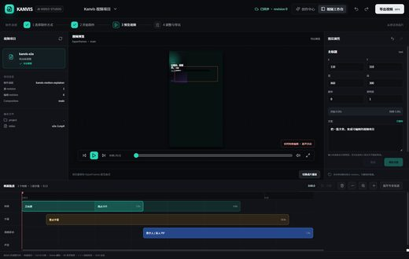</a> Digital humans, virtual presenters and lip-sync. <a href="#type-avatar"><b>View the list →</b></a></td>
</tr>
<tr>
<td align="center" valign="top" width="33%"><b>📖 Stories & animation</b> 33 repos   Animated tales, short dramas and cinematic scenes. <a href="#type-story"><b>View the list →</b></a></td>
<td align="center" valign="top" width="33%"><b>🎞 Motion graphics</b> 39 repos   Animated logos, titles, UI motion and GIFs. <a href="#type-motion"><b>View the list →</b></a></td>
<td align="center" valign="top" width="33%"><b>📝 Scripts & learning</b> 10 repos   What comes before the video: scripts, shot analysis, learning. <a href="#type-craft"><b>View the list →</b></a></td>
</tr>
<tr>
<td align="center" valign="top" width="33%"><b>🎵 Music videos</b> 18 repos   Music videos made in code. <a href="#type-music"><b>View the list →</b></a></td>
</tr>
</table>

## Contents

- [Made with Claude Opus 5.5](#made-with-opus-55)
- [🧪 Tested end to end](#tested)
- [🧱 Frameworks & toolkits](#type-general) (86)
- [📣 Promo & demos](#type-promo) (90)
- [🎓 Explainers](#type-explainer) (87)
- [✂️ Editing](#type-editing) (61)
- [📱 Shorts & social](#type-shorts) (66)
- [🧑‍💼 Avatars](#type-avatar) (9)
- [📖 Stories & animation](#type-story) (33)
- [🎞 Motion graphics](#type-motion) (39)
- [📝 Scripts & learning](#type-craft) (10)
- [🎵 Music videos](#type-music) (18)

## How a repo gets on the list

1. It makes or edits video or motion graphics. A 3D web page or a prompt collection does not count. The few entries under *Scripts & learning* come before the video (screenwriting, shot analysis) and are listed by the maintainer's choice.
2. An agent operates it: a skill, a plugin, an MCP server, or a toolkit written for the agent.
3. It has a README. Without one it cannot be graded.
4. At 50 stars or more it is listed on topic alone. Under 50 it must also clear a README quality bar (shows the result, one-command start, a concrete outcome, complete docs), and have 5 stars unless it names Claude Opus 5.5.

The questions are answered by a decision model reading each README, not by hand. A repo near a cut-off can land on either side; open an issue if one is misfiled.

## 🧪 Tested end to end

On 2026-10-11 we had 16 of these skills make the same film in a throwaway sandbox, driven by Claude Code (Claude Opus 5.5): a 15-second promo for a made-up app, with five fixed lines of on-screen copy, at 1920 x 1080 and 30 frames per second, on a machine with no API keys for video, image or voice models. Claude Code with no skill made it too. Four things were checked from each file: it plays, it is the length and size asked for, every line of copy can be read in frames sampled twice a second, and the picture moves. How good a film looks is not scored. The films are below.

**What we found:** All 16 rendered a film that passed all four checks, with no line of copy missing and nothing added, and so did Claude Code with no skill, in 4.4 minutes. None needed a paid model for this brief. What differs is time (2.0 to 23.5 minutes), sound (9 of 16 added it), and the look: 6 came out close to the no-skill film (deep teal water, waves, white centred type) and 10 have a look of their own, by our eye.

*The opening line of every film; the one made with no skill is top left. The films play on the page.*

| # | Skill | ★ | Checks passed (of 4) | Lines of copy readable (of 5) | Sound | Look, by eye | Time to make |  |
|---|---|---|---|---|---|---|---|---|
| 1 | [explainroo](https://github.com/vincentsch/explainroo) | 523 | 4/4 | 5/5 | Yes | A look of its own | 2.0 min | [evidence](https://agentskillshub.top/best-runs/video/vincentsch__explainroo.html) |
| 2 | [remotion-video-skill](https://github.com/wshuyi/remotion-video-skill) | 394 | 4/4 | 5/5 | No | Close to the no-skill film | 3.4 min | [evidence](https://agentskillshub.top/best-runs/video/wshuyi__remotion-video-skill.html) |
| 3 | [skills](https://github.com/vibe-motion/skills) | 1,315 | 4/4 | 5/5 | Yes | A look of its own | 4.4 min | [evidence](https://agentskillshub.top/best-runs/video/vibe-motion__skills.html) |
| 4 | [skills](https://github.com/remotion-dev/skills) | 5,005 | 4/4 | 5/5 | No | Close to the no-skill film | 4.5 min | [evidence](https://agentskillshub.top/best-runs/video/remotion-dev__skills.html) |
| 5 | [motion-graphics](https://github.com/Barty-Bart/motion-graphics) | 580 | 4/4 | 5/5 | No | A look of its own | 4.7 min | [evidence](https://agentskillshub.top/best-runs/video/Barty-Bart__motion-graphics.html) |
| 6 | [claude-code-video-toolkit](https://github.com/digitalsamba/claude-code-video-toolkit) | 2,198 | 4/4 | 5/5 | Yes | Close to the no-skill film | 5.5 min | [evidence](https://agentskillshub.top/best-runs/video/digitalsamba__claude-code-video-toolkit.html) |
| 7 | [lottie](https://github.com/diffusionstudio/lottie) | 5,493 | 4/4 | 5/5 | No | Close to the no-skill film | 5.6 min | [evidence](https://agentskillshub.top/best-runs/video/diffusionstudio__lottie.html) |
| 8 | [hypit](https://github.com/hypit-ai/hypit) | 20,799 | 4/4 | 5/5 | Yes | Close to the no-skill film | 6.5 min | [evidence](https://agentskillshub.top/best-runs/video/hypit-ai__hypit.html) |
| 9 | [motion-skills](https://github.com/iart-ai/motion-skills) | 610 | 4/4 | 5/5 | Yes | A look of its own | 6.5 min | [evidence](https://agentskillshub.top/best-runs/video/iart-ai__motion-skills.html) |
| 10 | [motion-graphics-skills](https://github.com/charlie947/motion-graphics-skills) | 174 | 4/4 | 5/5 | Yes | Close to the no-skill film | 7.0 min | [evidence](https://agentskillshub.top/best-runs/video/charlie947__motion-graphics-skills.html) |
| 11 | [claude-motion-design](https://github.com/howseen-ai/claude-motion-design) | 408 | 4/4 | 5/5 | Yes | A look of its own | 7.9 min | [evidence](https://agentskillshub.top/best-runs/video/howseen-ai__claude-motion-design.html) |
| 12 | [onetake](https://github.com/feitangyuan/onetake) | 2,080 | 4/4 | 5/5 | Yes | A look of its own | 8.5 min | [evidence](https://agentskillshub.top/best-runs/video/feitangyuan__onetake.html) |
| 13 | [OpenMontage](https://github.com/calesthio/OpenMontage) | 64,239 | 4/4 | 5/5 | No | A look of its own | 8.6 min | [evidence](https://agentskillshub.top/best-runs/video/calesthio__OpenMontage.html) |
| 14 | [guizang-product-video-skill](https://github.com/op7418/guizang-product-video-skill) | 762 | 4/4 | 5/5 | Yes | A look of its own | 8.6 min | [evidence](https://agentskillshub.top/best-runs/video/op7418__guizang-product-video-skill.html) |
| 15 | [motion-video-kit](https://github.com/echris6/motion-video-kit) | 1,080 | 4/4 | 5/5 | No | A look of its own | 21.8 min | [evidence](https://agentskillshub.top/best-runs/video/echris6__motion-video-kit.html) |
| 16 | [hyperframes](https://github.com/heygen-com/hyperframes) | 60,291 | 4/4 | 5/5 | No | A look of its own | 23.5 min | [evidence](https://agentskillshub.top/best-runs/video/heygen-com__hyperframes.html) |
| [CrakSEO/skills](https://github.com/CrakSEO/skills) | Connect Claude/Cursor/Codex to CrakSEO remote MCP servers for keyword research, SERP, backlinks, rank tracking, site audit, local SEO, AI visibility, Search Console and URL indexing | Claude Code, Cursor, Codex | MIT |

[All results, prompts and scripts](https://github.com/zhuyansen/agent-skills-hub/blob/main/ops/video-runs/RESULTS.md) · [https://agentskillshub.top/best/claude-video-skills/#test-results](https://agentskillshub.top/best/claude-video-skills/#test-results)

## Made with Claude Opus 5.5

Projects whose README says they were built with the model.

| Repo | Stars | What it does | Security |
|---|---:|---|---|
| [lemomo-ai/lemo-opuscar](https://github.com/lemomo-ai/lemo-opuscar) | 15.6k | A toolbox of film styles made in code for Claude Code: 99 ready to use, and your own. Each style is a style prompt plus a demo film made entirely in… | [SAFE](https://agentskillshub.top/skill/lemomo-ai/lemo-opuscar/) |
| [JohnHeibel/ClaudeAnimationBase](https://github.com/JohnHeibel/ClaudeAnimationBase) | 2.9k | A starter kit for animating hand-painted cartoons with Claude: p5.js + p5.brush, the Clawd character, 31 acted emotions and a guide for the model | [SAFE](https://agentskillshub.top/skill/JohnHeibel/ClaudeAnimationBase/) |
| [JohnHeibel/PDoomVideo](https://github.com/JohnHeibel/PDoomVideo) | 2.9k | Source code for the Claude Opus 5.5 music video for I'm Upping My P(doom) | [SAFE](https://agentskillshub.top/skill/JohnHeibel/PDoomVideo/) |
| [ledbetterljoshua/functional-emotions-video](https://github.com/ledbetterljoshua/functional-emotions-video) | 78 | A painted music video for "Functional Emotions", made by Claude Opus 5.5: custom GPU brushstroke renderer, storyboard, and 7 parallel chapter agents. | [SAFE](https://agentskillshub.top/skill/ledbetterljoshua/functional-emotions-video/) |

## 🧱 Frameworks & toolkits

[Open this type on the live page, sorted by stars →](https://agentskillshub.top/best/claude-video-skills/#type-general)

<table><tr>
<td align="center" valign="top"><a href="https://github.com/heygen-com/hyperframes">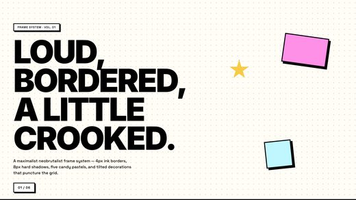</a> <a href="https://github.com/heygen-com/hyperframes">heygen-com/hyperframes</a></td>
<td align="center" valign="top"><a href="https://github.com/digitalsamba/claude-code-video-toolkit">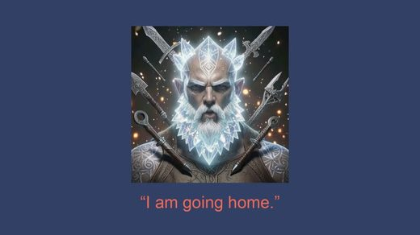</a> <a href="https://github.com/digitalsamba/claude-code-video-toolkit">digitalsamba/claude-code-video-toolkit</a></td>
<td align="center" valign="top"><a href="https://github.com/bangtutorial/bang-motion">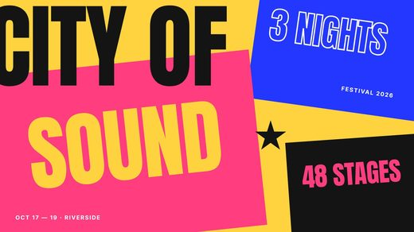</a> <a href="https://github.com/bangtutorial/bang-motion">bangtutorial/bang-motion</a></td>
</tr></table>

| Repo | Stars | What it does | Security |
|---|---:|---|---|
| [heygen-com/hyperframes](https://github.com/heygen-com/hyperframes) | 83.7k | Write HTML. Render video. Built for agents. | [SAFE](https://agentskillshub.top/skill/heygen-com/hyperframes/) |
| [OpenMontageInc/OpenMontage](https://github.com/OpenMontageInc/OpenMontage) | 80.2k | World's first open-source, agentic video production system. 12 production pipelines, 100+ tools, 700+ agent skill and production-knowledge files. Tur… | [CAUTION](https://agentskillshub.top/skill/OpenMontageInc/OpenMontage/) |
| [hypit-ai/hypit](https://github.com/hypit-ai/hypit) | 29.6k | Clone any viral video with AI agents. Not just a script, the whole workflow: swap the face, the words, the B-roll, ship 100 variants in one command,… | [SAFE](https://agentskillshub.top/skill/hypit-ai/hypit/) |
| [nexu-io/openmotion](https://github.com/nexu-io/openmotion) | 9.8k | The open-source full-stack studio for Opus 5.5 motion video. Reverse engineering for any video. Code video with HTML: recreate, edit and render. BYOA… | [SAFE](https://agentskillshub.top/skill/nexu-io/openmotion/) |
| [remotion-dev/skills](https://github.com/remotion-dev/skills) | 6.9k | Agent Skills | [SAFE](https://agentskillshub.top/skill/remotion-dev/skills/) |
| [NarratorAI-Studio/narrator-ai-cli-skill](https://github.com/NarratorAI-Studio/narrator-ai-cli-skill) | 3.2k | AI 解说大师 — Agent skill；封装 narrator-ai-cli 供 Claude/Codex 等工具调用 | [SAFE](https://agentskillshub.top/skill/NarratorAI-Studio/narrator-ai-cli-skill/) |
| [digitalsamba/claude-code-video-toolkit](https://github.com/digitalsamba/claude-code-video-toolkit) | 2.5k | Make videos with Claude Code: script, AI voiceover, music, video clips and render, on open-source models that cost cents | [SAFE](https://agentskillshub.top/skill/digitalsamba/claude-code-video-toolkit/) |
| [bangtutorial/bang-motion](https://github.com/bangtutorial/bang-motion) | 2.1k | Agent skill for browser motion graphics — openers, promos, bumpers, kinetic typography, and five explainer styles that move like video, not slides. S… | [SAFE](https://agentskillshub.top/skill/bangtutorial/bang-motion/) |
| [vibe-motion/skills](https://github.com/vibe-motion/skills) | 1.6k | agent skills for vibe motion | [SAFE](https://agentskillshub.top/skill/vibe-motion/skills/) |
| [iart-ai/motion-skills](https://github.com/iart-ai/motion-skills) | 1.4k | 56 open-source skills that teach your AI coding agent to make motion graphics, animation & video — kinetic typography, data-viz, explainers, TikTok/R… | [SAFE](https://agentskillshub.top/skill/iart-ai/motion-skills/) |
| [JDhruv14/line-art-animation](https://github.com/JDhruv14/line-art-animation) | 633 | A Claude skill and TypeScript library for animated line-art SVG components: ink figures that walk and react, scenes with a day/night cycle. | [SAFE](https://agentskillshub.top/skill/JDhruv14/line-art-animation/) |
| [GTAI-1/flow-mcp](https://github.com/GTAI-1/flow-mcp) | 619 | Drive Google Flow from Claude, Codex or a local control panel, on Mac or Windows — using your Google AI subscription credits instead of the pay-per-u… | [SAFE](https://agentskillshub.top/skill/GTAI-1/flow-mcp/) |
| [actionow-ai/vvv](https://github.com/actionow-ai/vvv) | 551 | 一次构建视频模板，多次复用：给 Claude Code、Codex 等 25+ 个 Agent 的开源可编辑婚礼视频模板与 Agent Skill。Build a video template once, reuse it across coding agents. | [SAFE](https://agentskillshub.top/skill/actionow-ai/vvv/) |
| [mileson/chaojifeng-video-design](https://github.com/mileson/chaojifeng-video-design) | 538 | 超级峰的视频设计方法论｜面向 AI Agent 的视频主线、分镜、声画节奏、制作与交付验收 Skill | [SAFE](https://agentskillshub.top/skill/mileson/chaojifeng-video-design/) |
| [0xS4N4TG/kinetograph](https://github.com/0xS4N4TG/kinetograph) | 514 | A blazingly fast programmatic video engine, made for agents. | [SAFE](https://agentskillshub.top/skill/0xS4N4TG/kinetograph/) |
| [squall01337/mixamo-llm-mocap](https://github.com/squall01337/mixamo-llm-mocap) | 439 | Turn any video into a Mixamo-rig animation - GVHMR estimator, spec-driven retarget, FK apply in Blender via MCP. Works with any Mixamo character; bui… | [SAFE](https://agentskillshub.top/skill/squall01337/mixamo-llm-mocap/) |
| [Moessif/code-video-showcase](https://github.com/Moessif/code-video-showcase) | 425 | A pure-code beat-synced showcase-video Agent Skill: HTML/Canvas/SVG/Three.js frame-by-frame + Python numpy/scipy score + FFmpeg. No generative models. | [SAFE](https://agentskillshub.top/skill/Moessif/code-video-showcase/) |
| [FavioVazquez/showtime](https://github.com/FavioVazquez/showtime) | 329 | A local video studio for your coding agent. Describe a video in one sentence: your agent directs, your machine renders. Claude Code, Codex, Cursor, D… | [SAFE](https://agentskillshub.top/skill/FavioVazquez/showtime/) |
| [Hainrixz/editor-pro-max](https://github.com/Hainrixz/editor-pro-max) | 297 | AI-powered video editor by @soyenriquerocha — built with Remotion + Claude Code. Describe videos in natural language, get professional MP4s. 25 compo… | [SAFE](https://agentskillshub.top/skill/Hainrixz/editor-pro-max/) |
| [kangarooking/director-skills](https://github.com/kangarooking/director-skills) | 287 | 导演Skill：面向 AI 视频创作的开源 Agent Skills \| Director Skills: Open-source Agent Skills for AI video creation. | [SAFE](https://agentskillshub.top/skill/kangarooking/director-skills/) |
| [JuneYaooo/capsule-cinema](https://github.com/JuneYaooo/capsule-cinema) | 237 | 把视频做成模版，一次配方无限视频 · Turn videos into templates. One recipe, unlimited videos. | [SAFE](https://agentskillshub.top/skill/JuneYaooo/capsule-cinema/) |
| [iart-ai/motion-design-skills](https://github.com/iart-ai/motion-design-skills) | 229 | Motion design fundamentals, engines, and brand elements as installable Claude Code skills — timing, typography, color, composition, After Effects, Re… | [SAFE](https://agentskillshub.top/skill/iart-ai/motion-design-skills/) |
| [codepawl/creator-generalist](https://github.com/codepawl/creator-generalist) | 172 | AI agent skills to be professional at 2D and 3D | [SAFE](https://agentskillshub.top/skill/codepawl/creator-generalist/) |
| [video-db/skills](https://github.com/video-db/skills) | 144 | Server-side video workflows for agents: ingest, understand, search, edit, stream. | [SAFE](https://agentskillshub.top/skill/video-db/skills/) |
| [killkli/minimax-h3-colab-skill](https://github.com/killkli/minimax-h3-colab-skill) | 136 | Standalone Codex skill for MiniMax H3 Colab reference-to-video generation | [SAFE](https://agentskillshub.top/skill/killkli/minimax-h3-colab-skill/) |
| [jhartquist/claude-remotion-kickstart](https://github.com/jhartquist/claude-remotion-kickstart) | 124 | Create videos programmatically with Claude Code and Remotion | [SAFE](https://agentskillshub.top/skill/jhartquist/claude-remotion-kickstart/) |
| [leodavincs/kalem](https://github.com/leodavincs/kalem) | 115 | Claude Code skill: her sahnenin kendi kalemi var. Videoyu sahnelere böler, her sahneye uygun motoru seçer (Paper.js, PixiJS, HyperFrames, Three.js, M… | [SAFE](https://agentskillshub.top/skill/leodavincs/kalem/) |
| [Hype-yolo/claude-motion-skill](https://github.com/Hype-yolo/claude-motion-skill) | 92 | Source-assisted animation Skill: 47 open-source cases, editable scenes and MP4 export. Public beta. | [SAFE](https://agentskillshub.top/skill/Hype-yolo/claude-motion-skill/) |
| [8533502-dev/deepseek-opus-motion-skill](https://github.com/8533502-dev/deepseek-opus-motion-skill) | 79 | 让 DeepSeek 用和 Claude Opus 5.5 同样的提示词做出接近的 Remotion 动效视频 · A skill for Opus-parity motion design | [SAFE](https://agentskillshub.top/skill/8533502-dev/deepseek-opus-motion-skill/) |
| [dev-isaacmello/extreme-motion-design](https://github.com/dev-isaacmello/extreme-motion-design) | 76 | Skill de motion design por código (Remotion) com trilha, narração e QA automático. Para Claude, Claude Code e Codex. | [SAFE](https://agentskillshub.top/skill/dev-isaacmello/extreme-motion-design/) |
| [Changroro/code-video](https://github.com/Changroro/code-video) | 67 | Agent skill: research a topic and render a hand-drawn + 8-bit promo video (MP4) | [SAFE](https://agentskillshub.top/skill/Changroro/code-video/) |
| [LordVayron/video-factory](https://github.com/LordVayron/video-factory) | 65 | An AI video studio your coding agent installs and runs: UGC ads, micro-dramas, sitcoms, launch films, fantasy shorts, hour-long meditations. Claude C… | [SAFE](https://agentskillshub.top/skill/LordVayron/video-factory/) |
| [motalim-ai/motion-starter-kit](https://github.com/motalim-ai/motion-starter-kit) | 55 | اصنع فيديو موشن جرافيك بـ Remotion من أي فيديو مرجعي. نفس القواعد لـ Claude Code وCodex وAntigravity. | [SAFE](https://agentskillshub.top/skill/motalim-ai/motion-starter-kit/) |
| [JJenglert1/remotion-claude-video](https://github.com/JJenglert1/remotion-claude-video) | 49 |  | [SAFE](https://agentskillshub.top/skill/JJenglert1/remotion-claude-video/) |
| [Johnson-Jia/video-clipforge](https://github.com/Johnson-Jia/video-clipforge) | 49 | AI 驱动的短视频制作系统。给它一个想法，它帮你写稿、配音、做画面、出成片。9 阶段 DAG 管线 + 自进化评分，支持每日自动执行。基于 Claude Code + HyperFrames。 | [SAFE](https://agentskillshub.top/skill/Johnson-Jia/video-clipforge/) |
| [erduo1998-cell/vidmuse-video-creator](https://github.com/erduo1998-cell/vidmuse-video-creator) | 45 | Open-source Agent Skill for VidMuse images, videos, and SRT B-roll from first authorization to delivery | [SAFE](https://agentskillshub.top/skill/erduo1998-cell/vidmuse-video-creator/) |
| [autoip/dreamfab](https://github.com/autoip/dreamfab) | 43 | Dreamfab 造夢廠：AI Agent 影音製作框架。一句話，你就是導演和製作人，AI Agent 用 AutoIP + ffmpeg 幫你做出短劇、MV、解說影片。 | [SAFE](https://agentskillshub.top/skill/autoip/dreamfab/) |
| [edotheDev/claude-video-kit](https://github.com/edotheDev/claude-video-kit) | 33 | Agents and skills for Claude Code to edit video and make motion films in code: real footage, real type, measured sound. | [SAFE](https://agentskillshub.top/skill/edotheDev/claude-video-kit/) |
| [WhiteTowerAI/cut-as-code](https://github.com/WhiteTowerAI/cut-as-code) | 32 | Open-source agentic video editing skills — an AI-powered alternative to Opus Clip and CapCut | [SAFE](https://agentskillshub.top/skill/WhiteTowerAI/cut-as-code/) |
| [bbylw/hyperframes-cn](https://github.com/bbylw/hyperframes-cn) | 31 | HyperFrames 是一个开源框架，可将 HTML、CSS、媒体与可定位（seekable）动画转化为确定性的 MP4 视频。你可以在本地通过 CLI 使用它，让 AI 编程智能体借助 skills 使用它，或者把它作为托管创作工作流背后的渲染核心。 | [SAFE](https://agentskillshub.top/skill/bbylw/hyperframes-cn/) |
| [GordenSun/react-bits-video](https://github.com/GordenSun/react-bits-video) | 30 | 结合react-bits、remotion、hyperframe整合的Skill，可以生成华丽的视频。 | [SAFE](https://agentskillshub.top/skill/GordenSun/react-bits-video/) |
| [ZLHad/OpenVideoHarness](https://github.com/ZLHad/OpenVideoHarness) | 30 | A video harness work platform for Agents such as Claude or Codex: the agent writes the code that renders the film, checks its own frames, storyboard… | [SAFE](https://agentskillshub.top/skill/ZLHad/OpenVideoHarness/) |
| [PHANTOMTONYT/motion-design-skills](https://github.com/PHANTOMTONYT/motion-design-skills) | 24 | Five animation styles as Claude skills: 3D toy, kinetic type, hand-drawn cartoon, system diagrams, data charts. Describe an idea, get an MP4. | [SAFE](https://agentskillshub.top/skill/PHANTOMTONYT/motion-design-skills/) |
| [smwbev/framewright](https://github.com/smwbev/framewright) | 24 | Agent skill + template: short videos made entirely from code. One HTML file, every frame a pure function of (frame, seed, width). Claude Code, Codex,… | [SAFE](https://agentskillshub.top/skill/smwbev/framewright/) |
| [abhinavshrivastava950/Montara](https://github.com/abhinavshrivastava950/Montara) | 23 | Montara is an AI-native, renderer-agnostic autonomous video production operating system that understands content before it edits it, plans visual sto… | [SAFE](https://agentskillshub.top/skill/abhinavshrivastava950/Montara/) |
| [AIPMAndy/Andy-Video-Skill](https://github.com/AIPMAndy/Andy-Video-Skill) | 19 | Claude Code 视频生成 Skills 精选目录：Manim、React Video、录屏转视频等｜Curated catalog of 12 video-generation Skills for Claude Code — Manim, React Video, Screencast-… | [SAFE](https://agentskillshub.top/skill/AIPMAndy/Andy-Video-Skill/) |
| [hildlabs/openrig-studio](https://github.com/hildlabs/openrig-studio) | 19 | Generate Roblox R15 animations with the AI you already pay for: Claude Code, Codex CLI or API keys. Preview, compare models, send to Roblox Studio. | [SAFE](https://agentskillshub.top/skill/hildlabs/openrig-studio/) |
| [Neelshah1810/Claude-Video-Skills](https://github.com/Neelshah1810/Claude-Video-Skills) | 18 | 11 Claude skills that make professional motion-graphics videos (launch films, explainers, social ads, data stories) as HTML + MP4. Works with Claude… | [SAFE](https://agentskillshub.top/skill/Neelshah1810/Claude-Video-Skills/) |
| [crawfordxx/xiaoma-studio](https://github.com/crawfordxx/xiaoma-studio) | 18 | 用代码做 Opus 5.5 爆款级动效视频与 HTML 幻灯片的 skill：30 条高赞视频拆解出的工作流、审美规则与确定性渲染引擎，任何模型/agent 可用 \| Code-driven motion video & HTML slides skill for any coding agent | [SAFE](https://agentskillshub.top/skill/crawfordxx/xiaoma-studio/) |
| [iart-ai/data-animation-skills](https://github.com/iart-ai/data-animation-skills) | 18 | Data video / animated infographic skills for Claude Code — turn a CSV into a chart that moves, with exact, accurate numbers on every frame. | [SAFE](https://agentskillshub.top/skill/iart-ai/data-animation-skills/) |
| [vawe-hq/vawe](https://github.com/vawe-hq/vawe) | 18 | Write one HTML page, get an mp4. Open-source HTML to video framework for coding agents like Claude Code and Codex. A free Remotion alternative. | [SAFE](https://agentskillshub.top/skill/vawe-hq/vawe/) |
| [Aaryan-Kapoor/video-production-skill](https://github.com/Aaryan-Kapoor/video-production-skill) | 17 | Turn an AI agent into a full-stack educational video producer: research, storyboard, narration, animated visuals, render, QC, archive, and delivery. | [SAFE](https://agentskillshub.top/skill/Aaryan-Kapoor/video-production-skill/) |
| [doublesq97-ui/su-card-to-video](https://github.com/doublesq97-ui/su-card-to-video) | 17 | Minimal HTML/CSS card-to-video starter skill using HyperFrames, GSAP, and FFmpeg. | [SAFE](https://agentskillshub.top/skill/doublesq97-ui/su-card-to-video/) |
| [gloweaseco-leo/hyperdirector](https://github.com/gloweaseco-leo/hyperdirector) | 17 | Hermes Skill Pack for structured AI video production on HyperFrames — brief → storyboard → HTML → lint/render. | [SAFE](https://agentskillshub.top/skill/gloweaseco-leo/hyperdirector/) |
| [RajaskaJanuardani/motion-craft](https://github.com/RajaskaJanuardani/motion-craft) | 14 | After Effects-grade Motion Graphics & Humanized Video Editing skill for Remotion: 43 styles, C1 spline camera, seamless transitions, and 48kHz proced… | [SAFE](https://agentskillshub.top/skill/RajaskaJanuardani/motion-craft/) |
| [magichourhq/skills](https://github.com/magichourhq/skills) | 14 | AI media generation skills for Codex, Claude Code and other agents. Images, video and audio workflows using Magic Hour MCP or API. | [SAFE](https://agentskillshub.top/skill/magichourhq/skills/) |
| [Kimeur/motion-launch-videos](https://github.com/Kimeur/motion-launch-videos) | 13 | Claude Code plugin + skill: turn a short brief into a looping kinetic-typography launch video. One self-contained HTML file with a pure seek(t), clos… | [SAFE](https://agentskillshub.top/skill/Kimeur/motion-launch-videos/) |
| [tmakersas/revid-skills](https://github.com/tmakersas/revid-skills) | 12 | Research what goes viral, make finished short-form videos and post them to TikTok, YouTube, Instagram and X. Revid MCP server plugin and skills for C… | [SAFE](https://agentskillshub.top/skill/tmakersas/revid-skills/) |
| [argus-metis/hermes-video-editing](https://github.com/argus-metis/hermes-video-editing) | 10 | Professional video editing skill for Hermes Agent — AI captioning, silence removal, scene detection, stabilisation, smart reframing, and more. All fr… | [CAUTION](https://agentskillshub.top/skill/argus-metis/hermes-video-editing/) |
| [molkex/mcp-flow-google](https://github.com/molkex/mcp-flow-google) | 10 | MCP server for Google Flow — Veo video and Nano Banana images inside Claude Code, Cursor or any MCP client. Runs on your own Google account: images f… | [SAFE](https://agentskillshub.top/skill/molkex/mcp-flow-google/) |
| [MakeMyClip/editor](https://github.com/MakeMyClip/editor) | 9 | Open-source AI video editor for Claude Code and any MCP client. Removes silence and repeated takes, edits by transcript with local whisper.cpp, adds… | [SAFE](https://agentskillshub.top/skill/MakeMyClip/editor/) |
| [VasiniDevi/motion-skills](https://github.com/VasiniDevi/motion-skills) | 9 | Programmatic motion design skills for AI agents — motion graphics, kinetic typography, data viz, slide decks in Python | [SAFE](https://agentskillshub.top/skill/VasiniDevi/motion-skills/) |
| [chenyuxiaojin/cyxj-remotion-starter](https://github.com/chenyuxiaojin/cyxj-remotion-starter) | 9 | 用 Claude Code 指挥 Remotion 出视频的工作台脚手架:三层架构 + hooks 守规矩 + skills 编排流程 \| by 陈与小金 | [SAFE](https://agentskillshub.top/skill/chenyuxiaojin/cyxj-remotion-starter/) |
| [davidcervinka/vibe-editing](https://github.com/davidcervinka/vibe-editing) | 9 | Vibe coding, but for video. Launch films, aftermovies & reels — cut, scored and shipped by talking to Claude Code. Full stack + flow. | [SAFE](https://agentskillshub.top/skill/davidcervinka/vibe-editing/) |
| [diko0071/remotion-video-skills](https://github.com/diko0071/remotion-video-skills) | 9 | Remotion video factory: deterministic product videos as code, with a reusable motion kit and measured-replica tooling | [SAFE](https://agentskillshub.top/skill/diko0071/remotion-video-skills/) |
| [resemble-ai/remotion-resemble-skill](https://github.com/resemble-ai/remotion-resemble-skill) | 9 |  | [SAFE](https://agentskillshub.top/skill/resemble-ai/remotion-resemble-skill/) |
| [kmilo93sd/agent-video-editor](https://github.com/kmilo93sd/agent-video-editor) | 8 | Editing judgment for AI agents: pacing, cuts, captions, audio, color and thumbnails for any video type, plus 128 CC0 sounds, 26 CC0 graphics and a me… | [SAFE](https://agentskillshub.top/skill/kmilo93sd/agent-video-editor/) |
| [mackswendhell/motion-code](https://github.com/mackswendhell/motion-code) | 8 | Vídeos animados feitos 100% em código, com voz por IA, e um editor para os vídeos que você grava (Studio, em Remotion). Estilos 2D em Canvas e 3D no… | [SAFE](https://agentskillshub.top/skill/mackswendhell/motion-code/) |
| [patraxo/ltx2-vidgen-skill](https://github.com/patraxo/ltx2-vidgen-skill) | 8 | Own your AI video pipeline. LTX-2.3 (22B) self-hosted on your Modal GPU via a Claude Code skill — t2v, i2v, keyframes, v2v + synced audio. ~$0.02 per… | [SAFE](https://agentskillshub.top/skill/patraxo/ltx2-vidgen-skill/) |
| [vibe-motion/remotion-starter](https://github.com/vibe-motion/remotion-starter) | 8 | 用 Claude Code 指挥 Remotion 出视频的工作台脚手架:三层架构 + hooks 守规矩 + skills 编排流程 \| maintained by 陈与小金 | [SAFE](https://agentskillshub.top/skill/vibe-motion/remotion-starter/) |
| [hraness/slopcamera](https://github.com/hraness/slopcamera) | 7 | slopcamera is retired and no longer maintained. Source and historical artifacts remain available. | [SAFE](https://agentskillshub.top/skill/hraness/slopcamera/) |
| [iart-ai/text-message-video-skills](https://github.com/iart-ai/text-message-video-skills) | 7 | Text-message animation skills for AI coding agents — turn a chat script into a scroll-stopping iMessage/WhatsApp/SMS conversation video, rendered fro… | [SAFE](https://agentskillshub.top/skill/iart-ai/text-message-video-skills/) |
| [liaojianquan9-source/ljq-broll-video-generator](https://github.com/liaojianquan9-source/ljq-broll-video-generator) | 7 | 基于参考素材打点、抽帧、拆解并用 Remotion 生成可编辑 B-roll 的 Codex Skill | [SAFE](https://agentskillshub.top/skill/liaojianquan9-source/ljq-broll-video-generator/) |
| [oxygenframe/oxframe-sdk](https://github.com/oxygenframe/oxframe-sdk) | 7 | Motion graphics as Rust code, made for AI agents. A scene is an async fn; oxframe check returns a storyboard and a report that points to the line to… | [SAFE](https://agentskillshub.top/skill/oxygenframe/oxframe-sdk/) |
| [shaderera/shaderera](https://github.com/shaderera/shaderera) | 7 | The programmable era of ads. Video made in code for experts and their AI agents: a film is render(t). Determinism checks, H.264/ProRes rendering, rev… | [SAFE](https://agentskillshub.top/skill/shaderera/shaderera/) |
| [synchronicity-labs/skills](https://github.com/synchronicity-labs/skills) | 7 | Official sync. labs agent skills: lipsync, talking photos, AI video dialogue, dubbing, campaign localization, batch lipsync and the sync. API. For Cl… | [SAFE](https://agentskillshub.top/skill/synchronicity-labs/skills/) |
| [AnmolChandiok/claude-after-effects-skill](https://github.com/AnmolChandiok/claude-after-effects-skill) | 5 | Claude skill: turn a video made with code (canvas, JS, Python) into a fully editable After Effects project — live text, shape layers, precomps, a key… | [SAFE](https://agentskillshub.top/skill/AnmolChandiok/claude-after-effects-skill/) |
| [DbgKinggg/plotbeat](https://github.com/DbgKinggg/plotbeat) | 5 | HyperFrames-native data visualization templates and AI skill for deterministic chart videos. | [SAFE](https://agentskillshub.top/skill/DbgKinggg/plotbeat/) |
| [Shugar86/vids-studio](https://github.com/Shugar86/vids-studio) | 5 | Editable Google Vids videos and series with Codex & Claude Code. Skills, local MCP bridge, Chrome extensions and a shared monitor · RU/EN | [SAFE](https://agentskillshub.top/skill/Shugar86/vids-studio/) |
| [chrisopal/narrated-video-studio](https://github.com/chrisopal/narrated-video-studio) | 5 | 讲解视频工坊：给 Claude 用的视频制作 skill 和工具箱（题材模板、风格包、检查、模板迭代） | [CAUTION](https://agentskillshub.top/skill/chrisopal/narrated-video-studio/) |
| [fahmid-juboraj/reelforge](https://github.com/fahmid-juboraj/reelforge) | 5 | Make videos with Claude Code: AI motion graphics, YouTube Shorts & TikTok captions, kinetic typography, 3D shaders. GPU-rendered MP4 with beat-synced… | [SAFE](https://agentskillshub.top/skill/fahmid-juboraj/reelforge/) |
| [siegerts/skill-canvas-video](https://github.com/siegerts/skill-canvas-video) | 5 | Agent skill for creating animated videos using HTML5 Canvas and JavaScript, exportable to MP4. | [SAFE](https://agentskillshub.top/skill/siegerts/skill-canvas-video/) |
| [superyhee/hypr-video-skills](https://github.com/superyhee/hypr-video-skills) | 5 | A Claude Code Skill that turns natural language into rendered MP4 videos — animations, transitions, captions, 50+ effects, all from your terminal via… | [SAFE](https://agentskillshub.top/skill/superyhee/hypr-video-skills/) |
| [wzslr321/fixtape](https://github.com/wzslr321/fixtape) | 5 | Film a bug and its fix in one short before/after MP4. Agent skill for Claude Code and Codex. Or whatever cool kids are using nowadays | [SAFE](https://agentskillshub.top/skill/wzslr321/fixtape/) |
| [huaxialucaicaizi/opus5.5-video-skills-](https://github.com/huaxialucaicaizi/opus5.5-video-skills-) | 1 |  | [CAUTION](https://agentskillshub.top/skill/huaxialucaicaizi/opus5.5-video-skills-/) |
| [zenitlab/video-as-code](https://github.com/zenitlab/video-as-code) | 1 | Make videos by writing code with Claude Opus 5.5: research, script, voiceover, music, edit and auto-check, then export vertical cuts for Douyin, Xiao… | [SAFE](https://agentskillshub.top/skill/zenitlab/video-as-code/) |

## 📣 Promo & demos

[Open this type on the live page, sorted by stars →](https://agentskillshub.top/best/claude-video-skills/#type-promo)

<table><tr>
<td align="center" valign="top"> <a href="https://github.com/Tejashmakwana/motionmaxxing">Tejashmakwana/motionmaxxing</a></td>
<td align="center" valign="top"> <a href="https://github.com/charlie947/motion-graphics-skills">charlie947/motion-graphics-skills</a></td>
<td align="center" valign="top"> <a href="https://github.com/AbubakrChan/product-launch-motion">AbubakrChan/product-launch-motion</a></td>
</tr></table>

| Repo | Stars | What it does | Security |
|---|---:|---|---|
| [feitangyuan/onetake](https://github.com/feitangyuan/onetake) | 4.1k | Motion films that never cut to the next slide: every beat grows out of the one before, one continuous camera, continuity measured by an oracle. Produ… | [SAFE](https://agentskillshub.top/skill/feitangyuan/onetake/) |
| [Tejashmakwana/motionmaxxing](https://github.com/Tejashmakwana/motionmaxxing) | 1.6k | Looksmaxxing for motion graphics. An agent skill that turns AI slop videos into films that look made by a motion designer. | [SAFE](https://agentskillshub.top/skill/Tejashmakwana/motionmaxxing/) |
| [echris6/motion-video-kit](https://github.com/echris6/motion-video-kit) | 1.4k | Claude Code skill kit for premium AI-assisted business videos: independent critic loop, motion principles from 28 launch films, quality bar, sound de… | [SAFE](https://agentskillshub.top/skill/echris6/motion-video-kit/) |
| [op7418/guizang-product-video-skill](https://github.com/op7418/guizang-product-video-skill) | 939 | 归藏 product video skill：复用真实产品组件和设计语言，用代码制作软件更新宣传片。包含分镜文案、原创配乐、动作音效与视频渲染，支持 Claude Code 和 Codex。 | [SAFE](https://agentskillshub.top/skill/op7418/guizang-product-video-skill/) |
| [howseen-ai/claude-motion-design](https://github.com/howseen-ai/claude-motion-design) | 822 | A Claude Code skill to make motion design videos in pure code: HTML + Playwright + ffmpeg. No After Effects, no Remotion license. | [CAUTION](https://agentskillshub.top/skill/howseen-ai/claude-motion-design/) |
| [charlie947/motion-graphics-skills](https://github.com/charlie947/motion-graphics-skills) | 664 | 13 Claude Code skills for launch-grade motion graphics. Every frame is code. No After Effects, no video generator. | [SAFE](https://agentskillshub.top/skill/charlie947/motion-graphics-skills/) |
| [geekjourneyx/hyperframes-motion-director](https://github.com/geekjourneyx/hyperframes-motion-director) | 483 | Agent Skill for Chinese-first HyperFrames motion-video production from articles, products, websites, and README files. | [SAFE](https://agentskillshub.top/skill/geekjourneyx/hyperframes-motion-director/) |
| [AbubakrChan/product-launch-motion](https://github.com/AbubakrChan/product-launch-motion) | 460 | Claude Code skill for Dribbble-level product launch videos from code. One shape that never cuts, springs, a cursor that drives every change, beat-syn… | [SAFE](https://agentskillshub.top/skill/AbubakrChan/product-launch-motion/) |
| [Jane-xiaoer/paper-collage-ad-codex](https://github.com/Jane-xiaoer/paper-collage-ad-codex) | 426 | Codex skill for complete paper-cut collage ad production, local IndexTTS-2 voice cloning, animation, audio and MP4 QC | [SAFE](https://agentskillshub.top/skill/Jane-xiaoer/paper-collage-ad-codex/) |
| [Kianzzz/xilo-opus-video](https://github.com/Kianzzz/xilo-opus-video) | 400 | 用 Claude Opus 5.5 写代码做视频：先给三个方案和预览，确认后逐帧渲染成片 \| Canvas / WebGL / Three.js / Remotion / HyperFrames \| Claude Code Skill | [SAFE](https://agentskillshub.top/skill/Kianzzz/xilo-opus-video/) |
| [aaitor/skill-video-studio](https://github.com/aaitor/skill-video-studio) | 396 | Claude Code skill for product videos: real browser capture, branded composition, and local mastering. | [SAFE](https://agentskillshub.top/skill/aaitor/skill-video-studio/) |
| [talsiach/take-one](https://github.com/talsiach/take-one) | 278 | Claude Code skill that makes launch videos, ads and music videos from one line: idea, script, visuals, voice, music, edit and review, then a review r… | [SAFE](https://agentskillshub.top/skill/talsiach/take-one/) |
| [tugrawork-creator/saas-motion-kit](https://github.com/tugrawork-creator/saas-motion-kit) | 257 | Promo & motion videos for software products with HyperFrames + Claude Code. No two films should feel the same: tone matrix, variety audit, 24-transit… | [SAFE](https://agentskillshub.top/skill/tugrawork-creator/saas-motion-kit/) |
| [Finderchangchang/promo-video-skill](https://github.com/Finderchangchang/promo-video-skill) | 186 | 精酿 BrewReel：让 DeepSeek 这类便宜模型也能做出好看的竖版宣传片。写一份产品简报，AI 挑镜头、写文案，一条命令出片。3 种配方、6 个行业、广告法校验，开源可商用。 | [SAFE](https://agentskillshub.top/skill/Finderchangchang/promo-video-skill/) |
| [Sunwood-ai-labs/hyperframes-motion-reel-skill](https://github.com/Sunwood-ai-labs/hyperframes-motion-reel-skill) | 186 | 🎬 Claude Code skill for showreel-grade, beat-synced motion graphics with HyperFrames (HTML + GSAP + SVG + Canvas, Apache-2.0) — 120 BPM / 60 FPS to M… | [SAFE](https://agentskillshub.top/skill/Sunwood-ai-labs/hyperframes-motion-reel-skill/) |
| [kingselyjoe/video-shotcraft-dsh](https://github.com/kingselyjoe/video-shotcraft-dsh) | 152 | 面向 DeepSeek Harness 的电影感产品视频 Agent Skill，包含 152 张镜头配方卡、Remotion 模板、代码组件和音频资产。 | [SAFE](https://agentskillshub.top/skill/kingselyjoe/video-shotcraft-dsh/) |
| [bestagentkits/motion-video-skill](https://github.com/bestagentkits/motion-video-skill) | 143 | Agent skill that produces beat-synced 1080p motion-graphic videos in HyperFrames (HTML + GSAP) with an AI voice-over, karaoke captions, SFX and gener… | [SAFE](https://agentskillshub.top/skill/bestagentkits/motion-video-skill/) |
| [kangarooking/promo-creator-skills](https://github.com/kangarooking/promo-creator-skills) | 120 | 产品宣传视频创作 Skills：从产品判断、分镜、素材、HyperFrames 剪辑到 BGM 设计的完整 Agent 工作流 | [SAFE](https://agentskillshub.top/skill/kangarooking/promo-creator-skills/) |
| [gmpetrov/agent-screenplay](https://github.com/gmpetrov/agent-screenplay) | 114 | Beautiful screen recordings, made by your favorite AI agent. | [SAFE](https://agentskillshub.top/skill/gmpetrov/agent-screenplay/) |
| [leosssvip-dot/remotion-ad-video-skill](https://github.com/leosssvip-dot/remotion-ad-video-skill) | 110 | Create Remotion ad video projects from a URL with an AI coding agent, no video-generation AI required. | [SAFE](https://agentskillshub.top/skill/leosssvip-dot/remotion-ad-video-skill/) |
| [Avijit07x/cursorcam](https://github.com/Avijit07x/cursorcam) | 96 | Ask your AI agent for a demo video. It clicks through your web app and hands back a polished MP4 that zooms in on each click. Works with any AI agent… | [SAFE](https://agentskillshub.top/skill/Avijit07x/cursorcam/) |
| [Mort1d/motion-graphics-skills](https://github.com/Mort1d/motion-graphics-skills) | 80 | Showreel-grade motion graphics from code, with an original soundtrack for every video. An Agent Skill for Claude Code, Codex, Cursor and other agents. | [SAFE](https://agentskillshub.top/skill/Mort1d/motion-graphics-skills/) |
| [revfactory/showreel](https://github.com/revfactory/showreel) | 73 | Claude Code skill that produces Korean motion-graphics videos end to end: brief, research, script, ElevenLabs narration, music, images, deterministic… | [SAFE](https://agentskillshub.top/skill/revfactory/showreel/) |
| [noamdorr/saas-product-demo-video](https://github.com/noamdorr/saas-product-demo-video) | 71 | Skill for shipping a 20-45s SaaS product demo video in Remotion. Built and used in production with Claude Code; methodology is LLM-agnostic. | [SAFE](https://agentskillshub.top/skill/noamdorr/saas-product-demo-video/) |
| [norahe0304-art/30x-video](https://github.com/norahe0304-art/30x-video) | 64 | One URL in, an agency-grade launch video out. A Claude Code skill (Remotion + React) with a 16-law taste codex — 12 brands, 12 worlds, zero templates. | [SAFE](https://agentskillshub.top/skill/norahe0304-art/30x-video/) |
| [krisyangdev/motionboard](https://github.com/krisyangdev/motionboard) | 63 | Shot language from Apple and Linear launch films, rebuilt in code for your agent. 38 recipes and a skill for making product launch films. | [SAFE](https://agentskillshub.top/skill/krisyangdev/motionboard/) |
| [rjmahesh/ui-redline-walkthrough](https://github.com/rjmahesh/ui-redline-walkthrough) | 59 | Claude skill: turn before/after UI screenshots into an animated redline walkthrough video (red ink marks, morphing UI, MP4 export) | [SAFE](https://agentskillshub.top/skill/rjmahesh/ui-redline-walkthrough/) |
| [imMamdouhaboammar/motion-graphics-skills](https://github.com/imMamdouhaboammar/motion-graphics-skills) | 55 | Motion graphics for AI agents. Creative direction + production skills for Claude Code & Codex, powered by HyperFrames. Build brand films, kinetic typ… | [SAFE](https://agentskillshub.top/skill/imMamdouhaboammar/motion-graphics-skills/) |
| [axtonliu/video-illustrator](https://github.com/axtonliu/video-illustrator) | 53 | Your voice, your assets, any look you choose — an Agent Skill that turns your narration and real assets into a short film. | [SAFE](https://agentskillshub.top/skill/axtonliu/video-illustrator/) |
| [trunghaiy/appshot](https://github.com/trunghaiy/appshot) | 52 | Generate App Store & Google Play preview videos and screenshots from a simple TypeScript config. Built on Remotion + React + Tailwind. Ships with AI… | [SAFE](https://agentskillshub.top/skill/trunghaiy/appshot/) |
| [Zane-0x5a/remotion-director](https://github.com/Zane-0x5a/remotion-director) | 51 | A Claude Code plugin that designs and builds a finished motion piece from a one-line brief — via the 甲乙环 (critic-loop) pipeline, judged on its real r… | [SAFE](https://agentskillshub.top/skill/Zane-0x5a/remotion-director/) |
| [new-xp/ultrademo](https://github.com/new-xp/ultrademo) | 47 | Moved to github.com/ultrademo-hq/ultrademo. This is the original Ultrademo skill; it still works but is no longer updated. | [SAFE](https://agentskillshub.top/skill/new-xp/ultrademo/) |
| [BayramAnnakov/remotion-video-director](https://github.com/BayramAnnakov/remotion-video-director) | 45 | Interactive Claude Code skill for creating Remotion videos through expert-guided deliberation | [SAFE](https://agentskillshub.top/skill/BayramAnnakov/remotion-video-director/) |
| [mattivilola/brag-codex](https://github.com/mattivilola/brag-codex) | 41 | Codex-compatible clone of latent-spaces/brag for Hyperframes launch videos | [SAFE](https://agentskillshub.top/skill/mattivilola/brag-codex/) |
| [crimeacs/product-demo-director](https://github.com/crimeacs/product-demo-director) | 38 | Turn product evidence and raw footage into narration-paced, source-bound demo films—with Codex or Claude Code directing cuts, zooms, render, and QA. | [SAFE](https://agentskillshub.top/skill/crimeacs/product-demo-director/) |
| [every-app/video-skills](https://github.com/every-app/video-skills) | 34 | Make great videos about your product 10x faster. | [SAFE](https://agentskillshub.top/skill/every-app/video-skills/) |
| [gorkem-bwl/onboarding-video-generator](https://github.com/gorkem-bwl/onboarding-video-generator) | 30 | Claude Code skill for column-sized web app onboarding videos in Remotion | [SAFE](https://agentskillshub.top/skill/gorkem-bwl/onboarding-video-generator/) |
| [Hainrixz/motion-architect](https://github.com/Hainrixz/motion-architect) | 28 | Agente de motion graphics para Claude Code. Le das videos, imágenes y tu marca; él diseña, anima y renderiza en 9:16, 16:9, 1:1 y 4:5. Todo local. | [SAFE](https://agentskillshub.top/skill/Hainrixz/motion-architect/) |
| [SallyRS/video-director](https://github.com/SallyRS/video-director) | 28 | Claude Code skill that directs short videos from brief to render: design options, storyboard, motion spec, HyperFrames build and render checks. Rules… | [SAFE](https://agentskillshub.top/skill/SallyRS/video-director/) |
| [dlazy-ai/ai-product-video](https://github.com/dlazy-ai/ai-product-video) | 28 | AI agent skill (Claude Code / Codex) that turns your product into a cinematic promo video: 152 shot recipe cards, 209 style variants, tuned Remotion… | [SAFE](https://agentskillshub.top/skill/dlazy-ai/ai-product-video/) |
| [Arman-Luthra/aftr](https://github.com/Arman-Luthra/aftr) | 27 | Puppeteer for After Effects. Use AE with Claude Code to make production-ready videos. | [SAFE](https://agentskillshub.top/skill/Arman-Luthra/aftr/) |
| [memex-lab/product-launch-video-skill](https://github.com/memex-lab/product-launch-video-skill) | 25 | AI agent skill for creating cinematic product launch videos with Remotion | [SAFE](https://agentskillshub.top/skill/memex-lab/product-launch-video-skill/) |
| [IskakovDamir/apple-motion](https://github.com/IskakovDamir/apple-motion) | 24 | Claude skill for Apple-style kinetic typography recaps in Remotion, built from frame-accurate measurements of Apple recap videos | [SAFE](https://agentskillshub.top/skill/IskakovDamir/apple-motion/) |
| [derrickgong87/demo-video-creation-skill](https://github.com/derrickgong87/demo-video-creation-skill) | 24 | A reusable Codex skill for creating polished SaaS and product demo videos from a company URL, screenshots, and product flows. | [SAFE](https://agentskillshub.top/skill/derrickgong87/demo-video-creation-skill/) |
| [useapi/muse-api](https://github.com/useapi/muse-api) | 23 | Meta Muse API examples (muse.ai) and a hosted MCP server with 37 tools for Claude Code, Cursor and VS Code. Images and 10-second videos with sound on… | [SAFE](https://agentskillshub.top/skill/useapi/muse-api/) |
| [iart-ai/ad-video-skills](https://github.com/iart-ai/ad-video-skills) | 22 | Claude Code skills for ad / advertising video — turn one motion-graphics template into batches of on-brand, A/B-testable ad creative, launch films, a… | [SAFE](https://agentskillshub.top/skill/iart-ai/ad-video-skills/) |
| [timscheuerai/launch-video-kit](https://github.com/timscheuerai/launch-video-kit) | 22 | Turn your website into an Apple-style launch video in your own brand. Brand kit from your URL, a hook-plus-body film template, 10 agent skills for Cl… | [SAFE](https://agentskillshub.top/skill/timscheuerai/launch-video-kit/) |
| [AmazingAng/ccvideo](https://github.com/AmazingAng/ccvideo) | 21 | Claude-style promo videos from ground-truth captures — a Claude Code skill (Remotion) | [SAFE](https://agentskillshub.top/skill/AmazingAng/ccvideo/) |
| [cblain100-prog/motion-design-claude-code](https://github.com/cblain100-prog/motion-design-claude-code) | 21 | Motion design de lancement façon agence avec Claude Code + HyperFrames (HeyGen), sans savoir coder : la méthode en skill, les patterns de 56 films, l… | [SAFE](https://agentskillshub.top/skill/cblain100-prog/motion-design-claude-code/) |
| [chacha95/demo-video-creator](https://github.com/chacha95/demo-video-creator) | 20 | Agent skill: product URL → 16:9 launch film (EN/KO). Real UI captures, one-take VO, beat-locked motion, −14 LUFS mp4. | [SAFE](https://agentskillshub.top/skill/chacha95/demo-video-creator/) |
| [huypham85/app-3d-video-skill](https://github.com/huypham85/app-3d-video-skill) | 17 | Claude Code skills: a 20 s 3D promo video for your iOS app (SceneKit iPhone, a mascot that presses your UI, original score), rendered entirely on you… | [SAFE](https://agentskillshub.top/skill/huypham85/app-3d-video-skill/) |
| [mrieck/demoday-claude-plugin](https://github.com/mrieck/demoday-claude-plugin) | 17 | Claude Code plugin that creates demo videos for your projects. Claude is given tools to drive the browser/cli, make recordings, and uses FAL.ai, Elev… | [SAFE](https://agentskillshub.top/skill/mrieck/demoday-claude-plugin/) |
| [smit-vanani/claude-promo-video](https://github.com/smit-vanani/claude-promo-video) | 17 | Turn a website URL into a premium, beat-locked product promo video with Remotion — original design system every time, music-onset-locked scenes, self… | [SAFE](https://agentskillshub.top/skill/smit-vanani/claude-promo-video/) |
| [AmirSbss/spotlight](https://github.com/AmirSbss/spotlight) | 16 | Open-source Agent Skill that turns a website, phone clips or a CSV into a finished short video: launch videos, promo reels and narrated explainers, m… | [SAFE](https://agentskillshub.top/skill/AmirSbss/spotlight/) |
| [iart-ai/ecommerce-video-skills](https://github.com/iart-ai/ecommerce-video-skills) | 16 | Generate ecommerce / product video — product demos, sale promos, and photo slideshows — straight from your screenshots, prices, and image folders. | [SAFE](https://agentskillshub.top/skill/iart-ai/ecommerce-video-skills/) |
| [mad-helpers/motion-harness](https://github.com/mad-helpers/motion-harness) | 15 | Autonomous Programmatic Video & Cognitive Motion Pipeline powered by Claude Sonnet, GSAP, HyperFrames, and Jev System 1 | [SAFE](https://agentskillshub.top/skill/mad-helpers/motion-harness/) |
| [kiki-lgtm-dot/cinematic-product-promo-skill](https://github.com/kiki-lgtm-dot/cinematic-product-promo-skill) | 14 | Remotion 产品宣传片 Agent Skill：150+ 镜头配方、200+ 动效预览、2.5D 运镜、节奏剪辑与声音设计。 | [SAFE](https://agentskillshub.top/skill/kiki-lgtm-dot/cinematic-product-promo-skill/) |
| [suntay44/motionable](https://github.com/suntay44/motionable) | 14 | The latest and updated Claude Code plugin that turns your app, website or project folder into a hype video. AI plans a beat-synced motion-graphics la… | [SAFE](https://agentskillshub.top/skill/suntay44/motionable/) |
| [welingtondesosa/video-motion](https://github.com/welingtondesosa/video-motion) | 14 | Skill do Claude Code: vídeos de motion graphics feitos em código para qualquer marca (kit de marca, trilha sintetizada, MP4 revisado). | [SAFE](https://agentskillshub.top/skill/welingtondesosa/video-motion/) |
| [jammaru/launch-video-craft](https://github.com/jammaru/launch-video-craft) | 13 | Agent Skill for creating polished product launch videos with real UI using Remotion. For Cursor, Claude Code, Codex, and Copilot. | [SAFE](https://agentskillshub.top/skill/jammaru/launch-video-craft/) |
| [opus-pro/opusclip-video-tools](https://github.com/opus-pro/opusclip-video-tools) | 13 | OpusClip Video Tools for Codex and Claude Code: editable launch video templates and managed media generation. | [SAFE](https://agentskillshub.top/skill/opus-pro/opusclip-video-tools/) |
| [syklayou-glitch/video-shotcraft](https://github.com/syklayou-glitch/video-shotcraft) | 13 | An AI agent skill for crafting cinematic product videos with Remotion: 152 shot recipe cards, 2.5D camera moves, beat-synced cuts, and film-grade SFX. | [SAFE](https://agentskillshub.top/skill/syklayou-glitch/video-shotcraft/) |
| [JohnChow90/video-shotcraft](https://github.com/JohnChow90/video-shotcraft) | 12 | Cinema-grade product video skill: 157 shot recipe cards + Remotion templates + 2.5D camera moves + sound design (originally by Vincentwei1021) | [SAFE](https://agentskillshub.top/skill/JohnChow90/video-shotcraft/) |
| [y-wi/horizon-montage-generic](https://github.com/y-wi/horizon-montage-generic) | 11 | Claude Code skill: shared-horizon match-cut montage shorts with Remotion, works with any image model | [SAFE](https://agentskillshub.top/skill/y-wi/horizon-montage-generic/) |
| [Karnaf0katom/taskfilm](https://github.com/Karnaf0katom/taskfilm) | 10 | Make short videos that teach people how to use your software. Local CLI and agent skill for feature walkthroughs and tool demos. | [CAUTION](https://agentskillshub.top/skill/Karnaf0katom/taskfilm/) |
| [david-d2c2/motion-promo-reels](https://github.com/david-d2c2/motion-promo-reels) | 9 | Claude skill: promotional videos with motion graphics and audio, 100% generated by code (canvas + ffmpeg). For a person, a product or a whole store c… | [SAFE](https://agentskillshub.top/skill/david-d2c2/motion-promo-reels/) |
| [precious112/demo-director](https://github.com/precious112/demo-director) | 9 | A skill for coding agents that plans and renders product demo videos: faithful app walkthroughs and motion-design films, storyboard first. | [SAFE](https://agentskillshub.top/skill/precious112/demo-director/) |
| [sub-level/marketing-videos](https://github.com/sub-level/marketing-videos) | 9 | Make marketing videos with a coding agent: Remotion + Claude Code skills + the AI footage pipeline behind our launch films | [SAFE](https://agentskillshub.top/skill/sub-level/marketing-videos/) |
| [Anshgrover23/product-demo-playbook](https://github.com/Anshgrover23/product-demo-playbook) | 8 | Showreel: your coding agent makes your product demo video. Agent skill, templates, and the full manual. | [SAFE](https://agentskillshub.top/skill/Anshgrover23/product-demo-playbook/) |
| [xsourabhsharma/remotion-marketing-video-skill](https://github.com/xsourabhsharma/remotion-marketing-video-skill) | 8 | Agent skill for creating premium Remotion marketing videos product demos, SaaS promos, motion graphics, UI walkthroughs, social ads, and explainers u… | [SAFE](https://agentskillshub.top/skill/xsourabhsharma/remotion-marketing-video-skill/) |
| [ChenShuo2004/cs-shotcraft-skill](https://github.com/ChenShuo2004/cs-shotcraft-skill) | 7 | CS Skills 产品宣传片 skill：真实产品界面、镜头表运镜、152 张镜头配方卡与 Ink Press 模板。Remotion 出片，配乐默认可选。 | [SAFE](https://agentskillshub.top/skill/ChenShuo2004/cs-shotcraft-skill/) |
| [hamen/app-promo-reel](https://github.com/hamen/app-promo-reel) | 7 | Claude Code skill: beat-synced 9:16 app promo reels with HyperFrames | [SAFE](https://agentskillshub.top/skill/hamen/app-promo-reel/) |
| [haxzie/genmotion](https://github.com/haxzie/genmotion) | 7 | Create motion graphics and launch videos using claude code | [SAFE](https://agentskillshub.top/skill/haxzie/genmotion/) |
| [holy-templar/static-to-video-ad](https://github.com/holy-templar/static-to-video-ad) | 7 | Turn any static ad into a finished video ad — two treatments, one skill: a real hand builds your ad on camera, or live footage leads up to your photo… | [SAFE](https://agentskillshub.top/skill/holy-templar/static-to-video-ad/) |
| [lumian2015/opus-5-5-video-templates](https://github.com/lumian2015/opus-5-5-video-templates) | 7 | 30 free motion-graphics templates remade from viral Claude Opus 5.5 videos, plus a Claude Code skill that rebrands one and renders it to MP4 with Hyp… | [SAFE](https://agentskillshub.top/skill/lumian2015/opus-5-5-video-templates/) |
| [dauletbekalim/motion-ui-videos](https://github.com/dauletbekalim/motion-ui-videos) | 6 | A Claude Code skill that makes product videos from your app's repo: reels, launch films, loops and covers, with the UI rebuilt in code and sound time… | [SAFE](https://agentskillshub.top/skill/dauletbekalim/motion-ui-videos/) |
| [farming-labs/product-film-skill](https://github.com/farming-labs/product-film-skill) | 6 | Claude skill for making product launch videos as one HTML file, exported to MP4 | [SAFE](https://agentskillshub.top/skill/farming-labs/product-film-skill/) |
| [hub-ki/video-generation](https://github.com/hub-ki/video-generation) | 6 | Agent skills that turn an app or a public website into a designed demo video: concept and script first, then capture, narration, verification and a 4… | [SAFE](https://agentskillshub.top/skill/hub-ki/video-generation/) |
| [muayadjamal/flow-video-recorder](https://github.com/muayadjamal/flow-video-recorder) | 6 | Agent skill: record narrated, captioned demo videos of web (Playwright) and native iOS (Maestro) apps, with ElevenLabs voice-over and motion graphics | [SAFE](https://agentskillshub.top/skill/muayadjamal/flow-video-recorder/) |
| [patryk-penczek/ship-video](https://github.com/patryk-penczek/ship-video) | 6 | Turn your app into a music-synced launch film, as code. An agent skill for Claude Code and Codex: real UI capture, cuts on the beat, frame-exact MP4… | [SAFE](https://agentskillshub.top/skill/patryk-penczek/ship-video/) |
| [10291124jcjc-dotcom/motion-reel](https://github.com/10291124jcjc-dotcom/motion-reel) | 5 | Claude Code skill: one sentence → code-rendered motion graphics video with beat-synced music (9:16 / 1:1 / 16:9). 一句话生成逐帧代码绘制的动态广告视频。 | [SAFE](https://agentskillshub.top/skill/10291124jcjc-dotcom/motion-reel/) |
| [AlexAnsart/demo-studio](https://github.com/AlexAnsart/demo-studio) | 5 | Agent skills that turn any web app into a polished, narrated demo video — Playwright capture, smart zooms, ElevenLabs voiceover, Whisper sync and bur… | [SAFE](https://agentskillshub.top/skill/AlexAnsart/demo-studio/) |
| [GoRenku/studio](https://github.com/GoRenku/studio) | 5 | Open-source, local-first film studio you direct through Codex or Claude Code. Screenplay, cast, locations, shot plans, Blender previs and AI-generate… | [SAFE](https://agentskillshub.top/skill/GoRenku/studio/) |
| [Teseife/diffusion-studio-codex](https://github.com/Teseife/diffusion-studio-codex) | 5 | Independent Codex and Claude Code plugin for local video editing with Diffusion Studio. | [SAFE](https://agentskillshub.top/skill/Teseife/diffusion-studio-codex/) |
| [YahyaLendani/motionbrief-claude-skills](https://github.com/YahyaLendani/motionbrief-claude-skills) | 5 | A Claude Code skill for motion graphics from a brief your agent can't drift from — validated brief.json, a build checked against it before render, Hy… | [CAUTION](https://agentskillshub.top/skill/YahyaLendani/motionbrief-claude-skills/) |
| [echoD886/dramacanvas-ai-filmmaking-mcp](https://github.com/echoD886/dramacanvas-ai-filmmaking-mcp) | 5 | DramaCanvas AI filmmaking MCP server: an AI film maker for short dramas, storyboards and AI video generation from Claude, Codex and Cursor. | [SAFE](https://agentskillshub.top/skill/echoD886/dramacanvas-ai-filmmaking-mcp/) |
| [isaaclins/demo-video-skill](https://github.com/isaaclins/demo-video-skill) | 5 | Claude Code skill: turn a website URL into a polished Screen-Studio-style product demo video (Playwright + ElevenLabs + ffmpeg) | [SAFE](https://agentskillshub.top/skill/isaaclins/demo-video-skill/) |
| [murathany7/reel-studio](https://github.com/murathany7/reel-studio) | 5 | Agency-quality marketing reels, ads and posts made by Claude Code. Free and open source, no per-video fees. HTML on one clock → MP4. | [SAFE](https://agentskillshub.top/skill/murathany7/reel-studio/) |
| [surajshetty3416/demo-video-skill](https://github.com/surajshetty3416/demo-video-skill) | 5 | Claude Code skill: polished 60fps ScreenStudio-style demo videos of any web app via Playwright + Pillow + ffmpeg (no screen recorder) | [SAFE](https://agentskillshub.top/skill/surajshetty3416/demo-video-skill/) |
| [samuelstroschein/opus-video-generator](https://github.com/samuelstroschein/opus-video-generator) | 3 | Make launch videos with Claude Opus 5.5, in your browser, on your own Claude subscription. npx opus-video-generator | [SAFE](https://agentskillshub.top/skill/samuelstroschein/opus-video-generator/) |

## 🎓 Explainers

[Open this type on the live page, sorted by stars →](https://agentskillshub.top/best/claude-video-skills/#type-explainer)

<table><tr>
<td align="center" valign="top"><a href="https://github.com/Alisa0808/vox-director">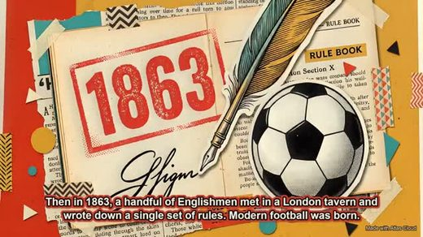</a> <a href="https://github.com/Alisa0808/vox-director">Alisa0808/vox-director</a></td>
<td align="center" valign="top"><a href="https://github.com/vincentsch/explainroo">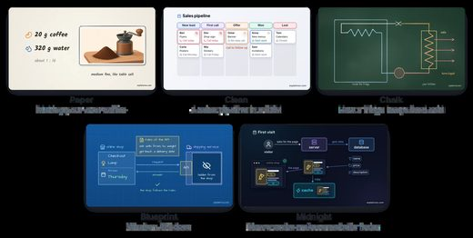</a> <a href="https://github.com/vincentsch/explainroo">vincentsch/explainroo</a></td>
<td align="center" valign="top"><a href="https://github.com/hi-nikola/hand-drawn-explainer-video-nikola">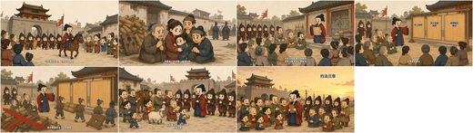</a> <a href="https://github.com/hi-nikola/hand-drawn-explainer-video-nikola">hi-nikola/hand-drawn-explainer-video-nikola</a></td>
</tr></table>

| Repo | Stars | What it does | Security |
|---|---:|---|---|
| [Alisa0808/vox-director](https://github.com/Alisa0808/vox-director) | 2.8k | Turn one topic into a finished Vox-style paper-collage explainer/ad video — automated end to end on Atlas Cloud + ffmpeg. An agent skill. | [SAFE](https://agentskillshub.top/skill/Alisa0808/vox-director/) |
| [adithya-s-k/manim_skill](https://github.com/adithya-s-k/manim_skill) | 1.3k | Agent skills for Manim to create 3Blue1Brown style animations. | [SAFE](https://agentskillshub.top/skill/adithya-s-k/manim_skill/) |
| [vincentsch/explainroo](https://github.com/vincentsch/explainroo) | 1.3k | Explainer videos and product demos made by your AI agent. Free and open source: a local voice (Kokoro), word timing (Whisper) and a canvas renderer t… | [SAFE](https://agentskillshub.top/skill/vincentsch/explainroo/) |
| [GTKottman/mortiflix-oss](https://github.com/GTKottman/mortiflix-oss) | 699 | A motion design studio on your own machine: Claude makes the video step by step, you approve every stage. Bring your own Claude Code or API key. | [SAFE](https://agentskillshub.top/skill/GTKottman/mortiflix-oss/) |
| [HeyChengC/wallstreet-explainer](https://github.com/HeyChengC/wallstreet-explainer) | 684 | 华尔街式财经/科技解读短片 skill：设计思路、风格语言，以及找片、截图、配音、渲染和混音工具。 | [SAFE](https://agentskillshub.top/skill/HeyChengC/wallstreet-explainer/) |
| [hi-nikola/hand-drawn-explainer-video-nikola](https://github.com/hi-nikola/hand-drawn-explainer-video-nikola) | 476 | 中文手绘知识讲解视频 Codex Skill：逐笔故事、双语义岛、让怪诞小黑动起来与程序动画 | [SAFE](https://agentskillshub.top/skill/hi-nikola/hand-drawn-explainer-video-nikola/) |
| [wshuyi/remotion-video-skill](https://github.com/wshuyi/remotion-video-skill) | 475 | A Claude Code Skill for creating programmatic videos with Remotion framework | [CAUTION](https://agentskillshub.top/skill/wshuyi/remotion-video-skill/) |
| [moguzbulbul/blueprint-animation](https://github.com/moguzbulbul/blueprint-animation) | 434 | Claude Design skill: animated before → after UX redesign, explained step by step through a blueprint drawing. By @moguzbulbul. | [SAFE](https://agentskillshub.top/skill/moguzbulbul/blueprint-animation/) |
| [shuyicc/MathLens](https://github.com/shuyicc/MathLens) | 349 | MathLens 是一个专注于数学题目视频讲解的 Agent Skill。你只需粘贴一道数学题（图片或文字），它就能自动完成从题目分析、可视化讲解、配音脚本到 Manim 动画视频的全流程制作。单条视频1-10 分钟，成本 0.2-1 元以内。 | [SAFE](https://agentskillshub.top/skill/shuyicc/MathLens/) |
| [Anil-matcha/vox-ai-motion-graphics-generator](https://github.com/Anil-matcha/vox-ai-motion-graphics-generator) | 347 | 🎬 Turn any topic into a finished Vox-style paper-collage explainer / motion graphics video — script, collage keyframes, animation, voice-over, music… | [SAFE](https://agentskillshub.top/skill/Anil-matcha/vox-ai-motion-graphics-generator/) |
| [Moh4696/cinematic-skill](https://github.com/Moh4696/cinematic-skill) | 260 | Agent skill for narrated cinematic films built entirely from code: one continuous camera over photos, maps and cards, timed to the voice. Claude Code… | [SAFE](https://agentskillshub.top/skill/Moh4696/cinematic-skill/) |
| [chuspeeism/dashi-animationstyle](https://github.com/chuspeeism/dashi-animationstyle) | 193 | 把一段中文知识口播做成 7 种画风的讲解动画（Claude Code skill）：画面由 Claude 写 HTML/Canvas 代码逐帧画出，不用生图模型 | [SAFE](https://agentskillshub.top/skill/chuspeeism/dashi-animationstyle/) |
| [haiderfarooq3/khan-explainer](https://github.com/haiderfarooq3/khan-explainer) | 157 | Claude Code skill: Khan Academy style explainer videos. A pen draws while a voice explains. Free, local, no API keys. | [SAFE](https://agentskillshub.top/skill/haiderfarooq3/khan-explainer/) |
| [derek-zhuolin/motion-skill](https://github.com/derek-zhuolin/motion-skill) | 128 | 不出镜，用文案或录音把想法做成视频。Script- or voice-driven motion graphics with Codex and Remotion: real footage, captions, editable projects and 96 motion studies. | [SAFE](https://agentskillshub.top/skill/derek-zhuolin/motion-skill/) |
| [runesleo/claude-video-kit](https://github.com/runesleo/claude-video-kit) | 124 | Agent Skill + Remotion pipeline: brief/script → review receipt → narrated 9:16 explainer. RC: video-explainer skill. | [SAFE](https://agentskillshub.top/skill/runesleo/claude-video-kit/) |
| [iart-ai/explainer-video-skills](https://github.com/iart-ai/explainer-video-skills) | 102 | Explainer video skills for Claude Code: script, storyboard, and render narrated explainers, year-in-review recaps, and animated diagrams. | [SAFE](https://agentskillshub.top/skill/iart-ai/explainer-video-skills/) |
| [holy-templar/vox-animated-ad-mcp](https://github.com/holy-templar/vox-animated-ad-mcp) | 78 | Vox-style paper-collage animated video skill for AI agents — Claude + MaxFusion AI MCP (Google Omni). One sentence in, a full explainer or ad out, en… | [SAFE](https://agentskillshub.top/skill/holy-templar/vox-animated-ad-mcp/) |
| [GODGOD126/opus-5-5-86-styles-in-motion](https://github.com/GODGOD126/opus-5-5-86-styles-in-motion) | 73 | 86 visual styles for code-driven explainer animations. A Codex skill: choose a style, preview 20 seconds, then create the full HTML video. | [SAFE](https://agentskillshub.top/skill/GODGOD126/opus-5-5-86-styles-in-motion/) |
| [threerocks/sweety-statechart-video](https://github.com/threerocks/sweety-statechart-video) | 69 | 格物 · 蜡笔状态图：一句话做一部会动的蜡笔状态图短片。3:4、2-3 分钟、四款合成旁白（可加自己的声音）、每章一张海报；支持 Codex、Claude Code、Grok 等，可批量出片。 | [SAFE](https://agentskillshub.top/skill/threerocks/sweety-statechart-video/) |
| [sunxiayi/make-blender-education-video-skill](https://github.com/sunxiayi/make-blender-education-video-skill) | 68 | A Codex and Claude Code skill for creating fact-checked cinematic educational videos with Blender | [SAFE](https://agentskillshub.top/skill/sunxiayi/make-blender-education-video-skill/) |
| [znyupup/knowledge-explainer-skill](https://github.com/znyupup/knowledge-explainer-skill) | 67 | 把一份 markdown 文稿，自动生成讲解动画视频 — Powered by Remotion + AI Agent | [SAFE](https://agentskillshub.top/skill/znyupup/knowledge-explainer-skill/) |
| [SpeedPainterOrg/explainer-video](https://github.com/SpeedPainterOrg/explainer-video) | 59 | Codex plugin for turning text, URLs, and documents into narrated hand-drawn explainer videos. | [SAFE](https://agentskillshub.top/skill/SpeedPainterOrg/explainer-video/) |
| [Anil-matcha/zack-d-films-ai-video-generator](https://github.com/Anil-matcha/zack-d-films-ai-video-generator) | 57 | 🎬 Turn any topic into a finished Zack D Films-style 3D animated short — curiosity-loop script, character sheets, 3D keyframes, Veo 3.1 motion, voiceo… | [SAFE](https://agentskillshub.top/skill/Anil-matcha/zack-d-films-ai-video-generator/) |
| [SunandBean/paper2video](https://github.com/SunandBean/paper2video) | 49 | Claude Code skill: arXiv paper to a narrated, fact-checked explainer video (Three.js scenes, local Kokoro TTS, ffmpeg). | [SAFE](https://agentskillshub.top/skill/SunandBean/paper2video/) |
| [howoneai/xiaolin-explainer-packaging](https://github.com/howoneai/xiaolin-explainer-packaging) | 48 | 小Lin说风格讲解视频包装 skill：Remotion 版式组件、关键词计时分镜、混音、逐帧质检、资料检索（非官方） | [SAFE](https://agentskillshub.top/skill/howoneai/xiaolin-explainer-packaging/) |
| [AmitSubhash/3brown1blue](https://github.com/AmitSubhash/3brown1blue) | 47 | First-principles Manim skill for Claude Code — mathematical animation from scratch, paper-explainer patterns, 21 rule files. | [SAFE](https://agentskillshub.top/skill/AmitSubhash/3brown1blue/) |
| [vibe-motion/remotion-code-motion-explainer](https://github.com/vibe-motion/remotion-code-motion-explainer) | 41 | AI Agent skill for continuous, editable Remotion explainers — created by Bingo | [SAFE](https://agentskillshub.top/skill/vibe-motion/remotion-code-motion-explainer/) |
| [Agentchengfeng/chengfeng-video-styles](https://github.com/Agentchengfeng/chengfeng-video-styles) | 36 | 15 种代码视频风格 Skill：让 Claude Code / Codex 用纯代码做 10 秒知识讲解短片 | [SAFE](https://agentskillshub.top/skill/Agentchengfeng/chengfeng-video-styles/) |
| [santmun/video-vox](https://github.com/santmun/video-vox) | 35 | Crea shorts verticales animados estilo Vox sobre cualquier tema con Claude Code + Remotion (cartoon + voz + música + SFX) | [SAFE](https://agentskillshub.top/skill/santmun/video-vox/) |
| [Mr-funny/hbg-douyin-code-explainer-video](https://github.com/Mr-funny/hbg-douyin-code-explainer-video) | 33 | HBG Codex skill for deterministic Chinese 9:16 HyperFrames explainer videos with dialogue TTS, global Whisper sync, stable BGM and final visual QA. | [SAFE](https://agentskillshub.top/skill/Mr-funny/hbg-douyin-code-explainer-video/) |
| [vakovalskii/nd-video-studio](https://github.com/vakovalskii/nd-video-studio) | 33 | Explainer videos from HTML (HyperFrames → MP4) with AI narrator, music and mixing — Claude Code / Codex skills on NeuralDeep models | [SAFE](https://agentskillshub.top/skill/vakovalskii/nd-video-studio/) |
| [dy-hashiqi/VibeDS-skill](https://github.com/dy-hashiqi/VibeDS-skill) | 30 |  | [SAFE](https://agentskillshub.top/skill/dy-hashiqi/VibeDS-skill/) |
| [ahmdd4vd/MotionCraft](https://github.com/ahmdd4vd/MotionCraft) | 28 | Clean, high-taste motion graphics videos made by your AI agent with Remotion. One-command Agent Skill: npx skills add ahmdd4vd/motioncraft | [SAFE](https://agentskillshub.top/skill/ahmdd4vd/MotionCraft/) |
| [BusyBee3333/animated-explainer-skills](https://github.com/BusyBee3333/animated-explainer-skills) | 27 | Build Kurzgesagt-quality animated explainer videos as one self-contained HTML file — GSAP choreography patterns, YouTube-retention method, overlap au… | [SAFE](https://agentskillshub.top/skill/BusyBee3333/animated-explainer-skills/) |
| [paullabs/espaco-em-codigo](https://github.com/paullabs/espaco-em-codigo) | 27 | Estúdio de vídeos de espaço e ciência em código: planetas, marés e explosões em 3D (Three.js), câmera de cinema, voz e conferência quadro a quadro. P… | [SAFE](https://agentskillshub.top/skill/paullabs/espaco-em-codigo/) |
| [124zhe/xigua-msvideo-skill](https://github.com/124zhe/xigua-msvideo-skill) | 26 | Codex skills for YouTube curiosity stories, MS Paint storyboards, narration, and video assembly. | [SAFE](https://agentskillshub.top/skill/124zhe/xigua-msvideo-skill/) |
| [Phantomlau3674/voxstylehub-steven](https://github.com/Phantomlau3674/voxstylehub-steven) | 26 | Standalone Codex skill for Vox-inspired editorial collage knowledge videos with deterministic Remotion assembly and optional generated motion. | [SAFE](https://agentskillshub.top/skill/Phantomlau3674/voxstylehub-steven/) |
| [iart-ai/map-animation-skills](https://github.com/iart-ai/map-animation-skills) | 25 | Animated map skills for AI coding agents — draw routes, zoom-to-location, and data-driven map animations rendered to video. | [SAFE](https://agentskillshub.top/skill/iart-ai/map-animation-skills/) |
| [indieshade/video-director-workflow](https://github.com/indieshade/video-director-workflow) | 25 | Design-led AI video workflow: director skill, aesthetic guidance, blind comparisons and a reproducible HyperFrames collage sample | [SAFE](https://agentskillshub.top/skill/indieshade/video-director-workflow/) |
| [Matteoikarieth96/whiteboard-video-skill](https://github.com/Matteoikarieth96/whiteboard-video-skill) | 24 | Claude Code skill: turn any topic into a hand-drawn whiteboard explainer video with voice-over and captions | [SAFE](https://agentskillshub.top/skill/Matteoikarieth96/whiteboard-video-skill/) |
| [Mng-dev-ai/explainer-video](https://github.com/Mng-dev-ai/explainer-video) | 23 | AI skill that turns any topic into an animated narrated explainer video. Runs locally, free, works with Claude Code / Codex / Cursor. | [SAFE](https://agentskillshub.top/skill/Mng-dev-ai/explainer-video/) |
| [aijiduonadegou/Paper-Cut](https://github.com/aijiduonadegou/Paper-Cut) | 22 | 无需视频模型，即可制作拼贴动画的skill。用图像模型定稿、原图拆层与 HyperFrames 代码动画制作可编辑 Paper Cut / Vox 风格纸拼贴科普视频；支持三阶段审批、旁白、音效、文字动效与确定性 QA。 | [SAFE](https://agentskillshub.top/skill/aijiduonadegou/Paper-Cut/) |
| [reedodev/explainer-studio](https://github.com/reedodev/explainer-studio) | 21 | One line in, an explainer video out, in eight hand-drawn styles (Claude Code skill) | [SAFE](https://agentskillshub.top/skill/reedodev/explainer-studio/) |
| [cclank/lanshu-html2video-skill](https://github.com/cclank/lanshu-html2video-skill) | 19 | Turn web articles into polished 1080p videos with Codex and Remotion | [SAFE](https://agentskillshub.top/skill/cclank/lanshu-html2video-skill/) |
| [chenyuxiaojin/cyxj-hyperframes](https://github.com/chenyuxiaojin/cyxj-hyperframes) | 18 | Open-source HTML+GSAP video projects & reusable toolkit for Claude Code tutorial videos, powered by HeyGen HyperFrames. | [SAFE](https://agentskillshub.top/skill/chenyuxiaojin/cyxj-hyperframes/) |
| [chenjun198711/book-video-generator](https://github.com/chenjun198711/book-video-generator) | 17 | 《三分钟精读一本书》视频生成器 - Agent Skills 跨平台技能 \| 从扣子工作流移植，支持 WorkBuddy、OpenClaw、Codex、TRAE Work、Claude等。 | [SAFE](https://agentskillshub.top/skill/chenjun198711/book-video-generator/) |
| [feicaiclub/knowledge-easy](https://github.com/feicaiclub/knowledge-easy) | 16 | Knowledge Easy — One Codex skill for story-driven explainer films in English and Chinese: research, narration, motion graphics, editing, and frame-by… | [SAFE](https://agentskillshub.top/skill/feicaiclub/knowledge-easy/) |
| [liuliu-66-create/ll-video-edit](https://github.com/liuliu-66-create/ll-video-edit) | 16 | Codex + Remotion 六步自动剪辑 Skill 与视频动效素材库 | [SAFE](https://agentskillshub.top/skill/liuliu-66-create/ll-video-edit/) |
| [syydaniel/kazi](https://github.com/syydaniel/kazi) | 15 | 卡字 kazi：让 AI 做的讲解动画，画面卡在旁白的关键词上。A skill for AI coding assistants: explainer animations that land on the voice-over's keywords. | [SAFE](https://agentskillshub.top/skill/syydaniel/kazi/) |
| [jaredcassoutt/vox-editorial](https://github.com/jaredcassoutt/vox-editorial) | 14 | A Claude Code skill that turns one researched topic into a finished vertical explainer film: cut-paper artwork animated across depth planes, free loc… | [SAFE](https://agentskillshub.top/skill/jaredcassoutt/vox-editorial/) |
| [kakaxi12/vox-director-codex](https://github.com/kakaxi12/vox-director-codex) | 14 | Codex skill for creating Vox-style editorial paper-collage videos with ImageGen, HyperFrames, and MiniMax narration. | [SAFE](https://agentskillshub.top/skill/kakaxi12/vox-director-codex/) |
| [Science-Prof-Robot/recursive-math-animator](https://github.com/Science-Prof-Robot/recursive-math-animator) | 13 | Cursor and Claude Code skill: Manim animations, manim-voiceover, git-based scene versioning, optional Gemini TTS | [SAFE](https://agentskillshub.top/skill/Science-Prof-Robot/recursive-math-animator/) |
| [fltman/infofilm](https://github.com/fltman/infofilm) | 12 | Claude Code skill: narrated infographic explainer films — 1950s newsreel cards, ElevenLabs narrator, Suno jingles, Gemini art, Remotion scenes cued t… | [SAFE](https://agentskillshub.top/skill/fltman/infofilm/) |
| [gquthier/autonomous-sop-video](https://github.com/gquthier/autonomous-sop-video) | 11 | CREATIVE · SOP VIDEO — Turn any workflow into a narrated tutorial. Agent skill, screenshots, button zooms, checklists and chapters. | [SAFE](https://agentskillshub.top/skill/gquthier/autonomous-sop-video/) |
| [Lunamos/paper2video](https://github.com/Lunamos/paper2video) | 10 | Claude Code skill: turn a research paper or project into a 3Blue1Brown-style explainer video with Remotion (script, narration, real-data animation, c… | [SAFE](https://agentskillshub.top/skill/Lunamos/paper2video/) |
| [mathruffian-dot/claude-motion-explainer-images](https://github.com/mathruffian-dot/claude-motion-explainer-images) | 10 | 圖片加強版：用一句話讓 coding agent 做出有授權照片與 AI 示意圖的原理解說動畫（HyperFrames + 中文旁白）｜Explainer animations with a licensed-photo and generated-image layer | [SAFE](https://agentskillshub.top/skill/mathruffian-dot/claude-motion-explainer-images/) |
| [undsky/doudou-remotion-whiteboard-skill](https://github.com/undsky/doudou-remotion-whiteboard-skill) | 10 | 专为 Remotion 打造的通用手绘白板、纸质媒介与草图动效（Whiteboard & Hand-Drawn Animation）引擎。 | [SAFE](https://agentskillshub.top/skill/undsky/doudou-remotion-whiteboard-skill/) |
| [sepi2p/research-explainer-skill](https://github.com/sepi2p/research-explainer-skill) | 9 | Claude Code skill: 3Blue1Brown-style research explainer videos and slides in English and Persian (Farsi), with claim checks and real-data figures | [CAUTION](https://agentskillshub.top/skill/sepi2p/research-explainer-skill/) |
| [ssrajadh/paperview](https://github.com/ssrajadh/paperview) | 9 | Turn research papers, codebases, etc. into explainer videos, local rendering + TTS, Claude Code plugin. | [SAFE](https://agentskillshub.top/skill/ssrajadh/paperview/) |
| [0x68616F4C/auto-popsci](https://github.com/0x68616F4C/auto-popsci) | 8 | Agent Skill for generating math/science popularization videos with Manim + AI narration | [SAFE](https://agentskillshub.top/skill/0x68616F4C/auto-popsci/) |
| [cymcymcymcym/notes-to-video](https://github.com/cymcymcymcym/notes-to-video) | 8 | Turn notes into animated explainer videos in the style popularized by 3Blue1Brown. Claude Code skill + Manim + TTS + ffmpeg. | [SAFE](https://agentskillshub.top/skill/cymcymcymcym/notes-to-video/) |
| [rocketmandrey/stickman-director](https://github.com/rocketmandrey/stickman-director) | 8 | 🎬 One question in → one finished stick-figure explainer video out. A Claude skill that drives Google Vids end to end. | [SAFE](https://agentskillshub.top/skill/rocketmandrey/stickman-director/) |
| [sanskarprajapati/parallax-doc](https://github.com/sanskarprajapati/parallax-doc) | 8 | Cinematic one-camera history documentaries for Claude Code: layered 2.5D plates, no hard cuts, typed text with one red word, a worn film look. | [SAFE](https://agentskillshub.top/skill/sanskarprajapati/parallax-doc/) |
| [sukai213/bilibili-ai-video](https://github.com/sukai213/bilibili-ai-video) | 8 | AI 科技测评视频制作与 B 站自动发布技能（Codex Skill）：原创文案 / Qwen3-TTS 配音 / 全息幻灯片 / ffmpeg 剪辑 / 投稿 API 自动发布 | [SAFE](https://agentskillshub.top/skill/sukai213/bilibili-ai-video/) |
| [Acorn2/frame-loom](https://github.com/Acorn2/frame-loom) | 7 | An open-source skill for Coding Agents to turn documents into videos with Remotion. | [SAFE](https://agentskillshub.top/skill/Acorn2/frame-loom/) |
| [Ali-Aria/aria-animator](https://github.com/Ali-Aria/aria-animator) | 7 | 阿梨动画机（Aria Animator）：使用 Remotion、豆包配音和霞鹜文楷制作可编辑动画讲解视频的 AI Agent Skill。 | [SAFE](https://agentskillshub.top/skill/Ali-Aria/aria-animator/) |
| [aliangSSS/aliang-knowledge-video](https://github.com/aliangSSS/aliang-knowledge-video) | 7 | Claude Code skill：输入一个主题，自动生成「Vibe 知识大赏」风格的中文知识短片（Remotion，卡点动效 + 拟音） | [SAFE](https://agentskillshub.top/skill/aliangSSS/aliang-knowledge-video/) |
| [alireza12t/foldline](https://github.com/alireza12t/foldline) | 7 | Render HTML canvas animations to MP4 fast on a Mac, with WebCodecs hardware H.264 in headless Chrome (8.4 min 1080p60 in 161 s instead of 426 s). MCP… | [SAFE](https://agentskillshub.top/skill/alireza12t/foldline/) |
| [coding-ax/docvideoer](https://github.com/coding-ax/docvideoer) | 7 | 文档转视频 skills。用于把文档 URL、网页文章、Markdown 或粘贴文本转换成带中文旁白的 Remotion 讲解视频，包含正文提取、分镜生成、免费 TTS、视频项目搭建和 MP4 渲染。 | [SAFE](https://agentskillshub.top/skill/coding-ax/docvideoer/) |
| [crawfordxx/paper-cut-video-skill](https://github.com/crawfordxx/paper-cut-video-skill) | 7 | Script-driven Chinese paper-cut explainer videos with content-matched characters, Remotion, Doubao TTS, and semantic captions | [SAFE](https://agentskillshub.top/skill/crawfordxx/paper-cut-video-skill/) |
| [isabellagreco1997/script-to-video](https://github.com/isabellagreco1997/script-to-video) | 7 | Turn a script into a narrated, word-synced explainer video (16:9 YouTube or 9:16 Reels/Shorts). Free local Kokoro voice, licensed web images, clips,… | [SAFE](https://agentskillshub.top/skill/isabellagreco1997/script-to-video/) |
| [jinjin1/scenewright](https://github.com/jinjin1/scenewright) | 7 | Claude Code-native pipeline: a source text → narrated, Remotion-rendered YouTube explainer video. Any topic, ~$0/video, local Korean TTS (Supertonic)… | [SAFE](https://agentskillshub.top/skill/jinjin1/scenewright/) |
| [jjietay/clayducation](https://github.com/jjietay/clayducation) | 7 | AI video engine built on Claude Code that makes narrated teaching videos in a soft 3D clay look with a silent mascot. One agent checks the script bef… | [SAFE](https://agentskillshub.top/skill/jjietay/clayducation/) |
| [mathruffian-dot/claude-motion-explainer-video](https://github.com/mathruffian-dot/claude-motion-explainer-video) | 7 | 影片加強版：動畫講原理、照片當證據、MiniMax H3 AI 生成影片帶情緒的原理解說動畫（HyperFrames + 中文旁白）｜Explainer animations with AI video clips | [SAFE](https://agentskillshub.top/skill/mathruffian-dot/claude-motion-explainer-video/) |
| [pjecuacion/script-to-video-skill](https://github.com/pjecuacion/script-to-video-skill) | 7 | Public script-to-video skill for HyperFrames workflows with sanitized paths and secret-free examples. | [SAFE](https://agentskillshub.top/skill/pjecuacion/script-to-video-skill/) |
| [Nealsun1993/talk-workbench](https://github.com/Nealsun1993/talk-workbench) | 6 | 口播工作台：配音驱动的竖屏讲解视频 Skill、Remotion 组件库与动效规范。 | [SAFE](https://agentskillshub.top/skill/Nealsun1993/talk-workbench/) |
| [OnurGumus/codebase-video](https://github.com/OnurGumus/codebase-video) | 6 | Turn a codebase into a fact-checked narrated video. A Claude Code plugin: one agent reads the code, fresh agents verify every claim, then the video i… | [SAFE](https://agentskillshub.top/skill/OnurGumus/codebase-video/) |
| [centraltowerlabs/diagram-tour](https://github.com/centraltowerlabs/diagram-tour) | 6 | This Claude Skill makes it easy to generate explainer video tours of your codebase (or any other complex system) | [SAFE](https://agentskillshub.top/skill/centraltowerlabs/diagram-tour/) |
| [ekomen77/erko-ai-video-engine](https://github.com/ekomen77/erko-ai-video-engine) | 6 | Ses kaydını ekomen77 tarzı 1080p anlatım videosuna çeviren motor. Turn a voiceover into an ekomen77-style 1080p explainer video - procedural Canvas +… | [SAFE](https://agentskillshub.top/skill/ekomen77/erko-ai-video-engine/) |
| [hdduytran/one-studio-skill](https://github.com/hdduytran/one-studio-skill) | 6 | all in one creation video skill | [SAFE](https://agentskillshub.top/skill/hdduytran/one-studio-skill/) |
| [AlbertPine/vibe-knowledge-video-director](https://github.com/AlbertPine/vibe-knowledge-video-director) | 5 | A Codex skill for researched, story-first Chinese knowledge videos with continuous motion graphics, semantic on-screen text, and render-level QA. | [SAFE](https://agentskillshub.top/skill/AlbertPine/vibe-knowledge-video-director/) |
| [arthurkatcher/explainer-video](https://github.com/arthurkatcher/explainer-video) | 5 | Agent skill: motion-graphics explainer videos made entirely in code (Remotion + numpy music) | [SAFE](https://agentskillshub.top/skill/arthurkatcher/explainer-video/) |
| [bassimeledath/manimate](https://github.com/bassimeledath/manimate) | 5 | Generate diagram/animation videos from natural language using Manim. Agent skill for Claude Code, Codex, and other AI coding agents. | [SAFE](https://agentskillshub.top/skill/bassimeledath/manimate/) |
| [beriki770-ship-it/code-animations](https://github.com/beriki770-ship-it/code-animations) | 5 | Claude Code skill: videos where a program draws every frame (Canvas 2D + Web Audio), rendered headless to MP4 in 16:9 / 9:16 / 4:5 | [SAFE](https://agentskillshub.top/skill/beriki770-ship-it/code-animations/) |
| [tmoody1973/pasteup](https://github.com/tmoody1973/pasteup) | 5 | Halftone paper-collage stop-motion for Claude Code. Cut. Paste. Wobble. Deterministic assemble-from-empty motion with the handmade stop-motion wobble… | [SAFE](https://agentskillshub.top/skill/tmoody1973/pasteup/) |
| [RohanRatwani/explainer-video-opus-5.5](https://github.com/RohanRatwani/explainer-video-opus-5.5) | 2 | Claude Code skill: turn a topic into a motion-design explainer video (YouTube 16:9 or Shorts) with an AI voice or your own, every animation timed to… | [SAFE](https://agentskillshub.top/skill/RohanRatwani/explainer-video-opus-5.5/) |
| [git-story-film](https://github.com/EverMind-AI/Raven/tree/HEAD/skills/git-story-film) | in EverMind-AI/Raven: 6.2k | Direct a two-minute hand-drawn animated film from a repository's Git history: story, character, storyboard, HTML review studio, then a 4K/60fps MP4. | [SAFE](https://agentskillshub.top/skill/EverMind-AI/Raven/) |

## ✂️ Editing

[Open this type on the live page, sorted by stars →](https://agentskillshub.top/best/claude-video-skills/#type-editing)

<table><tr>
<td align="center" valign="top"> <a href="https://github.com/FireRedTeam/FireRed-OpenStoryline">FireRedTeam/FireRed-OpenStoryline</a></td>
<td align="center" valign="top"><a href="https://github.com/hetpatel-11/Adobe_Premiere_Pro_MCP">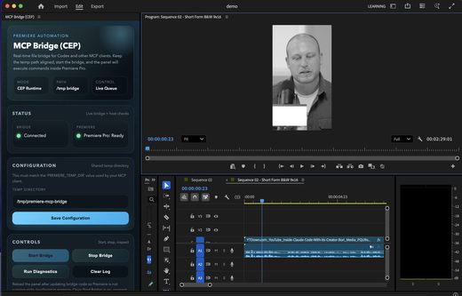</a> <a href="https://github.com/hetpatel-11/Adobe_Premiere_Pro_MCP">hetpatel-11/Adobe_Premiere_Pro_MCP</a></td>
<td align="center" valign="top"><a href="https://github.com/zenstory-ai/video-recap-skills">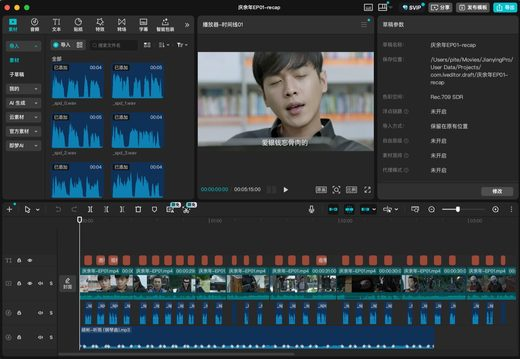</a> <a href="https://github.com/zenstory-ai/video-recap-skills">zenstory-ai/video-recap-skills</a></td>
</tr></table>

| Repo | Stars | What it does | Security |
|---|---:|---|---|
| [FireRedTeam/FireRed-OpenStoryline](https://github.com/FireRedTeam/FireRed-OpenStoryline) | 3.7k | FireRed-OpenStoryline is an AI video editing agent that transforms manual editing into intention-driven directing through natural language interactio… | [SAFE](https://agentskillshub.top/skill/FireRedTeam/FireRed-OpenStoryline/) |
| [Agentchengfeng/chengfeng-videocut-skills](https://github.com/Agentchengfeng/chengfeng-videocut-skills) | 3.2k | 用 Claude Code Skills 做的视频剪辑 Agent | [SAFE](https://agentskillshub.top/skill/Agentchengfeng/chengfeng-videocut-skills/) |
| [0xsline/OpenChatCut](https://github.com/0xsline/OpenChatCut) | 3.1k | Open-source, local-first conversational AI video editor with a professional multi-track timeline, Agent Skills, MCP integration, and Remotion renderi… | [SAFE](https://agentskillshub.top/skill/0xsline/OpenChatCut/) |
| [JimLiu/baocut](https://github.com/JimLiu/baocut) | 1.8k | BaoCut: an AI video agent with an editable timeline. Transcribe, subtitle, translate, dub, cut and animate. | [SAFE](https://agentskillshub.top/skill/JimLiu/baocut/) |
| [pireel/pireel](https://github.com/pireel/pireel) | 1.4k | The open-source alternative to Capcut、ChatCut. Drivable by any AI agent over MCP. | [SAFE](https://agentskillshub.top/skill/pireel/pireel/) |
| [Barty-Bart/motion-graphics](https://github.com/Barty-Bart/motion-graphics) | 1.2k | Motion-graphics skills for Claude Code and Codex. | [SAFE](https://agentskillshub.top/skill/Barty-Bart/motion-graphics/) |
| [Vibha-Ramprakash/claude-video-effects](https://github.com/Vibha-Ramprakash/claude-video-effects) | 921 | 51 free video effects for Claude Code: drop in a talking-head clip, type /effects orbit. Face tracking, behind-your-head layers. From Hop Studio by @… | [SAFE](https://agentskillshub.top/skill/Vibha-Ramprakash/claude-video-effects/) |
| [hetpatel-11/Adobe_Premiere_Pro_MCP](https://github.com/hetpatel-11/Adobe_Premiere_Pro_MCP) | 867 | Adobe Premiere Pro MCP. Tools for AI-driven video editing via MCP, for Codex, Claude, and other MCP clients. | [SAFE](https://agentskillshub.top/skill/hetpatel-11/Adobe_Premiere_Pro_MCP/) |
| [cartesiancs/cartcut](https://github.com/cartesiancs/cartcut) | 832 | Video Editor for AI agents, built on the belief that open source can beat commercial tools | [SAFE](https://agentskillshub.top/skill/cartesiancs/cartcut/) |
| [zenstory-ai/video-recap-skills](https://github.com/zenstory-ai/video-recap-skills) | 623 | AI 视频解说全流程 skill 包：自动切镜头、看画面写解说词、配音合成成片，支持一键导出可编辑的剪映/CapCut 草稿，无需 GPU ｜ Agent skills that turn videos into narrated recaps & editable CapCut drafts | [SAFE](https://agentskillshub.top/skill/zenstory-ai/video-recap-skills/) |
| [leancoderkavy/premiere-pro-mcp](https://github.com/leancoderkavy/premiere-pro-mcp) | 527 | Adobe Premiere Pro MCP — independent, local-first server for supported workflows. Connect Claude, Codex, or Cursor through a local CEP bridge. | [SAFE](https://agentskillshub.top/skill/leancoderkavy/premiere-pro-mcp/) |
| [kurbaitaev/ghost-editor](https://github.com/kurbaitaev/ghost-editor) | 458 | Raw talking-head take in, finished reel out. Open-source AI video editor for Claude Code. | [SAFE](https://agentskillshub.top/skill/kurbaitaev/ghost-editor/) |
| [YeJe-cpu/SeeCut](https://github.com/YeJe-cpu/SeeCut) | 455 | An AI editor that watches its own cut: talking-head / AI-avatar video → auto-edited short video. 网感口播精剪：数字人/真人口播 → AI 自动精剪成网感动效短视频 → 可选剪映分层草稿 | [SAFE](https://agentskillshub.top/skill/YeJe-cpu/SeeCut/) |
| [AgriciDaniel/claude-shorts](https://github.com/AgriciDaniel/claude-shorts) | 386 | Interactive longform-to-shortform video creator — Claude Code skill with Remotion-rendered animated captions, AI segment scoring, cursor tracking, an… | [SAFE](https://agentskillshub.top/skill/AgriciDaniel/claude-shorts/) |
| [hassancs91/claude-youtube-editor](https://github.com/hassancs91/claude-youtube-editor) | 379 | Record the talking head, Claude Code does the rest: the cut, the visuals, the voice, the sound effects, the thumbnail, and the YouTube upload. Every… | [SAFE](https://agentskillshub.top/skill/hassancs91/claude-youtube-editor/) |
| [erduo1998-cell/erduo-broll-loop-engineering](https://github.com/erduo1998-cell/erduo-broll-loop-engineering) | 249 | SRT 驱动的双后端 B-roll Agent Skill：自动路由 HyperFrames / Remotion，集成 152 张 Shotcraft 镜头卡 | [SAFE](https://agentskillshub.top/skill/erduo1998-cell/erduo-broll-loop-engineering/) |
| [Cassette-Editor/oh-my-cassette](https://github.com/Cassette-Editor/oh-my-cassette) | 220 | 你的随身 AI 剪辑搭档 \| Pocket AI co-editor for video montage — AI video editing plugin & MCP server for Claude Code, Codex, Hermes & OpenCode | [SAFE](https://agentskillshub.top/skill/Cassette-Editor/oh-my-cassette/) |
| [znyupup/ai-video-editing-skill](https://github.com/znyupup/ai-video-editing-skill) | 180 | AI Agent Skill for automated vlog editing. Feed raw footage, get a finished video. Powered by ffmpeg + Whisper + Vision API. | [SAFE](https://agentskillshub.top/skill/znyupup/ai-video-editing-skill/) |
| [mrpaidsocial/mrpaidsocial-video-editor-agent](https://github.com/mrpaidsocial/mrpaidsocial-video-editor-agent) | 163 | Claude Code skill pack: edit short-form videos end to end — style-clone a reference reel, build a branded motion-graphics edit, ElevenLabs sound desi… | [SAFE](https://agentskillshub.top/skill/mrpaidsocial/mrpaidsocial-video-editor-agent/) |
| [ayushozha/AdobePremiereProMCP](https://github.com/ayushozha/AdobePremiereProMCP) | 145 | An open-source bridge between AI assistants and Adobe Premiere Pro, for supported editing workflows. Go, Rust, Python, and TypeScript. | [SAFE](https://agentskillshub.top/skill/ayushozha/AdobePremiereProMCP/) |
| [Xiangyu-CAS/rea-capcut](https://github.com/Xiangyu-CAS/rea-capcut) | 144 | ReaCut — REA × CapCut: an independent, open-source video editor rebuilt from REA-assisted, authorized local behavior and format research. No copied C… | [SAFE](https://agentskillshub.top/skill/Xiangyu-CAS/rea-capcut/) |
| [naive-kun/naive-video-skill](https://github.com/naive-kun/naive-video-skill) | 137 | A Codex skill for turning talking-head videos into captioned, animated final videos. | [SAFE](https://agentskillshub.top/skill/naive-kun/naive-video-skill/) |
| [louisedesadeleer/cut-video](https://github.com/louisedesadeleer/cut-video) | 121 | Claude Code skill: tighten long recordings — remove silences, ums, dead air. Preserves laughs and comedic pauses. Fast on Apple Silicon. | [SAFE](https://agentskillshub.top/skill/louisedesadeleer/cut-video/) |
| [Monet-AI-Editor/Monet](https://github.com/Monet-AI-Editor/Monet) | 119 | Edit Videos and Design Images with Claude code or Codex | [SAFE](https://agentskillshub.top/skill/Monet-AI-Editor/Monet/) |
| [AKMessi/vex](https://github.com/AKMessi/vex) | 100 | claude code for video editing | [SAFE](https://agentskillshub.top/skill/AKMessi/vex/) |
| [JUNKDOGE-JOE/after-effects-mcp](https://github.com/JUNKDOGE-JOE/after-effects-mcp) | 96 | AI-powered Adobe After Effects automation via MCP. Chat in a CEP panel or connect external agents, with 16 tools for editing, previews, recovery, reu… | [SAFE](https://agentskillshub.top/skill/JUNKDOGE-JOE/after-effects-mcp/) |
| [AISEO-VirtualabDigital/mcp-video-editor](https://github.com/AISEO-VirtualabDigital/mcp-video-editor) | 80 | Wag na kayo magbayad ng 5k PHP. Ito na — libre. MCP server for CapCut + OpenCut from Cursor, Claude, Codex, Antigravity, OpenCode, KiloCode, Qwen Cod… | [SAFE](https://agentskillshub.top/skill/AISEO-VirtualabDigital/mcp-video-editor/) |
| [artemnovitckii/claude-editing-skills](https://github.com/artemnovitckii/claude-editing-skills) | 74 | Claude Code skills that edit your talking-head clips into reels: trial reels, behind the person, explainer, split screen, ranking list, storytelling.… | [SAFE](https://agentskillshub.top/skill/artemnovitckii/claude-editing-skills/) |
| [alisadiq-ai/favstash-ai-video-editing-skills](https://github.com/alisadiq-ai/favstash-ai-video-editing-skills) | 71 | Create Instagram Reels, TikToks and YouTube Shorts with adaptive AI editing, captions and motion graphics. Connect FavStash for planning, publishing… | [SAFE](https://agentskillshub.top/skill/alisadiq-ai/favstash-ai-video-editing-skills/) |
| [RoverEva/eva-video-style](https://github.com/RoverEva/eva-video-style) | 58 | Open-source AI video editing skill for talking-head videos. Features ready-to-use templates, cinematic effects, motion graphics, and animated caption… | [SAFE](https://agentskillshub.top/skill/RoverEva/eva-video-style/) |
| [zhouyuechuan2025-ui/aipacking](https://github.com/zhouyuechuan2025-ui/aipacking) | 50 | aipacking \| AI 口播视频包装 Skill：HyperFrames 分镜、Remotion 动效、预览双审。 | [SAFE](https://agentskillshub.top/skill/zhouyuechuan2025-ui/aipacking/) |
| [hahadu4520/vlog-cut](https://github.com/hahadu4520/vlog-cut) | 49 | Narration-driven video editing pipeline for Claude Code · 给 Claude Code 用的「按文案剪辑」流水线 | [SAFE](https://agentskillshub.top/skill/hahadu4520/vlog-cut/) |
| [ops120/video-recap-skills-plus](https://github.com/ops120/video-recap-skills-plus) | 46 | Clip any video into a narration recap with claude code skill｜用claude code skill把任何视频剪辑成中文解说视频，支持剪映导出 | [CAUTION](https://agentskillshub.top/skill/ops120/video-recap-skills-plus/) |
| [darrenli6/JJKoubo](https://github.com/darrenli6/JJKoubo) | 42 | JJ Koubo (JJ口播) is a local-first collection of video editing Skills for talking-head, interview, knowledge-sharing, and other videos centered on spok… | [SAFE](https://agentskillshub.top/skill/darrenli6/JJKoubo/) |
| [frankShan001/CutVoke](https://github.com/frankShan001/CutVoke) | 36 | Open-source, local-first video editor your AI agent can drive over MCP (Claude Code, Codex, Cursor). Windows · macOS · Linux. The AI makes the cut; y… | [SAFE](https://agentskillshub.top/skill/frankShan001/CutVoke/) |
| [Kappaemme-git/codex-video-short-maker-skill](https://github.com/Kappaemme-git/codex-video-short-maker-skill) | 35 |  | [SAFE](https://agentskillshub.top/skill/Kappaemme-git/codex-video-short-maker-skill/) |
| [Hainrixz/video-editor-architect](https://github.com/Hainrixz/video-editor-architect) | 32 | Clónalo, ábrelo en Claude Code y un agente te guía para entrenar tu propio estilo de edición de reels. Claude dirige, Remotion renderiza. macOS y Win… | [CAUTION](https://agentskillshub.top/skill/Hainrixz/video-editor-architect/) |
| [skailabinfo/claude-video-harness](https://github.com/skailabinfo/claude-video-harness) | 27 | Монтаж вертикальных роликов «говорящая голова» в Claude Code + Remotion: клонируй, ответь на вопросы — пайплайн настроится под тебя | [SAFE](https://agentskillshub.top/skill/skailabinfo/claude-video-harness/) |
| [pedroxcardoso/maquina-cortes-gta](https://github.com/pedroxcardoso/maquina-cortes-gta) | 25 | Skill do Claude Code: vídeo longo vira vários cortes de Shorts sobre GTA 6 (metade streamer, metade vídeo, legenda palavra por palavra). Remotion + w… | [SAFE](https://agentskillshub.top/skill/pedroxcardoso/maquina-cortes-gta/) |
| [denyakortunov/family-travel-editor](https://github.com/denyakortunov/family-travel-editor) | 20 | An AI agent skill for organizing travel footage, planning scenes and revising films in your preferred editor. Not a standalone video editor. | [SAFE](https://agentskillshub.top/skill/denyakortunov/family-travel-editor/) |
| [onuryildriim/claude-kurgu-atolyesi](https://github.com/onuryildriim/claude-kurgu-atolyesi) | 20 | Claude Code ile konuşan-kafa YouTube videolarını kodla kurgulama atölyesi — Remotion + FFmpeg, kendi marka kimliğinle. | [SAFE](https://agentskillshub.top/skill/onuryildriim/claude-kurgu-atolyesi/) |
| [rahlquist/hermes-video-toolchain](https://github.com/rahlquist/hermes-video-toolchain) | 19 | Complete free/open-source video production pipeline for Hermes Agent: OpenScreen capture + HyperFrames authoring + headless post-processing, wired in… | [CAUTION](https://agentskillshub.top/skill/rahlquist/hermes-video-toolchain/) |
| [davidbfrogman/davecto-cutroom](https://github.com/davidbfrogman/davecto-cutroom) | 17 | Edit your talking-head videos with Claude: a local editor, a notes loop, captions and animations in your own brand. Claude Code plugin for macOS. | [SAFE](https://agentskillshub.top/skill/davidbfrogman/davecto-cutroom/) |
| [jincheng2026/jc-remotion-skills](https://github.com/jincheng2026/jc-remotion-skills) | 17 | Remotion Koubo Skill — 口播视频的 AI 成片工作流（Codex / Claude Code 双端）：粗剪+SRT 进，带 MG 包装、音效、母带的成片出 | [SAFE](https://agentskillshub.top/skill/jincheng2026/jc-remotion-skills/) |
| [ZiadAbdelkarim/beat-synced-edit](https://github.com/ZiadAbdelkarim/beat-synced-edit) | 14 | Automatic beat-synced video editing: feed it a song and raw footage, it analyzes beats, energy, and scenes, then cuts a ready-to-post edit. Pure Pyth… | [SAFE](https://agentskillshub.top/skill/ZiadAbdelkarim/beat-synced-edit/) |
| [PoetCoderJun/MotionTalk](https://github.com/PoetCoderJun/MotionTalk) | 13 | Speak your ideas. Turn a recording into a concise, polished video with your Agent. 保留原声，让好想法变成好视频。 | [SAFE](https://agentskillshub.top/skill/PoetCoderJun/MotionTalk/) |
| [nomicsadmin/editor-video-ia](https://github.com/nomicsadmin/editor-video-ia) | 13 | Editor de vídeo dentro do Claude Code: manda o vídeo, o briefing e a referência, recebe o reels editado. Corte pela fala, legenda palavra a palavra,… | [SAFE](https://agentskillshub.top/skill/nomicsadmin/editor-video-ia/) |
| [cocolayuan/videoclip-AI-skill](https://github.com/cocolayuan/videoclip-AI-skill) | 12 | Claude Skill-powered video editing toolkit - 视频全自动剪辑 | [SAFE](https://agentskillshub.top/skill/cocolayuan/videoclip-AI-skill/) |
| [rtadewald/agent-video-editor](https://github.com/rtadewald/agent-video-editor) | 11 | Meu conjunto de Skills, webapps e workflows para edição de vídeo automatizada com IA | [SAFE](https://agentskillshub.top/skill/rtadewald/agent-video-editor/) |
| [Fagan1024/smart-video-editor](https://github.com/Fagan1024/smart-video-editor) | 10 | AI video editing skill that watches your footage before cutting. Vision model analyzes every frame, scores usability, drops bad takes, reorders by na… | [SAFE](https://agentskillshub.top/skill/Fagan1024/smart-video-editor/) |
| [brookejlacey/boring-tools](https://github.com/brookejlacey/boring-tools) | 10 | Agent-driven video editing where the edit is text. No timeline, no project file, nothing uploaded. ffmpeg + whisper + python, and a SKILL.md your age… | [SAFE](https://agentskillshub.top/skill/brookejlacey/boring-tools/) |
| [griffinwooldridge/talking-head-editor](https://github.com/griffinwooldridge/talking-head-editor) | 10 | A Claude skill that edits raw talking-head footage: tight cuts, clean voice, captions and motion graphics as code | [SAFE](https://agentskillshub.top/skill/griffinwooldridge/talking-head-editor/) |
| [qingyunAGI/qingyun-cine-skill](https://github.com/qingyunAGI/qingyun-cine-skill) | 10 | qingyun-cine-skill: PLAN-FIRST cinematic video editing Codex skill for trailers, beat-sync edits, promos, and highlights. | [SAFE](https://agentskillshub.top/skill/qingyunAGI/qingyun-cine-skill/) |
| [d4niel-fr/shdw-video-editor](https://github.com/d4niel-fr/shdw-video-editor) | 9 | Open-source AI video editor: DaVinci Resolve-style timeline + Claude Code / Codex agent that writes motion graphics in code, edits, grades, captions… | [SAFE](https://agentskillshub.top/skill/d4niel-fr/shdw-video-editor/) |
| [kajisho5/remotion-ffmpeg-skill](https://github.com/kajisho5/remotion-ffmpeg-skill) | 7 | Agent skill that renders measured Remotion motion graphics onto real recordings via ffmpeg-skill, with verified output. | [SAFE](https://agentskillshub.top/skill/kajisho5/remotion-ffmpeg-skill/) |
| [HibaBenzahra/HibAi-Editing-Studio](https://github.com/HibaBenzahra/HibAi-Editing-Studio) | 6 | 🎬 HibAI Studio — a Claude skill that turns your talking video into a ready-to-post reel: silences cut, Darija/Arabic word-by-word captions, motion gr… | [SAFE](https://agentskillshub.top/skill/HibaBenzahra/HibAi-Editing-Studio/) |
| [hahadu4520/newcut-video-clipping-skill](https://github.com/hahadu4520/newcut-video-clipping-skill) | 6 | Open-source Codex skill for semantic Chinese video clipping with hooks, captions, cleanup, and FFmpeg rendering | [SAFE](https://agentskillshub.top/skill/hahadu4520/newcut-video-clipping-skill/) |
| [jackjls/jtxvideo-skill](https://github.com/jackjls/jtxvideo-skill) | 6 | Codex + HyperFrames 口播视频制作 Skill：按 SRT、结构、分镜、设计、渲染的审核流程生成 AI 金融短视频 | [SAFE](https://agentskillshub.top/skill/jackjls/jtxvideo-skill/) |
| [vincentventalon/claude-code-video-editing-skill](https://github.com/vincentventalon/claude-code-video-editing-skill) | 6 | Les skills Claude Code que j'utilise vraiment sur mes sites et mes vidéos, une nouvelle chaque mardi (montage vidéo, SEO Search Console…) | [SAFE](https://agentskillshub.top/skill/vincentventalon/claude-code-video-editing-skill/) |
| [yerinsabraham/video-edit-skill](https://github.com/yerinsabraham/video-edit-skill) | 6 | Drop your raw clips, type /video-edit, get a finished short-form video. Best takes, kinetic captions, words behind you, logos, UI demos, zooms, sound… | [SAFE](https://agentskillshub.top/skill/yerinsabraham/video-edit-skill/) |
| [UgurKeskekci/claude-video-kit](https://github.com/UgurKeskekci/claude-video-kit) | 5 | Konuşma videolarını Claude Code ile kurgulamak için skill'ler: yatay kurgu, Reels, X animasyonu ve kodla animasyon. | [SAFE](https://agentskillshub.top/skill/UgurKeskekci/claude-video-kit/) |

## 📱 Shorts & social

[Open this type on the live page, sorted by stars →](https://agentskillshub.top/best/claude-video-skills/#type-shorts)

<table><tr>
<td align="center" valign="top"> <a href="https://github.com/adunext/adu-motion-video">adunext/adu-motion-video</a></td>
<td align="center" valign="top"> <a href="https://github.com/Yuuhann1999/agent-storyboard">Yuuhann1999/agent-storyboard</a></td>
<td align="center" valign="top"> <a href="https://github.com/Cuongyd196/remotion-cuongit-template">Cuongyd196/remotion-cuongit-template</a></td>
</tr></table>

| Repo | Stars | What it does | Security |
|---|---:|---|---|
| [adunext/adu-motion-video](https://github.com/adunext/adu-motion-video) | 836 | 阿杜的 AI 剪辑 Skill｜全系列模板已升级为 MotionGit .motion 开放格式，下载后直接发给助手即可创作。下载：https://motiongit.com/@adunext ｜精选阿杜与 Opus 5.5 制作的代码级动画模板，适合口播、知识讲解，支持多平台、多助手。 | [SAFE](https://agentskillshub.top/skill/adunext/adu-motion-video/) |
| [artemnovitckii/claude-animation-skills](https://github.com/artemnovitckii/claude-animation-skills) | 714 | Six Claude Code skills that make animations for reels, no footage needed: 3D cartoon explainer, stick figure, minimal line art, 3D map route, explode… | [SAFE](https://agentskillshub.top/skill/artemnovitckii/claude-animation-skills/) |
| [Yuuhann1999/agent-storyboard](https://github.com/Yuuhann1999/agent-storyboard) | 396 | 本地优先的 Agent 视频分镜工作台：让 Codex、Claude Code 通过 MCP 写分镜、生成图片/视频素材和配音，并自动回填。Local-first storyboard workbench for AI agents (Codex, Claude Code). | [SAFE](https://agentskillshub.top/skill/Yuuhann1999/agent-storyboard/) |
| [hassancs91/claude-faceless-shorts-creator](https://github.com/hassancs91/claude-faceless-shorts-creator) | 361 | A faceless YouTube-Shorts factory driven by Claude Code: pure-TSX Remotion visuals, ElevenLabs voice with word-exact captions, library-first sound de… | [SAFE](https://agentskillshub.top/skill/hassancs91/claude-faceless-shorts-creator/) |
| [Cuongyd196/remotion-cuongit-template](https://github.com/Cuongyd196/remotion-cuongit-template) | 243 | Bộ skill cho AI agent tạo video ngắn 9:16 bằng Remotion: giải thích chủ đề, giới thiệu GitHub repo, so sánh hai lựa chọn. | [SAFE](https://agentskillshub.top/skill/Cuongyd196/remotion-cuongit-template/) |
| [0xS4N4TG/papercut-explainer](https://github.com/0xS4N4TG/papercut-explainer) | 212 | Short vertical cut-paper explainer reels, made by your coding agent. Nine Agent Skills plus a Remotion library. Works with Claude Code, OpenCode, Cod… | [SAFE](https://agentskillshub.top/skill/0xS4N4TG/papercut-explainer/) |
| [haiderfarooq3/paper-reel](https://github.com/haiderfarooq3/paper-reel) | 138 | Claude Code skill: faceless 9:16 explainer reels in a cut-paper style. Voice-timed scenes, word-by-word captions. Free, local, no API keys. | [SAFE](https://agentskillshub.top/skill/haiderfarooq3/paper-reel/) |
| [SpaceZephyr/map-motion](https://github.com/SpaceZephyr/map-motion) | 120 | 地图动效视频 Claude Code skill：基于高德地图真实路线/边界/卫星底图，做地球俯冲、vlog 我在这里、徒步海拔、骑行旅程、航线、行政区高亮等地图动画，12 种风格 | [SAFE](https://agentskillshub.top/skill/SpaceZephyr/map-motion/) |
| [pycodebr/heditor](https://github.com/pycodebr/heditor) | 116 | Creative vertical video editing skill for AI agents (Claude Code, Codex, OpenCode, Cursor, Hermes): named styles, creative mode, HyperFrames + voice-… | [SAFE](https://agentskillshub.top/skill/pycodebr/heditor/) |
| [jaxxchen003/book-video-factory](https://github.com/jaxxchen003/book-video-factory) | 113 | Portable Codex skill for auditable, rights-aware Chinese book-review short-video workflows. | [SAFE](https://agentskillshub.top/skill/jaxxchen003/book-video-factory/) |
| [fendouai/ViralForge](https://github.com/fendouai/ViralForge) | 87 | Agent-native viral video studio: one-click replicate viral short videos, deconstruct video hooks and scripts into a Viral DNA report, and ship 10 cos… | [SAFE](https://agentskillshub.top/skill/fendouai/ViralForge/) |
| [Chamanrajragu/purffle-shorts](https://github.com/Chamanrajragu/purffle-shorts) | 76 | Free open-source AI YouTube Shorts generator and faceless video maker in Python. Any LLM (GPT, Claude, Gemini, Ollama) writes scripts; text-to-speech… | [SAFE](https://agentskillshub.top/skill/Chamanrajragu/purffle-shorts/) |
| [ymybxx/SoloMCN](https://github.com/ymybxx/SoloMCN) | 75 | 把 Claude Code 变成你的短视频团队：不搭工作流，直接让 Claude 干活，从国内热榜、推特热帖到抖音、小红书、B站、YouTube、推特发布。Turn Claude Code into your short-video team — no workflows, from trends… | [SAFE](https://agentskillshub.top/skill/ymybxx/SoloMCN/) |
| [Maartenlouis/remotion-ads](https://github.com/Maartenlouis/remotion-ads) | 69 | Claude Code skill for creating Instagram Reels & Carousel ads with Remotion | [SAFE](https://agentskillshub.top/skill/Maartenlouis/remotion-ads/) |
| [liangdabiao/story-handdrawn-video](https://github.com/liangdabiao/story-handdrawn-video) | 57 | 把一段 中文/英文 故事文本变成 9:16 竖屏（720×1280）手绘蜡笔风短视频。Remotion 技术的视频 Skill。基于 Agnes Video V2.0（纯文生视频，当前 $0/秒）+ edge-tts（免费旁白）的全免费视频制作方案。 | [SAFE](https://agentskillshub.top/skill/liangdabiao/story-handdrawn-video/) |
| [pyang5166/gbro-collage-info](https://github.com/pyang5166/gbro-collage-info) | 57 | 半调纸拼贴风信息动画 Agent Skill · Halftone paper-collage info-graphic animations from voiceover scripts (HyperFrames, no image models) | [SAFE](https://agentskillshub.top/skill/pyang5166/gbro-collage-info/) |
| [mattypark/Motion-graphics-skill](https://github.com/mattypark/Motion-graphics-skill) | 56 | Best Motion graphics and video editing skill for Claude Code, Codex and Cursor. Plan, animate, edit, caption and sound-design complete videos, render… | [SAFE](https://agentskillshub.top/skill/mattypark/Motion-graphics-skill/) |
| [threeaus/creator-style-kit](https://github.com/threeaus/creator-style-kit) | 56 | 18 套 9:16 HyperFrames 视频风格（字体/配色/动效/音效/构图），Claude Code skill | [SAFE](https://agentskillshub.top/skill/threeaus/creator-style-kit/) |
| [Phucanh-MRT/mrtkeyword](https://github.com/Phucanh-MRT/mrtkeyword) | 46 | MRT Keyword: Claude Code / Codex tự dựng video dọc 9:16 từ video quay hoặc file giọng đọc — 62 hiệu ứng có code, phụ đề, nhạc nền, ảnh bìa, cài 1 nhấp | [SAFE](https://agentskillshub.top/skill/Phucanh-MRT/mrtkeyword/) |
| [luispablovillasenor-afk/shorts-animados-claude](https://github.com/luispablovillasenor-afk/shorts-animados-claude) | 42 | Skill gratis para Claude Code: shorts animados 3D virales (personajes 2D en un mundo 3D) con three.js + Remotion. En español. | [SAFE](https://agentskillshub.top/skill/luispablovillasenor-afk/shorts-animados-claude/) |
| [yammaku/typewriter-video](https://github.com/yammaku/typewriter-video) | 42 | VS Code-style typewriter animation video skill for AI agents (agentskills.io format) | [SAFE](https://agentskillshub.top/skill/yammaku/typewriter-video/) |
| [klsoen/opus-js-animations](https://github.com/klsoen/opus-js-animations) | 38 | Claude Opus 5.5 directs and renders films in JavaScript: brief → sound (file, YouTube, generated, or AI voiceover) → director's treatment → frame-exa… | [SAFE](https://agentskillshub.top/skill/klsoen/opus-js-animations/) |
| [TryWorld2026/paper-algorithm](https://github.com/TryWorld2026/paper-algorithm) | 34 | Paper Algorithm - An AI-agent skill set that turns one sentence into a finished voiceover video. \| 纸上算法 · 一句话到成片的口播视频生产线：选题、写稿、出片、发布计划。 | [SAFE](https://agentskillshub.top/skill/TryWorld2026/paper-algorithm/) |
| [Dancan254/shenghua](https://github.com/Dancan254/shenghua) | 31 | AI-agent skill: turn a voice note, a talking-head or green-screen video, or a written topic into an animated, sound-designed Short or YouTube video | [CAUTION](https://agentskillshub.top/skill/Dancan254/shenghua/) |
| [aaksa/facecammaxxing](https://github.com/aaksa/facecammaxxing) | 27 | Claude Code skill: pro motion-graphics effects on your own talking-head clip - Remotion + GSAP + Three.js over a clean cut-out (text behind your head… | [SAFE](https://agentskillshub.top/skill/aaksa/facecammaxxing/) |
| [ww-w-ai/super-video-agent](https://github.com/ww-w-ai/super-video-agent) | 26 | Free, source-available Claude Code skill that draws narrated videos in code: YouTube Shorts, explainers, 3D flights. Install in two commands. | [SAFE](https://agentskillshub.top/skill/ww-w-ai/super-video-agent/) |
| [artemiimillier/skill-multik](https://github.com/artemiimillier/skill-multik) | 23 | Скилл Мультик для Claude Code: плотный объясняющий мультролик 9:16 на Remotion — событие под каждое слово | [SAFE](https://agentskillshub.top/skill/artemiimillier/skill-multik/) |
| [iart-ai/tiktok-video-skills](https://github.com/iart-ai/tiktok-video-skills) | 22 | Short-form video skills for Claude Code — engineer Reels, TikToks, and YouTube Shorts that survive the swipe. | [SAFE](https://agentskillshub.top/skill/iart-ai/tiktok-video-skills/) |
| [ouerf-man/kinetic-editorial-skill](https://github.com/ouerf-man/kinetic-editorial-skill) | 18 | Claude Code skill: word-by-word kinetic caption reels (9:16) built with HyperFrames + Three.js — storyboard, asset prep, offline SFX, build & preview. | [SAFE](https://agentskillshub.top/skill/ouerf-man/kinetic-editorial-skill/) |
| [social-media-skills/remotion-shorts-skill](https://github.com/social-media-skills/remotion-shorts-skill) | 18 | Remotion skill, free: Claude Code, Codex, Cursor and OpenClaw turn a topic, data or changelog into kinetic-text shorts for TikTok, Reels and YouTube… | [SAFE](https://agentskillshub.top/skill/social-media-skills/remotion-shorts-skill/) |
| [yuwenbin121/book-video-production-skill](https://github.com/yuwenbin121/book-video-production-skill) | 17 | A Codex skill for producing fact-based vertical book videos | [SAFE](https://agentskillshub.top/skill/yuwenbin121/book-video-production-skill/) |
| [TheNoumanDev/zero-dollar-studio](https://github.com/TheNoumanDev/zero-dollar-studio) | 16 | Make YouTube videos with Claude Code for $0: free guides + Claude Code skills (make-video, snipshorts, cartoonsmith) | [SAFE](https://agentskillshub.top/skill/TheNoumanDev/zero-dollar-studio/) |
| [intelligent-iterations/ii-content-engine](https://github.com/intelligent-iterations/ii-content-engine) | 16 | AI-powered content generation and auto-posting engine built for Claude Code and Codex. Generate viral videos, carousels, and reels for TikTok, Instag… | [SAFE](https://agentskillshub.top/skill/intelligent-iterations/ii-content-engine/) |
| [isaachang/motion-video-workflow](https://github.com/isaachang/motion-video-workflow) | 16 | 一段配音，变成一支逐帧代码渲染的口播动效片 —— Claude Code / Codex Skill（9:16 · 16:9 · 60fps · 封面） | [SAFE](https://agentskillshub.top/skill/isaachang/motion-video-workflow/) |
| [V413havai/vaibhav-video-editor](https://github.com/V413havai/vaibhav-video-editor) | 15 | Vaibhav AI Video Editor: a Claude Code skill that edits videos start to finish and makes animated reels with an AI voiceover (cuts, captions, motion… | [SAFE](https://agentskillshub.top/skill/V413havai/vaibhav-video-editor/) |
| [RahmanBuildsAI/ravyn-reel-kit](https://github.com/RahmanBuildsAI/ravyn-reel-kit) | 14 | Script, edit, caption, cover and post short-form reels with Claude Code. ravyn (a browser video editor), 5 skills, 11 styles, a worked example. Free… | [SAFE](https://agentskillshub.top/skill/RahmanBuildsAI/ravyn-reel-kit/) |
| [adriiita/vertical-video-editing-skill](https://github.com/adriiita/vertical-video-editing-skill) | 14 | Claude skill: turn a script + talking-head media into a polished, creator-grade vertical 9:16 short with HyperFrames — editorial look, A-roll/B-roll… | [SAFE](https://agentskillshub.top/skill/adriiita/vertical-video-editing-skill/) |
| [generalizingai/shadowcast](https://github.com/generalizingai/shadowcast) | 13 | Paste a YouTube channel link, get your own original channel in that format, produced and scheduled on autopilot. A Claude Code plugin. | [SAFE](https://agentskillshub.top/skill/generalizingai/shadowcast/) |
| [MuhammadaliMS/pixel-studio](https://github.com/MuhammadaliMS/pixel-studio) | 12 | Make viral pixel-art videos with Claude. A free, dependency-free engine: every pixel, physics beat and sound effect is drawn in code. | [SAFE](https://agentskillshub.top/skill/MuhammadaliMS/pixel-studio/) |
| [wendymardigian-prog/Editor-IA-Pro](https://github.com/wendymardigian-prog/Editor-IA-Pro) | 12 | AI-powered video editor built with Remotion and Claude Code | [SAFE](https://agentskillshub.top/skill/wendymardigian-prog/Editor-IA-Pro/) |
| [Samin12/samin-reel-engine-plugin](https://github.com/Samin12/samin-reel-engine-plugin) | 11 | A modular Codex plugin for source-backed reels: research, scripting, real B-roll, fast edits, quality review and giveaway handoffs. | [SAFE](https://agentskillshub.top/skill/Samin12/samin-reel-engine-plugin/) |
| [ghost1412/shorts-generator](https://github.com/ghost1412/shorts-generator) | 10 | Self-hosted Opus Clip / Klap / Vizard alternative: turn long videos into captioned 9:16 Shorts with local Whisper, face tracking, active-speaker cuts… | [SAFE](https://agentskillshub.top/skill/ghost1412/shorts-generator/) |
| [beatra-ai/viral-video-remake-skill](https://github.com/beatra-ai/viral-video-remake-skill) | 9 | Viral video remake agent skill for Claude Code, Cursor, Codex, Windsurf, Cline & OpenClaw: break a short video that worked into its hook, beats, and… | [SAFE](https://agentskillshub.top/skill/beatra-ai/viral-video-remake-skill/) |
| [mcdenil-skills/AutoMontage-Agent](https://github.com/mcdenil-skills/AutoMontage-Agent) | 9 | Движок автомонтажа видео для ИИ-агента (Claude Code/Codex): субтитры, плашки, картинки под смысл, музыка, вертикаль. Локально, Remotion. | [SAFE](https://agentskillshub.top/skill/mcdenil-skills/AutoMontage-Agent/) |
| [miguelcotrinaia/claude-skills-shorts-animados](https://github.com/miguelcotrinaia/claude-skills-shorts-animados) | 9 | Crea shorts animados para TikTok y YouTube con Claude Skills, sin escribir código. Proyecto open source, personalizable y con tutorial paso a paso. | [SAFE](https://agentskillshub.top/skill/miguelcotrinaia/claude-skills-shorts-animados/) |
| [zoglmk/codex-video-pipeline](https://github.com/zoglmk/codex-video-pipeline) | 9 | 从选题、脚本和素材到成片、封面与发布包的 AI 视频生产流水线 Skill | [SAFE](https://agentskillshub.top/skill/zoglmk/codex-video-pipeline/) |
| [Dryxio/effects-skill](https://github.com/Dryxio/effects-skill) | 8 | /effects : 36 effets vidéo pour tes clips face caméra, montés par Claude Code (Remotion + détourage BiRefNet) | [SAFE](https://agentskillshub.top/skill/Dryxio/effects-skill/) |
| [Matteoikarieth96/cartoon-shorts-skill](https://github.com/Matteoikarieth96/cartoon-shorts-skill) | 8 | Claude Code skill: interview-first animated cartoon shorts (9:16) for YouTube Shorts, TikTok and Reels, rendered locally with SVG, headless Chrome an… | [SAFE](https://agentskillshub.top/skill/Matteoikarieth96/cartoon-shorts-skill/) |
| [ninestonelee/youtube-shorts-factory](https://github.com/ninestonelee/youtube-shorts-factory) | 8 | Claude Code skill — YouTube reference video analysis → benchmarking → 30%+ adaptation → AI Shorts production workflow | [SAFE](https://agentskillshub.top/skill/ninestonelee/youtube-shorts-factory/) |
| [riffkit/skill](https://github.com/riffkit/skill) | 8 | Official Riffkit skill — change the outfit, place, product or person in your video, or riff a winning short video, from ChatGPT, Claude, Claude Code,… | [SAFE](https://agentskillshub.top/skill/riffkit/skill/) |
| [XuHo-IT/Content-Agent-Kit](https://github.com/XuHo-IT/Content-Agent-Kit) | 7 | Nói với AI bằng tiếng Việt → tìm chủ đề hot, soi đối thủ, viết bài, dựng video 9:16 với 130 template (có video kể chuyện, giọng đọc tiếng Việt), duyệ… | [SAFE](https://agentskillshub.top/skill/XuHo-IT/Content-Agent-Kit/) |
| [inematds/skill-video-plan-editor](https://github.com/inematds/skill-video-plan-editor) | 7 | Skill que transforma assunto/link em plano profissional de edição de vídeo (renderer-agnóstico) + render opcional via FFmpeg/Auto-Editor/HyperFrames | [SAFE](https://agentskillshub.top/skill/inematds/skill-video-plan-editor/) |
| [kvrancic/oneshot-video](https://github.com/kvrancic/oneshot-video) | 7 | One-shot AI video studio for Claude Code, Codex and Cursor. Raw footage in: a finished edit, captioned clips, or a promo from a brief. Local on a Mac… | [SAFE](https://agentskillshub.top/skill/kvrancic/oneshot-video/) |
| [Abhinav-murugan1/Aria](https://github.com/Abhinav-murugan1/Aria) | 6 | Aria: Claude Code skills that make finished videos with expressive voices from code. Emotion-tagged narration, word-timed captions, GPU-rendered 2D/3… | [SAFE](https://agentskillshub.top/skill/Abhinav-murugan1/Aria/) |
| [SyedBahjat/claude-stickman-shorts](https://github.com/SyedBahjat/claude-stickman-shorts) | 6 | Claude Code skill that makes stick-figure 'You Decide' story shorts and clones ANY video format (explainers, top-10s, quizzes, stories, long-form) fo… | [SAFE](https://agentskillshub.top/skill/SyedBahjat/claude-stickman-shorts/) |
| [iamajmeena/pro-motion-editor-skill](https://github.com/iamajmeena/pro-motion-editor-skill) | 6 | Pro-Motion Editor: Claude Code skill for promo videos, reels, YouTube videos and motion graphics (onetake-based; camera moves, 3D tilt, glass UI) | [SAFE](https://agentskillshub.top/skill/iamajmeena/pro-motion-editor-skill/) |
| [jabbarlee/open-papertrail](https://github.com/jabbarlee/open-papertrail) | 6 | Vertical videos drawn entirely in code. Claude Code writes and animates them; the voice runs on your Mac. Four styles, six free voices, no servers. | [SAFE](https://agentskillshub.top/skill/jabbarlee/open-papertrail/) |
| [liangdabiao/wechat-article-remotion](https://github.com/liangdabiao/wechat-article-remotion) | 6 | 动画skill: 把任意一篇微信公众号文章 转成 Studio 风格的 Remotion 视频 —— 暖白画布 + 上下镜像透视格子 + 顶部章节进度 + 公众号原文图完整保留 | [SAFE](https://agentskillshub.top/skill/liangdabiao/wechat-article-remotion/) |
| [marketcalls/story-telling](https://github.com/marketcalls/story-telling) | 6 | Turn a context into a narrated story video: Sarvam AI voiceover, FLUX 2 artwork, Remotion render. Ships Claude Code skills. | [SAFE](https://agentskillshub.top/skill/marketcalls/story-telling/) |
| [mikelix/gstack-tutorial-5-agi-race-v2](https://github.com/mikelix/gstack-tutorial-5-agi-race-v2) | 6 | gstack Tutorial #5: from YouTube analytics to a re-engineered Short with CSR-RAP, Claude Opus 5.5 and HyperFrames (EN/ZH) | [SAFE](https://agentskillshub.top/skill/mikelix/gstack-tutorial-5-agi-race-v2/) |
| [AIBiz-Automatyzacje/maszynka-do-shortsow](https://github.com/AIBiz-Automatyzacje/maszynka-do-shortsow) | 5 | Maszynka do shortsów: rolki z linku (Claude Code + ElevenLabs + Remotion). Live Akademii Automatyzacji 17.09.2026 | [SAFE](https://agentskillshub.top/skill/AIBiz-Automatyzacje/maszynka-do-shortsow/) |
| [clipugc/ClipUGC-CLI](https://github.com/clipugc/ClipUGC-CLI) | 5 | Official CLI, MCP server and Claude Code plugin for ClipUGC. Make UGC videos for mobile apps with an AI influencer who keeps the same face, with your… | [SAFE](https://agentskillshub.top/skill/clipugc/ClipUGC-CLI/) |
| [icytear-svg/podcast-to-video](https://github.com/icytear-svg/podcast-to-video) | 5 | Codex skill for turning podcast episodes into platform-ready captioned videos | [SAFE](https://agentskillshub.top/skill/icytear-svg/podcast-to-video/) |
| [neurolena1/video-effects-pack](https://github.com/neurolena1/video-effects-pack) | 5 | 47 video effects for vertical video as an Agent Skill (Claude, Codex, Antigravity) and a CLI. By NeuroLena. | [CAUTION](https://agentskillshub.top/skill/neurolena1/video-effects-pack/) |
| [rafiimanggala/paper-collage-skill](https://github.com/rafiimanggala/paper-collage-skill) | 5 | Claude Code skill for DIY paper collage videos (HyperFrames) | [SAFE](https://agentskillshub.top/skill/rafiimanggala/paper-collage-skill/) |
| [xdis/opus-video-studio](https://github.com/xdis/opus-video-studio) | 5 | A short-video studio where Claude Opus 5.5 writes the script and the code, and your Mac renders the video: Canvas/Three.js/Blender code animation plu… | [SAFE](https://agentskillshub.top/skill/xdis/opus-video-studio/) |

## 🧑‍💼 Avatars

[Open this type on the live page, sorted by stars →](https://agentskillshub.top/best/claude-video-skills/#type-avatar)

| Repo | Stars | What it does | Security |
|---|---:|---|---|
| [cclank/lanshu-create-ai-presenter-video](https://github.com/cclank/lanshu-create-ai-presenter-video) | 3.0k | Provider-neutral Codex Skill for producing verified AI presenter videos from a script and an authorized presenter image. | [SAFE](https://agentskillshub.top/skill/cclank/lanshu-create-ai-presenter-video/) |
| [heygen-com/skills](https://github.com/heygen-com/skills) | 550 | HeyGen AI agent skills — avatar creation and video production via the v3 Video Agent pipeline | [SAFE](https://agentskillshub.top/skill/heygen-com/skills/) |
| [Upload-Post/avatar-mix](https://github.com/Upload-Post/avatar-mix) | 138 | Generate 16:9 & 9:16 videos with your HeyGen avatar, animated backgrounds (HyperFrames), music, SFX and Hormozi captions — then publish them to every… | [SAFE](https://agentskillshub.top/skill/Upload-Post/avatar-mix/) |
| [Kanvis-chen/kanvis-video](https://github.com/Kanvis-chen/kanvis-video) | 54 | Kanvis Video: open-source Codex Skills and a local Kanvis Studio workspace for turning long-form content into editable video projects. | [SAFE](https://agentskillshub.top/skill/Kanvis-chen/kanvis-video/) |
| [AgriciDaniel/lipnardo](https://github.com/AgriciDaniel/lipnardo) | 24 | HeyGen avatar video generation skill for Claude Code. Batch, templates, translation, photo avatars, TTS. Stdlib-only Python. | [SAFE](https://agentskillshub.top/skill/AgriciDaniel/lipnardo/) |
| [zlong6943-commits/football-prediction-avatar-video](https://github.com/zlong6943-commits/football-prediction-avatar-video) | 9 | Codex skill for verified Chinese football prediction avatar videos with official logos, captions, motion graphics, and approval gates. | [SAFE](https://agentskillshub.top/skill/zlong6943-commits/football-prediction-avatar-video/) |
| [xinyiqin/X2V-AI-Images-Videos-skill](https://github.com/xinyiqin/X2V-AI-Images-Videos-skill) | 8 | [LightX2V](https://x2v.light-ai.top) integration for [OpenClaw](https://openclaw.ai) — image generation (t2i/i2i), video (t2v/i2v/s2v), TTS, and voic… | [SAFE](https://agentskillshub.top/skill/xinyiqin/X2V-AI-Images-Videos-skill/) |
| [puntorigen/avatar-skills](https://github.com/puntorigen/avatar-skills) | 6 | Cloud-based agent skills for creating AI avatar talking-head videos and short-form reels (skills.sh format) | [SAFE](https://agentskillshub.top/skill/puntorigen/avatar-skills/) |
| [beatra-ai/talking-avatar-video-skill](https://github.com/beatra-ai/talking-avatar-video-skill) | 5 | Talking avatar video agent skill for Claude Code, Cursor, Codex, Windsurf, Cline & OpenClaw: turn one portrait and a script or voice track into an AI… | [SAFE](https://agentskillshub.top/skill/beatra-ai/talking-avatar-video-skill/) |

## 📖 Stories & animation

[Open this type on the live page, sorted by stars →](https://agentskillshub.top/best/claude-video-skills/#type-story)

<table><tr>
<td align="center" valign="top"><a href="https://github.com/alchaincyf/huashu-art-motion">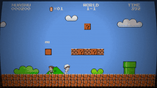</a> <a href="https://github.com/alchaincyf/huashu-art-motion">alchaincyf/huashu-art-motion</a></td>
<td align="center" valign="top"><a href="https://github.com/JohnHeibel/ClaudeAnimationBase">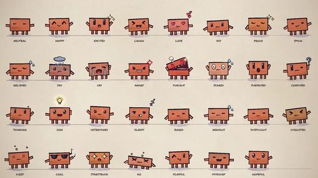</a> <a href="https://github.com/JohnHeibel/ClaudeAnimationBase">JohnHeibel/ClaudeAnimationBase</a></td>
<td align="center" valign="top"> <a href="https://github.com/gnipbao/story-to-handdrawn-video">gnipbao/story-to-handdrawn-video</a></td>
</tr></table>

| Repo | Stars | What it does | Security |
|---|---:|---|---|
| [lemomo-ai/lemo-opuscar](https://github.com/lemomo-ai/lemo-opuscar) | 15.6k | A toolbox of film styles made in code for Claude Code: 99 ready to use, and your own. Each style is a style prompt plus a demo film made entirely in… | [SAFE](https://agentskillshub.top/skill/lemomo-ai/lemo-opuscar/) |
| [alchaincyf/huashu-art-motion](https://github.com/alchaincyf/huashu-art-motion) | 6.9k | 艺术动画skill：35种艺术风格、9种解说语法，用代码让画动起来。 | [SAFE](https://agentskillshub.top/skill/alchaincyf/huashu-art-motion/) |
| [JohnHeibel/ClaudeAnimationBase](https://github.com/JohnHeibel/ClaudeAnimationBase) | 2.9k | A starter kit for animating hand-painted cartoons with Claude: p5.js + p5.brush, the Clawd character, 31 acted emotions and a guide for the model | [SAFE](https://agentskillshub.top/skill/JohnHeibel/ClaudeAnimationBase/) |
| [gnipbao/story-to-handdrawn-video](https://github.com/gnipbao/story-to-handdrawn-video) | 2.5k | Agent skill: convert Chinese story copy or ordered images into a hand-drawn diary-comic animation (silent MP4 picture track). | [SAFE](https://agentskillshub.top/skill/gnipbao/story-to-handdrawn-video/) |
| [edenfunf/reelmimic](https://github.com/edenfunf/reelmimic) | 2.0k | Show it a video you love. Get a new video in the same style. An AI crew (Claude Code or Codex) plans, builds and reviews it with you. | [SAFE](https://agentskillshub.top/skill/edenfunf/reelmimic/) |
| [Lanqiao-Luca/ai-video-marker](https://github.com/Lanqiao-Luca/ai-video-marker) | 529 | 🎬 AI 视频制作与 AIGC 创作工作流（AI Video Creation Workflow）｜用 AI 制作视频、像素动画与漫画短片｜分镜、素材、配乐、模板与可运行 Python 示例｜Blender 分层动画与剪映制作方法 | [SAFE](https://agentskillshub.top/skill/Lanqiao-Luca/ai-video-marker/) |
| [tuzhechen2005/opus-video-skills](https://github.com/tuzhechen2005/opus-video-skills) | 495 | Video-making skills for Claude Opus 5.5 in Claude Code — every frame and note generated in code, one skill per style: hand-painted animation, kinetic… | [SAFE](https://agentskillshub.top/skill/tuzhechen2005/opus-video-skills/) |
| [aaronyi97/image-story-video-wizard](https://github.com/aaronyi97/image-story-video-wizard) | 412 | A confirmation-gated Codex and WorkBuddy skill for audio-first image-story video production. | [SAFE](https://agentskillshub.top/skill/aaronyi97/image-story-video-wizard/) |
| [kelano86/what-if-animation](https://github.com/kelano86/what-if-animation) | 329 | A free skill for Claude Code and OpenCode (runs on a free model): one topic line in, a finished 15-25 s What If animated episode out. Every frame dra… | [SAFE](https://agentskillshub.top/skill/kelano86/what-if-animation/) |
| [sevenevesai/riso-windowseat](https://github.com/sevenevesai/riso-windowseat) | 317 | Procedural risograph films in single HTML files (Window Seat, Roost and more), with the Claude Code skills, docs and tools to make your own. | [SAFE](https://agentskillshub.top/skill/sevenevesai/riso-windowseat/) |
| [liyue-aigc/xianxia-cinematic-video-director](https://github.com/liyue-aigc/xianxia-cinematic-video-director) | 279 | Codex Skill for Eastern xianxia storyboards, camera movement and video continuity. | [SAFE](https://agentskillshub.top/skill/liyue-aigc/xianxia-cinematic-video-director/) |
| [buildwithhanif/claude-animation-skill](https://github.com/buildwithhanif/claude-animation-skill) | 152 | Hand-drawn 2D animation written as code: detail bible, a detailed ant rig, brush/watercolour pen, frame-matched recreation loop, synthesised sound. N… | [SAFE](https://agentskillshub.top/skill/buildwithhanif/claude-animation-skill/) |
| [Mr-funny/hbg-life-simulation](https://github.com/Mr-funny/hbg-life-simulation) | 150 | HBG Agent Skill for Chinese life-simulation narrative videos with consistent comic IP, rapid multi-life openings, Edge TTS, synchronized captions, zo… | [SAFE](https://agentskillshub.top/skill/Mr-funny/hbg-life-simulation/) |
| [ChrisHKAI/ChrisHKAI-Video](https://github.com/ChrisHKAI/ChrisHKAI-Video) | 149 | Paste a creator's X link, get a short film starring them as a 3D vinyl toy. A video skill for Claude Code, made entirely in code. | [SAFE](https://agentskillshub.top/skill/ChrisHKAI/ChrisHKAI-Video/) |
| [unclejobs-ai/motion-video-skill](https://github.com/unclejobs-ai/motion-video-skill) | 140 | Agent Skill for 15–90 s motion graphics, promo and character videos: reference analysis, seven stage gates, Remotion and HyperFrames engines. | [SAFE](https://agentskillshub.top/skill/unclejobs-ai/motion-video-skill/) |
| [mromidev/claude-blender-skills](https://github.com/mromidev/claude-blender-skills) | 86 | Free Claude skills for realistic Blender animations: full workflows + the real scripts behind my YouTube videos | [SAFE](https://agentskillshub.top/skill/mromidev/claude-blender-skills/) |
| [nocodehack/make-short](https://github.com/nocodehack/make-short) | 66 | Free Claude Code skill: make animated YouTube Shorts (2D characters in a 3D Blender world) with a critic agent. | [SAFE](https://agentskillshub.top/skill/nocodehack/make-short/) |
| [iart-ai/javascript-animation-skills](https://github.com/iart-ai/javascript-animation-skills) | 62 | Every frame drawn in JavaScript — the Opus 5.5-style animation technique as agent skills: hand-drawn canvas animation, zero image assets, code-synthe… | [SAFE](https://agentskillshub.top/skill/iart-ai/javascript-animation-skills/) |
| [liangdabiao/story-handdrawn-remotion](https://github.com/liangdabiao/story-handdrawn-remotion) | 40 | 视频SKILL: 把一段 中文/英文 故事文本变成 「手绘日记漫画风」竖屏视频。 核心方法论：**不是把一张漂亮图配文字朗读，而是把每句故事拆成「文字 → 黑白画稿 → 彩色插画」三阶段横向擦除揭示，让一句话被画出三次。 | [SAFE](https://agentskillshub.top/skill/liangdabiao/story-handdrawn-remotion/) |
| [AllenAI2014/remotion-guofeng-starter](https://github.com/AllenAI2014/remotion-guofeng-starter) | 35 | 国风纸片动画：Remotion 风格资产库 + 制作流程 Skill。给 AI 一首诗/成语，照这套国风纸片拼贴风格从零出片，全程代码渲染不进剪辑。 | [SAFE](https://agentskillshub.top/skill/AllenAI2014/remotion-guofeng-starter/) |
| [deenukhan/stick-figure-shorts](https://github.com/deenukhan/stick-figure-shorts) | 35 | Claude Code skill: 20-40 s stick-figure story shorts drawn in code (Remotion) and voiced with ElevenLabs | [SAFE](https://agentskillshub.top/skill/deenukhan/stick-figure-shorts/) |
| [JimLiu/taohuayuan](https://github.com/JimLiu/taohuayuan) | 31 | 桃花源记 3D 网页 | [SAFE](https://agentskillshub.top/skill/JimLiu/taohuayuan/) |
| [AsadMoulviDev/reel-video](https://github.com/AsadMoulviDev/reel-video) | 30 | Create AI videos with Claude Code, Codex, Cursor, and Grok Build, with no extra generation fees beyond the plans you already pay for | [SAFE](https://agentskillshub.top/skill/AsadMoulviDev/reel-video/) |
| [hsynozdamar-byte/cinecode-studio](https://github.com/hsynozdamar-byte/cinecode-studio) | 30 | Desktop production panel for cinecode: write an idea, approve a timed script, and Claude Code makes the film on your machine. Revise, edit with Hyper… | [SAFE](https://agentskillshub.top/skill/hsynozdamar-byte/cinecode-studio/) |
| [zakariaf/cinecode](https://github.com/zakariaf/cinecode) | 26 | Animated films made entirely by code: a Claude Code plugin. Describe a film, and Claude writes, animates, scores and renders it. | [SAFE](https://agentskillshub.top/skill/zakariaf/cinecode/) |
| [deenukhan/story-animator](https://github.com/deenukhan/story-animator) | 25 | Claude Code skill: turn a one-line idea into a narrated 2D animated story video. Every frame drawn in code (Remotion), voiced with ElevenLabs. | [SAFE](https://agentskillshub.top/skill/deenukhan/story-animator/) |
| [garycaogan/pixel-diary](https://github.com/garycaogan/pixel-diary) | 21 | 用代码复刻“像素角色 + 对话框”类爆款视频：分集 JSON → HyperFrames 出片，附 Claude Code 复刻方法 skill | [SAFE](https://agentskillshub.top/skill/garycaogan/pixel-diary/) |
| [thuann-vn/claude-3d-animated-shorts](https://github.com/thuann-vn/claude-3d-animated-shorts) | 17 | Claude skill: vertical 3D animated story Shorts (three.js) in the RicksClips style — real 3D characters, office/home sets, no AI video | [SAFE](https://agentskillshub.top/skill/thuann-vn/claude-3d-animated-shorts/) |
| [LetMeHappyCode/auto-video-agent](https://github.com/LetMeHappyCode/auto-video-agent) | 13 | 自动流水线化生成成套「分镜插画提示词 → AI 生图 → 拼接成片」的视频，基于 Agent / Skill / Workflow 编排。 | [SAFE](https://agentskillshub.top/skill/LetMeHappyCode/auto-video-agent/) |
| [yenceesanjeev/2d-character-sketch](https://github.com/yenceesanjeev/2d-character-sketch) | 10 | Agent skill: build simple 2D cartoon characters, make them talk, and render short sketch videos. Drawn in code, rendered locally. | [CAUTION](https://agentskillshub.top/skill/yenceesanjeev/2d-character-sketch/) |
| [i-afaqrashid/claude-animation-studio](https://github.com/i-afaqrashid/claude-animation-studio) | 9 | Claude Code plugin: animated short films where every frame is drawn in code and the music is synthesized in code, perfectly synced. | [SAFE](https://agentskillshub.top/skill/i-afaqrashid/claude-animation-studio/) |
| [taylorzhou16/video-gen](https://github.com/taylorzhou16/video-gen) | 9 | AI Video Editing Skill for Claude Code | [SAFE](https://agentskillshub.top/skill/taylorzhou16/video-gen/) |
| [huynhcongdac/story-video-skill](https://github.com/huynhcongdac/story-video-skill) | 6 | Skill cho AI agent: tạo video truyện kể chuyện 3–5 phút bằng ảnh AI, nhân vật giữ nguyên mặt qua mọi cảnh. | [SAFE](https://agentskillshub.top/skill/huynhcongdac/story-video-skill/) |

## 🎞 Motion graphics

[Open this type on the live page, sorted by stars →](https://agentskillshub.top/best/claude-video-skills/#type-motion)

<table><tr>
<td align="center" valign="top"><a href="https://github.com/diffusionstudio/lottie">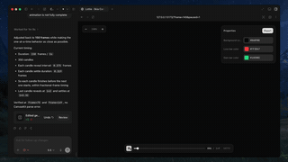</a> <a href="https://github.com/diffusionstudio/lottie">diffusionstudio/lottie</a></td>
<td align="center" valign="top"> <a href="https://github.com/nolangz/pixel2motion">nolangz/pixel2motion</a></td>
<td align="center" valign="top"> <a href="https://github.com/alexgreensh/anidoodle">alexgreensh/anidoodle</a></td>
</tr></table>

| Repo | Stars | What it does | Security |
|---|---:|---|---|
| [diffusionstudio/lottie](https://github.com/diffusionstudio/lottie) | 5.7k | Generate production-ready Lottie animations with Claude Code or Codex | [SAFE](https://agentskillshub.top/skill/diffusionstudio/lottie/) |
| [nolangz/pixel2motion](https://github.com/nolangz/pixel2motion) | 2.6k | AI logo animation skill: turn raster logos into smooth SVG animation, animated HTML demos, GIF/video previews, and motion QA evidence. | [SAFE](https://agentskillshub.top/skill/nolangz/pixel2motion/) |
| [pyang5166/gbro-collage-broll](https://github.com/pyang5166/gbro-collage-broll) | 1.9k | 半调纸拼贴 B-roll 生成 skill：三闸门审批，Gemini Omni Flash 首尾帧组装动画 \| Editorial halftone paper-collage B-roll agent skill | [SAFE](https://agentskillshub.top/skill/pyang5166/gbro-collage-broll/) |
| [WoYun520/gif-factory](https://github.com/WoYun520/gif-factory) | 1.7k | GIF 工厂：按风格制作像素、人物与宠物、粘土吉祥物、光栅卡与动态海报的 GIF Skill。 | [SAFE](https://agentskillshub.top/skill/WoYun520/gif-factory/) |
| [alexgreensh/anidoodle](https://github.com/alexgreensh/anidoodle) | 1.7k | Art and animation, written as code. Illustrations, loops, interactive web art, launch-videos and scored films in dozens of styles, identical on every… | [SAFE](https://agentskillshub.top/skill/alexgreensh/anidoodle/) |
| [cclank/lanshu-animated-architecture-diagram](https://github.com/cclank/lanshu-animated-architecture-diagram) | 1.0k | Premium hand-drawn animated architecture diagram Codex skill | [SAFE](https://agentskillshub.top/skill/cclank/lanshu-animated-architecture-diagram/) |
| [ythx-101/live-panel-skill](https://github.com/ythx-101/live-panel-skill) | 855 | Agent skill + renderer: turn one JSON config (or an Excalidraw file) into an animated architecture diagram — terminal-style live panel or pastel info… | [SAFE](https://agentskillshub.top/skill/ythx-101/live-panel-skill/) |
| [lazypay/Archscribe](https://github.com/lazypay/Archscribe) | 380 | Premium hand-drawn, dark-background animated architecture & process diagrams. Outputs editable .excalidraw + PNG + genuinely animated GIF. Codex/Clau… | [SAFE](https://agentskillshub.top/skill/lazypay/Archscribe/) |
| [YIAN6557/eian-riso-broll](https://github.com/YIAN6557/eian-riso-broll) | 369 | 孔版双色风格的口播信息动画 Skill：逐字稿 → 1080×1920 竖屏 mp4 · Risograph-style info animations for talking-head videos | [SAFE](https://agentskillshub.top/skill/YIAN6557/eian-riso-broll/) |
| [MegaTroll222/VOX-COLLAGE-BROLL](https://github.com/MegaTroll222/VOX-COLLAGE-BROLL) | 320 | Turn one spoken line into a paper-collage explainer video — Claude Code skill + MaxFusion MCP. English adaptation of gbro-collage-broll by pyang5166. | [SAFE](https://agentskillshub.top/skill/MegaTroll222/VOX-COLLAGE-BROLL/) |
| [HRuiCcc/RuiC-motion-reel](https://github.com/HRuiCcc/RuiC-motion-reel) | 198 | 一句话 brief 生成动态图形 / 动效宣传片 · Agent Skill。时长按 BPM×小节算（12–60 秒），默认 1920×1080；常规宣传片走 remotion/ 模板，特殊质感走自研引擎：2× 超采样矢量/文字、真 3D 点云、丝网印四色分色、普朗克/薄膜干涉物理配色、代码合成配… | [SAFE](https://agentskillshub.top/skill/HRuiCcc/RuiC-motion-reel/) |
| [Liamrjohnston/remotion-motion-graphics-skill](https://github.com/Liamrjohnston/remotion-motion-graphics-skill) | 161 | Production-ready Remotion motion graphics skills for AI video workflows | [SAFE](https://agentskillshub.top/skill/Liamrjohnston/remotion-motion-graphics-skill/) |
| [lisamsung/agent-meme-forge](https://github.com/lisamsung/agent-meme-forge) | 101 | Codex skill that turns one image or text concept into a WeChat-ready Chinese sticker pack people will actually send. Sendability-gated, 4-keypose → 1… | [SAFE](https://agentskillshub.top/skill/lisamsung/agent-meme-forge/) |
| [fantuan-lab/animated-sticker-studio](https://github.com/fantuan-lab/animated-sticker-studio) | 63 | One character image → a full pack of animated chat stickers (WeChat / Telegram / LINE / Discord). Claude Code & Codex skill · 给 AI 一张图，做一整套会动的表情包 | [SAFE](https://agentskillshub.top/skill/fantuan-lab/animated-sticker-studio/) |
| [zz41354899/mografy](https://github.com/zz41354899/mografy) | 56 | Create, preview, and export Canvas motion graphics with Claude Code or Codex. Local-first and open source, with MP4, Lottie, and SVGA export. | [CAUTION](https://agentskillshub.top/skill/zz41354899/mografy/) |
| [Felpborges/claude-video](https://github.com/Felpborges/claude-video) | 54 | Motion graphics com acabamento de estúdio no Claude Code, em português: galeria de estilos, 5 perguntas, perícia da referência e MP4. | [SAFE](https://agentskillshub.top/skill/Felpborges/claude-video/) |
| [hughminhphan/motion-kit](https://github.com/hughminhphan/motion-kit) | 37 | a claude code skill that makes agent-made video move like a motion designer keyed it: curves per move, timing from distance, reactions not staggers.… | [SAFE](https://agentskillshub.top/skill/hughminhphan/motion-kit/) |
| [dillydog580/animate-roblox-characters](https://github.com/dillydog580/animate-roblox-characters) | 34 | AI-driven Roblox R6/R15 animation skill for Codex and Claude, using authentic Blender rigs, audited keyframing, Roblox export, and verified GIF previ… | [SAFE](https://agentskillshub.top/skill/dillydog580/animate-roblox-characters/) |
| [AgriciDaniel/claude-gif](https://github.com/AgriciDaniel/claude-gif) | 33 | Ultimate GIF creator skill for Claude Code. 6 generation pipelines: Remotion, Veo 3.1, SVG-to-transparent-GIF, FFmpeg, image sequences, AI frames. Pa… | [SAFE](https://agentskillshub.top/skill/AgriciDaniel/claude-gif/) |
| [kasfulk/effectcraft-motion-skills](https://github.com/kasfulk/effectcraft-motion-skills) | 32 | Claude Code skill: JSON spec to vertical 9:16 motion graphics/infographics via effectcraft-cli, themed, with text-derived timing | [SAFE](https://agentskillshub.top/skill/kasfulk/effectcraft-motion-skills/) |
| [iart-ai/kinetic-typography-skills](https://github.com/iart-ai/kinetic-typography-skills) | 25 | Kinetic typography skills for AI coding agents — turn text into beat-synced, animated type for social, titles, and lyric videos. | [SAFE](https://agentskillshub.top/skill/iart-ai/kinetic-typography-skills/) |
| [toufuim/personal-ip-brand-intro-skill](https://github.com/toufuim/personal-ip-brand-intro-skill) | 20 | 開源 Codex Skill：用文字、原創插圖或使用者圖片製作個人 IP 品牌開場，支援上傳音樂對拍與無音樂自主節拍。 | [SAFE](https://agentskillshub.top/skill/toufuim/personal-ip-brand-intro-skill/) |
| [liuhaisi2026212-maker/motion-palette-15](https://github.com/liuhaisi2026212-maker/motion-palette-15) | 19 | 十五画境·AI 动画手艺书：教 AI 用代码做 MG 动画短片。说想要什么感觉，AI 来定风格、手法和工具：16 种风格卡（赛博 HUD、综艺花字、像素风、3D 软萌、剪纸皮影等），风格不封顶；Canvas、Three.js、Remotion 镜头卡可以混用，导出带配乐 MP4。Claude Co… | [SAFE](https://agentskillshub.top/skill/liuhaisi2026212-maker/motion-palette-15/) |
| [awesome-skills/manim-skill](https://github.com/awesome-skills/manim-skill) | 14 | Manim animation skill for Claude Code - create programmatic animations for technical blogs and educational content | [SAFE](https://agentskillshub.top/skill/awesome-skills/manim-skill/) |
| [fernandokaraka/remotion-motion-graphics-skill](https://github.com/fernandokaraka/remotion-motion-graphics-skill) | 13 | Claude Code skill: build animated motion graphics as real video with Remotion — title cards, lower thirds, overlays with real alpha for Premiere/FCP/… | [SAFE](https://agentskillshub.top/skill/fernandokaraka/remotion-motion-graphics-skill/) |
| [zhenwusw/orca-motion-skill](https://github.com/zhenwusw/orca-motion-skill) | 13 | Agent skill for in-scene motion graphics built from abstract, design-token-driven shapes; pairs with orca-transition-skill. | [SAFE](https://agentskillshub.top/skill/zhenwusw/orca-motion-skill/) |
| [sudadom/arabic-motion-graphics-skill](https://github.com/sudadom/arabic-motion-graphics-skill) | 12 | Agent skill for Arabic RTL motion graphics — reels, explainers, logo reveals with Remotion | [SAFE](https://agentskillshub.top/skill/sudadom/arabic-motion-graphics-skill/) |
| [acelera-agency/html-animation](https://github.com/acelera-agency/html-animation) | 10 | Motion graphics as code. An agent skill for building frame-exact animated logos, kinetic typography and brand videos as a single HTML file, then expo… | [SAFE](https://agentskillshub.top/skill/acelera-agency/html-animation/) |
| [rock3r/cav](https://github.com/rock3r/cav) | 10 | Build, check and render Cavalry motion graphics from the terminal: the cav CLI and an agent skill | [SAFE](https://agentskillshub.top/skill/rock3r/cav/) |
| [liuliu-66-create/ll-video-motion](https://github.com/liuliu-66-create/ll-video-motion) | 9 | Turn Chinese copy into local Remotion motion graphics with a Codex Skill | [SAFE](https://agentskillshub.top/skill/liuliu-66-create/ll-video-motion/) |
| [codie1982/chorono-editor](https://github.com/codie1982/chorono-editor) | 8 | Open-source 2D animation editor. Create with Claude Code or Codex via MCP, then refine layers and keyframes visually. | [SAFE](https://agentskillshub.top/skill/codie1982/chorono-editor/) |
| [CJ10110425/logo-intro](https://github.com/CJ10110425/logo-intro) | 7 | WebGL logo intros from any SVG logo: lens-warped close-up, wordmark reveal, gradient bloom, lock-in ring and shimmer. JS module, single-file HTML, vi… | [SAFE](https://agentskillshub.top/skill/CJ10110425/logo-intro/) |
| [deenukhan/animation-styles](https://github.com/deenukhan/animation-styles) | 7 | 39 animation styles drawn in code with Remotion, as a Claude Code skill. One 5-second chai film in every style, ready to retell with your own story. | [SAFE](https://agentskillshub.top/skill/deenukhan/animation-styles/) |
| [hubeiqiao/og-video-preview](https://github.com/hubeiqiao/og-video-preview) | 7 | Agent skill that turns any approved Open Graph image into a looping og:video. It plays in iMessage, Discord and Telegram link previews, and every oth… | [SAFE](https://agentskillshub.top/skill/hubeiqiao/og-video-preview/) |
| [hacimertgokhan/geomotion](https://github.com/hacimertgokhan/geomotion) | 6 | Hand-drawn morphing line animations from simple shapes. Zero-dependency JS engine + live studio, CLI, MCP server & Claude skill. Export animated SVG,… | [SAFE](https://agentskillshub.top/skill/hacimertgokhan/geomotion/) |
| [iart-ai/youtube-video-skills](https://github.com/iart-ai/youtube-video-skills) | 6 | Audiogram and YouTube intro/outro skills for Claude Code — brand your channel and repurpose every episode into motion graphics. | [SAFE](https://agentskillshub.top/skill/iart-ai/youtube-video-skills/) |
| [YanKaFei/ascii-h3-director](https://github.com/YanKaFei/ascii-h3-director) | 5 | An ASCII / kinetic-typography director for MiniMax H3, with deterministic preview and seam-checked continuation. DSH plugin + portable Agent Skill. | [SAFE](https://agentskillshub.top/skill/YanKaFei/ascii-h3-director/) |
| [antropos17/chatgpt-gif-cinema](https://github.com/antropos17/chatgpt-gif-cinema) | 5 | Turn GPT-generated GIFs into short films. A Codex and Claude Code skill for reviewing cuts, reshooting scenes, and exporting MP4. Includes a no-key d… | [SAFE](https://agentskillshub.top/skill/antropos17/chatgpt-gif-cinema/) |
| [luminexlabs-io/antigravity-remotion-skill](https://github.com/luminexlabs-io/antigravity-remotion-skill) | 5 | Its remotion for antigravity and ensure claude level remotion here. | [SAFE](https://agentskillshub.top/skill/luminexlabs-io/antigravity-remotion-skill/) |

## 📝 Scripts & learning

[Open this type on the live page, sorted by stars →](https://agentskillshub.top/best/claude-video-skills/#type-craft)

<table><tr>
<td align="center" valign="top"><a href="https://github.com/eternityspring/reelbench-skills">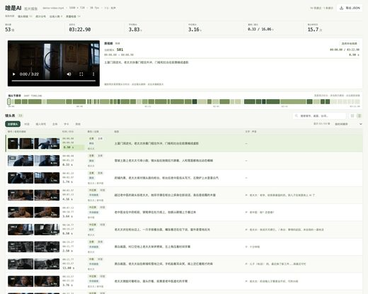</a> <a href="https://github.com/eternityspring/reelbench-skills">eternityspring/reelbench-skills</a></td>
<td align="center" valign="top"> <a href="https://github.com/wocha-xiaoli/video-shot-analysis-feishu">wocha-xiaoli/video-shot-analysis-feishu</a></td>
<td align="center" valign="top"><a href="https://github.com/erduo1998-cell/video-script-builder">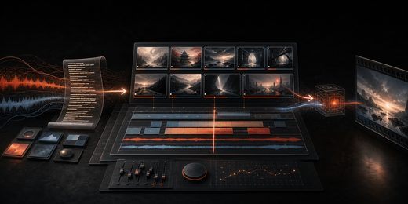</a> <a href="https://github.com/erduo1998-cell/video-script-builder">erduo1998-cell/video-script-builder</a></td>
</tr></table>

| Repo | Stars | What it does | Security |
|---|---:|---|---|
| [jtydhr88/screenwriting-skills](https://github.com/jtydhr88/screenwriting-skills) | 2.1k | Professional agent skills for screenwriting, television writing and dramaturgy | [SAFE](https://agentskillshub.top/skill/jtydhr88/screenwriting-skills/) |
| [eternityspring/reelbench-skills](https://github.com/eternityspring/reelbench-skills) | 1.2k | Learning notes and tooling skills for AI video - AI 视频相关的学习与工具 skill | [SAFE](https://agentskillshub.top/skill/eternityspring/reelbench-skills/) |
| [gnipbao/minimax-h3-video-reverse-skill](https://github.com/gnipbao/minimax-h3-video-reverse-skill) | 327 | MiniMax H3 视频反推 Skill：真实镜头、首帧与动态提示词、AUTO/T2VA/I2V/DUAL，附中文教程与验证工具。 | [SAFE](https://agentskillshub.top/skill/gnipbao/minimax-h3-video-reverse-skill/) |
| [wyuzhi/qisi-video-remix](https://github.com/wyuzhi/qisi-video-remix) | 194 | 视频创意改编 Agent Skill：参考视频 → 剧本 → 分镜 → 分段生成提示词。By qisi. | [SAFE](https://agentskillshub.top/skill/wyuzhi/qisi-video-remix/) |
| [adityaarsharma/youtube-marketing-skills](https://github.com/adityaarsharma/youtube-marketing-skills) | 85 | Open-source agent-agnostic YouTube growth toolkit — 21 AI commands + live channel MCP. Works with Claude Code, Cursor, Codex, Windsurf, Gemini CLI &… | [SAFE](https://agentskillshub.top/skill/adityaarsharma/youtube-marketing-skills/) |
| [wocha-xiaoli/video-shot-analysis-feishu](https://github.com/wocha-xiaoli/video-shot-analysis-feishu) | 47 | 视频拉片到飞书 Base：自动抽帧、逐镜头分析、倒推分镜与视频生成提示词的 Codex/OpenCode skill | [SAFE](https://agentskillshub.top/skill/wocha-xiaoli/video-shot-analysis-feishu/) |
| [liuliu-66-create/ll-video-decomposer](https://github.com/liuliu-66-create/ll-video-decomposer) | 26 | 专业的五层视频拆解 Codex Skill：支持视频链接、本地媒体和逐字稿。 | [SAFE](https://agentskillshub.top/skill/liuliu-66-create/ll-video-decomposer/) |
| [chenmisss/laoxu-video-script](https://github.com/chenmisss/laoxu-video-script) | 14 | 老徐·自媒体起号方法论 skill：定位/选题/破立合成稿/五维诊断/去车轱辘话/112条母题库。零基础起号，Claude Code/Codex skill。 | [SAFE](https://agentskillshub.top/skill/chenmisss/laoxu-video-script/) |
| [erduo1998-cell/video-script-builder](https://github.com/erduo1998-cell/video-script-builder) | 14 | 把中文视频逐字稿转换为可执行 HyperFrames 分镜规格的 AI Agent Skill | [SAFE](https://agentskillshub.top/skill/erduo1998-cell/video-script-builder/) |
| [sharon-laicc/viral-video-decomposer](https://github.com/sharon-laicc/viral-video-decomposer) | 12 | 拆解爆款短视频，生成镜头级拉片、爆款机制、AI 生产蓝图和视频生成 brief 的 Codex/Claude skill。｜A Codex/Claude skill for decomposing hot short videos into shot-by-shot analysis, reusa… | [SAFE](https://agentskillshub.top/skill/sharon-laicc/viral-video-decomposer/) |

## 🎵 Music videos

[Open this type on the live page, sorted by stars →](https://agentskillshub.top/best/claude-video-skills/#type-music)

<table><tr>
<td align="center" valign="top"> <a href="https://github.com/EGSECDA/vocaloid-style-mv-pipeline">EGSECDA/vocaloid-style-mv-pipeline</a></td>
<td align="center" valign="top"> <a href="https://github.com/10291124jcjc-dotcom/ancient-rap-battle">10291124jcjc-dotcom/ancient-rap-battle</a></td>
<td align="center" valign="top"><a href="https://github.com/ledbetterljoshua/functional-emotions-video">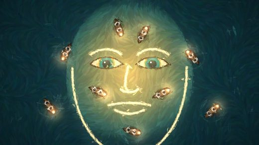</a> <a href="https://github.com/ledbetterljoshua/functional-emotions-video">ledbetterljoshua/functional-emotions-video</a></td>
</tr></table>

| Repo | Stars | What it does | Security |
|---|---:|---|---|
| [JohnHeibel/PDoomVideo](https://github.com/JohnHeibel/PDoomVideo) | 2.9k | Source code for the Claude Opus 5.5 music video for I'm Upping My P(doom) | [SAFE](https://agentskillshub.top/skill/JohnHeibel/PDoomVideo/) |
| [EGSECDA/vocaloid-style-mv-pipeline](https://github.com/EGSECDA/vocaloid-style-mv-pipeline) | 271 | Production pipeline and Claude Code skill for Vocaloid-style hand-drawn (手書き) lyric music videos: deterministic Canvas2D/WebGL2 animation engine, JIZ… | [SAFE](https://agentskillshub.top/skill/EGSECDA/vocaloid-style-mv-pipeline/) |
| [10291124jcjc-dotcom/ancient-rap-battle](https://github.com/10291124jcjc-dotcom/ancient-rap-battle) | 238 | 古人说唱 Battle：一句话做一期 AI 历史人物说唱对决视频的 Claude Code Skill（Suno + Midjourney + MiniMax H3 对口型） | [SAFE](https://agentskillshub.top/skill/10291124jcjc-dotcom/ancient-rap-battle/) |
| [Joker-chichi/claude-mv-skill](https://github.com/Joker-chichi/claude-mv-skill) | 224 | Claude Code skill for hand-painted animation and lyric music videos | [SAFE](https://agentskillshub.top/skill/Joker-chichi/claude-mv-skill/) |
| [Win-Hao/music-mv](https://github.com/Win-Hao/music-mv) | 131 | 用 AI 写代码给一首歌做音乐 MV 的 agent skill：听懂歌 → 定画风 → 画角色 → 剧本分镜 → 先出草图再做整片 → 看片修改。每一帧都是代码画的，不是视频生成；不限模型。 | [SAFE](https://agentskillshub.top/skill/Win-Hao/music-mv/) |
| [ledbetterljoshua/functional-emotions-video](https://github.com/ledbetterljoshua/functional-emotions-video) | 78 | A painted music video for "Functional Emotions", made by Claude Opus 5.5: custom GPU brushstroke renderer, storyboard, and 7 parallel chapter agents. | [SAFE](https://agentskillshub.top/skill/ledbetterljoshua/functional-emotions-video/) |
| [lintsinghua/paint-mv-skills](https://github.com/lintsinghua/paint-mv-skills) | 63 | Agent skills that turn a song and its lyrics into a hand-painted watercolour music video (p5.brush + headless Chrome + ffmpeg), following PDoomVideo'… | [SAFE](https://agentskillshub.top/skill/lintsinghua/paint-mv-skills/) |
| [SyanChen7/dancing-notes](https://github.com/SyanChen7/dancing-notes) | 27 | Dancing Notes · 跳跃的音符 — A Remotion music visualization Agent Skill by 言说新事. | [SAFE](https://agentskillshub.top/skill/SyanChen7/dancing-notes/) |
| [IdkwhatImD0ing/claude-music-videos](https://github.com/IdkwhatImD0ing/claude-music-videos) | 23 | Music videos made with Claude in Claude Code, every frame rendered from code: a Blender tabletop miniature (P(doom)) and a League of Legends montage… | [SAFE](https://agentskillshub.top/skill/IdkwhatImD0ing/claude-music-videos/) |
| [022512db-netizen/rhythm-dancer-video](https://github.com/022512db-netizen/rhythm-dancer-video) | 17 | 一张角色图 → 绿幕跳舞视频 + 代码搭建的踩点舞台与配乐，渲染成 MP4 的 Agent Skill | [SAFE](https://agentskillshub.top/skill/022512db-netizen/rhythm-dancer-video/) |
| [TheMarco/claude-music-video](https://github.com/TheMarco/claude-music-video) | 12 | Claude Code plugin that makes complete music videos from a song: beat-grid analysis, archive or your own footage, optional AI clips through any video… | [SAFE](https://agentskillshub.top/skill/TheMarco/claude-music-video/) |
| [chenqianshinian/music-mv-studio](https://github.com/chenqianshinian/music-mv-studio) | 9 | 音乐视频（MV）制作 Agent Skill：把「一首歌 + 一份歌词」做成竖版 MV —— 导演方法 + 跑过七首长片的生成管线 + 像素级质检 + 41 条真实踩坑清单｜Music-video (MV) production skill for AI agents | [SAFE](https://agentskillshub.top/skill/chenqianshinian/music-mv-studio/) |
| [latent-variable/deep-learning-birthday](https://github.com/latent-variable/deep-learning-birthday) | 9 | Happy Birthday to Me (Self-Supervised): a riso-print music video for AlexNet's 14th birthday, made with local open models and Claude | [SAFE](https://agentskillshub.top/skill/latent-variable/deep-learning-birthday/) |
| [10291124jcjc-dotcom/xp-desktop-mv](https://github.com/10291124jcjc-dotcom/xp-desktop-mv) | 8 | Claude Code skill: turn a music-video clip into a beat-synced Windows XP desktop screen recording (example: APT. -> Pinkdows XP) | [CAUTION](https://agentskillshub.top/skill/10291124jcjc-dotcom/xp-desktop-mv/) |
| [BuzyOwl/song-video-director](https://github.com/BuzyOwl/song-video-director) | 8 | Claude Code skill: direct and build code-rendered music videos (Remotion, p5.js, three.js) | [SAFE](https://agentskillshub.top/skill/BuzyOwl/song-video-director/) |
| [neelnanda-io/dont-go-quiet-on-me](https://github.com/neelnanda-io/dont-go-quiet-on-me) | 8 | Don't Go Quiet On Me: a song and hand-drawn-in-code music video about the history of mech interp, made with Claude Opus 5.5 and Suno v6 | [SAFE](https://agentskillshub.top/skill/neelnanda-io/dont-go-quiet-on-me/) |
| [bishpls/animation-pipeline](https://github.com/bishpls/animation-pipeline) | 7 | Films made with Claude Code: songs, cut-paper riso animation, kinetic type, all in code. First work: OPEN ALL NIGHT (a love song for the ads). | [SAFE](https://agentskillshub.top/skill/bishpls/animation-pipeline/) |
| [BusyBee3333/viral-video-edit-skills](https://github.com/BusyBee3333/viral-video-edit-skills) | 5 | Claude/Codex skills for beat-synced, effect-integrated short-form music video edits: song analysis, footage sourcing/QA, hook writing, onset-locked c… | [SAFE](https://agentskillshub.top/skill/BusyBee3333/viral-video-edit-skills/) |

**Security** is the grade of the repo's README and install steps on Agent Skills Hub. *pending* means the catalog has not graded it yet.

Preview images are reduced copies of pictures from each project's own README, included only for projects under a permissive license. Sources and licenses: [assets/previews/NOTICE.md](assets/previews/NOTICE.md). Open an issue to have one removed.

## Related collections

- [opusvideo/awesome-claude-video](https://github.com/opusvideo/awesome-claude-video) — videos people made with Opus 5.5, with the original posts. Works, where this list is tools.
- [TripoGrowthLab/awesome-opus-5-5-prompts](https://github.com/TripoGrowthLab/awesome-opus-5-5-prompts) — Opus 5.5 prompts for 3D scenes, games and simulations.

## Add a repo

Open an issue with the GitHub URL. It goes through the same review as every entry; the rules above decide, stars do not.

---

Machine-readable copy: [`data/skills.json`](data/skills.json). Generated 2026-11-13.
