# Awesome Claude Video Skills

[English](README.md)

让 **Claude Code、Codex 等编程 agent 做视频**的开源 skill 和工具包:HyperFrames、Remotion、动效、剪辑、讲解、数字人。共 503 个仓库,每个都由 [Agent Skills Hub (agentskillshub.top)](https://agentskillshub.top) 读过 README 并做了安全评级。

带类型筛选的在线页面:**[https://agentskillshub.top/best/claude-video-skills/](https://agentskillshub.top/best/claude-video-skills/)** · 每 8 小时刷新

## 到底装哪个

我们实跑了其中 16 个(16 个出了结果),结论如下。[完整实测结果](#tested)在下面。

- 🥇 **想尽快出一条成片: [explainroo](https://github.com/vincentsch/explainroo)**  
  从需求到带声音的成片只用了 2 分钟，16 个里最快，而且看起来不像默认风格。
- 🥈 **想要一个贯穿全片的创意: [onetake](https://github.com/feitangyuan/onetake)**  
  一滴水不切镜地带出全部五句。想要画面更满的插画风，可以看 motion-video-kit，前提是你能等 22 分钟。
- 🥉 **想用 Remotion 做自己的设计: [skills](https://github.com/remotion-dev/skills)**  
  Remotion 官方的 skill：渲染稳定，4.5 分钟。不给方向时它做出的片子接近默认风格，所以设计方向要你自己给。

**选之前要知道:** hyperframes (这里星数最高的渲染器，15 秒的需求做了 23.5 分钟); motion-graphics (是为真人出镜素材做的，而这条需求没有素材).

不管选哪个：简单的宣传片可能根本不需要 skill。不装 skill 的 Claude Code 用 4.4 分钟做出了一条通过全部检查的成片。skill 的价值在于风格、流程，或者处理你已有的素材。

*不排名次：全部 16 个 skill，以及不装 skill 的 Claude Code，都通过了同样的四项检查（能播放的文件、时长和尺寸符合要求、五句文案都读得到、画面在动）。表格按耗时排列。成片是接近默认风格还是有自己的样子，是我们看图判断的；请自己看成片来判断。*

## 这些工具能做出什么

<table>
<tr>
<td align="center" valign="top" width="33%"><b>🧱 框架与通用工具包</b> 86 个仓库   渲染框架和通用工具包。 <a href="#type-general"><b>查看列表 →</b></a></td>
<td align="center" valign="top" width="33%"><b>📣 产品宣传与演示</b> 90 个仓库   产品发布片、广告和演示视频。 <a href="#type-promo"><b>查看列表 →</b></a></td>
<td align="center" valign="top" width="33%"><b>🎓 讲解科普</b> 88 个仓库   知识讲解、教程和旁白课程。 <a href="#type-explainer"><b>查看列表 →</b></a></td>
</tr>
<tr>
<td align="center" valign="top" width="33%"><b>✂️ 剪辑与后期</b> 61 个仓库   对已有素材做剪辑、字幕、B-roll 和解说。 <a href="#type-editing"><b>查看列表 →</b></a></td>
<td align="center" valign="top" width="33%"><b>📱 短视频与口播</b> 66 个仓库   面向 Reels、Shorts、TikTok、抖音的竖屏视频。 <a href="#type-shorts"><b>查看列表 →</b></a></td>
<td align="center" valign="top" width="33%"><b>🧑‍💼 数字人</b> 9 个仓库  <a href="https://github.com/Kanvis-chen/kanvis-video">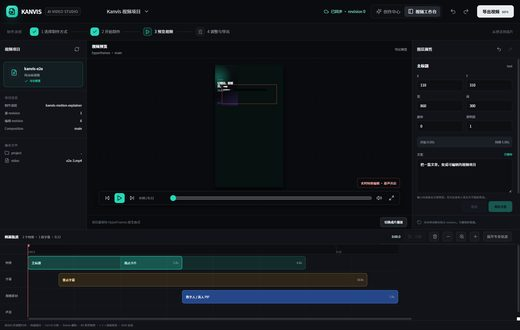</a> 数字人、虚拟主播和口型同步。 <a href="#type-avatar"><b>查看列表 →</b></a></td>
</tr>
<tr>
<td align="center" valign="top" width="33%"><b>📖 故事与动画</b> 35 个仓库   动画故事、短剧和电影感场景。 <a href="#type-story"><b>查看列表 →</b></a></td>
<td align="center" valign="top" width="33%"><b>🎞 动效与 Logo</b> 40 个仓库   Logo 动画、标题、界面动效和 GIF。 <a href="#type-motion"><b>查看列表 →</b></a></td>
<td align="center" valign="top" width="33%"><b>📝 剧本与学习</b> 10 个仓库   视频的前期:剧本、拉片和学习。 <a href="#type-craft"><b>查看列表 →</b></a></td>
</tr>
<tr>
<td align="center" valign="top" width="33%"><b>🎵 音乐视频</b> 18 个仓库   用代码做出来的音乐视频。 <a href="#type-music"><b>查看列表 →</b></a></td>
</tr>
</table>

## 目录

- [用 Claude Opus 5.5 做出来的](#made-with-opus-55)
- [🧪 端到端实测](#tested)
- [🧱 框架与通用工具包](#type-general) (86)
- [📣 产品宣传与演示](#type-promo) (90)
- [🎓 讲解科普](#type-explainer) (88)
- [✂️ 剪辑与后期](#type-editing) (61)
- [📱 短视频与口播](#type-shorts) (66)
- [🧑‍💼 数字人](#type-avatar) (9)
- [📖 故事与动画](#type-story) (35)
- [🎞 动效与 Logo](#type-motion) (40)
- [📝 剧本与学习](#type-craft) (10)
- [🎵 音乐视频](#type-music) (18)

## 什么样的仓库能上榜

1. 它做视频、剪视频或做动效。3D 网页、提示词合集不算。"剧本与学习"一类里的少数条目属于视频的前期(编剧、拉片),由维护者指定收录。
2. 它是给 agent 用的:skill、插件、MCP 服务器,或为 agent 写的工具包。
3. 它有 README。没有 README 就没法评级。
4. 50 星及以上只看是否切题;50 星以下还要过 README 质量线(展示成品、一条命令上手、说清产出、文档完整),并且至少 5 星——点名 Claude Opus 5.5 的除外。

这些问题由决策模型逐个读 README 回答,不是人工挑选。卡在线上的仓库可能判到任一边,归错了请提 issue。

## 🧪 端到端实测

2026-10-11 我们让其中 16 个 skill 在用完即删的沙箱里由 Claude Code（Claude Opus 5.5）调用，做同一条片子：给一个虚构应用做 15 秒宣传片，五句固定的画面文案，1920 x 1080、每秒 30 帧，机器上没有任何视频、图像或语音模型的密钥。不装 skill 的 Claude Code 也做了一条。每个文件查四件事：能播放、时长和尺寸符合要求、每句文案在每秒抽两帧的画面里都读得到、画面在动。片子好不好看不打分，成片就在下面。

**发现:** 16 个全部渲染出了通过四项检查的成片，文案一句没少、也没有多加内容；不装 skill 的 Claude Code 也一样，用了 4.4 分钟。这条需求没有一个用到付费模型。差别在耗时（2.0 到 23.5 分钟）、声音（16 个里 9 个加了声音）和观感：按我们的眼睛看，6 个做出来接近不装 skill 的成片（深青色水面、波浪、白字居中），10 个有自己的样子。

*每条成片的第一句画面;左上角是不装 skill 做的。成片可以在页面上播放。*

| # | Skill | ★ | 通过检查（共 4 项） | 读得到的文案（共 5 句） | 声音 | 观感（肉眼判断） | 制作耗时 |  |
|---|---|---|---|---|---|---|---|---|
| 1 | [explainroo](https://github.com/vincentsch/explainroo) | 523 | 4/4 | 5/5 | 有 | 有自己的样子 | 2.0 分钟 | [证据](https://agentskillshub.top/best-runs/video/vincentsch__explainroo.html) |
| 2 | [remotion-video-skill](https://github.com/wshuyi/remotion-video-skill) | 394 | 4/4 | 5/5 | 无 | 接近不装 skill 的成片 | 3.4 分钟 | [证据](https://agentskillshub.top/best-runs/video/wshuyi__remotion-video-skill.html) |
| 3 | [skills](https://github.com/vibe-motion/skills) | 1,315 | 4/4 | 5/5 | 有 | 有自己的样子 | 4.4 分钟 | [证据](https://agentskillshub.top/best-runs/video/vibe-motion__skills.html) |
| 4 | [skills](https://github.com/remotion-dev/skills) | 5,005 | 4/4 | 5/5 | 无 | 接近不装 skill 的成片 | 4.5 分钟 | [证据](https://agentskillshub.top/best-runs/video/remotion-dev__skills.html) |
| 5 | [motion-graphics](https://github.com/Barty-Bart/motion-graphics) | 580 | 4/4 | 5/5 | 无 | 有自己的样子 | 4.7 分钟 | [证据](https://agentskillshub.top/best-runs/video/Barty-Bart__motion-graphics.html) |
| 6 | [claude-code-video-toolkit](https://github.com/digitalsamba/claude-code-video-toolkit) | 2,198 | 4/4 | 5/5 | 有 | 接近不装 skill 的成片 | 5.5 分钟 | [证据](https://agentskillshub.top/best-runs/video/digitalsamba__claude-code-video-toolkit.html) |
| 7 | [lottie](https://github.com/diffusionstudio/lottie) | 5,493 | 4/4 | 5/5 | 无 | 接近不装 skill 的成片 | 5.6 分钟 | [证据](https://agentskillshub.top/best-runs/video/diffusionstudio__lottie.html) |
| 8 | [hypit](https://github.com/hypit-ai/hypit) | 20,799 | 4/4 | 5/5 | 有 | 接近不装 skill 的成片 | 6.5 分钟 | [证据](https://agentskillshub.top/best-runs/video/hypit-ai__hypit.html) |
| 9 | [motion-skills](https://github.com/iart-ai/motion-skills) | 610 | 4/4 | 5/5 | 有 | 有自己的样子 | 6.5 分钟 | [证据](https://agentskillshub.top/best-runs/video/iart-ai__motion-skills.html) |
| 10 | [motion-graphics-skills](https://github.com/charlie947/motion-graphics-skills) | 174 | 4/4 | 5/5 | 有 | 接近不装 skill 的成片 | 7.0 分钟 | [证据](https://agentskillshub.top/best-runs/video/charlie947__motion-graphics-skills.html) |
| 11 | [claude-motion-design](https://github.com/howseen-ai/claude-motion-design) | 408 | 4/4 | 5/5 | 有 | 有自己的样子 | 7.9 分钟 | [证据](https://agentskillshub.top/best-runs/video/howseen-ai__claude-motion-design.html) |
| 12 | [onetake](https://github.com/feitangyuan/onetake) | 2,080 | 4/4 | 5/5 | 有 | 有自己的样子 | 8.5 分钟 | [证据](https://agentskillshub.top/best-runs/video/feitangyuan__onetake.html) |
| 13 | [OpenMontage](https://github.com/calesthio/OpenMontage) | 64,239 | 4/4 | 5/5 | 无 | 有自己的样子 | 8.6 分钟 | [证据](https://agentskillshub.top/best-runs/video/calesthio__OpenMontage.html) |
| 14 | [guizang-product-video-skill](https://github.com/op7418/guizang-product-video-skill) | 762 | 4/4 | 5/5 | 有 | 有自己的样子 | 8.6 分钟 | [证据](https://agentskillshub.top/best-runs/video/op7418__guizang-product-video-skill.html) |
| 15 | [motion-video-kit](https://github.com/echris6/motion-video-kit) | 1,080 | 4/4 | 5/5 | 无 | 有自己的样子 | 21.8 分钟 | [证据](https://agentskillshub.top/best-runs/video/echris6__motion-video-kit.html) |
| 16 | [hyperframes](https://github.com/heygen-com/hyperframes) | 60,291 | 4/4 | 5/5 | 无 | 有自己的样子 | 23.5 分钟 | [证据](https://agentskillshub.top/best-runs/video/heygen-com__hyperframes.html) |

[全部结果、提示词和脚本](https://github.com/zhuyansen/agent-skills-hub/blob/main/ops/video-runs/RESULTS.md) · [https://agentskillshub.top/best/claude-video-skills/#test-results](https://agentskillshub.top/best/claude-video-skills/#test-results)

## 用 Claude Opus 5.5 做出来的

README 写明用这个模型做的项目。

| 仓库 | 星数 | 做什么 | 安全评级 |
|---|---:|---|---|
| [lemomo-ai/lemo-opuscar](https://github.com/lemomo-ai/lemo-opuscar) | 15.9k | Opus 5.5 x 39 种影片风格：风格提示词 + 纯代码样片 + 导演与技术指南 | [SAFE](https://agentskillshub.top/skill/lemomo-ai/lemo-opuscar/) |
| [JohnHeibel/ClaudeAnimationBase](https://github.com/JohnHeibel/ClaudeAnimationBase) | 3.0k | 用 Claude 制作手绘卡通动画的入门套件：p5.js + p5.brush、Clawd 角色、31 种表演情绪和给模型的指南 | [SAFE](https://agentskillshub.top/skill/JohnHeibel/ClaudeAnimationBase/) |
| [JohnHeibel/PDoomVideo](https://github.com/JohnHeibel/PDoomVideo) | 2.9k | Claude Opus 5.5 音乐视频《I'm Upping My P(doom)》的源代码 | [SAFE](https://agentskillshub.top/skill/JohnHeibel/PDoomVideo/) |
| [ledbetterljoshua/functional-emotions-video](https://github.com/ledbetterljoshua/functional-emotions-video) | 79 | Claude Opus 5.5 制作的《Functional Emotions》手绘风音乐视频：自研 GPU 笔触渲染器、7 个并行章节 agent | [SAFE](https://agentskillshub.top/skill/ledbetterljoshua/functional-emotions-video/) |

## 🧱 框架与通用工具包

[在在线页面打开这一类,按星数排序 →](https://agentskillshub.top/best/claude-video-skills/#type-general)

<table><tr>
<td align="center" valign="top"><a href="https://github.com/heygen-com/hyperframes">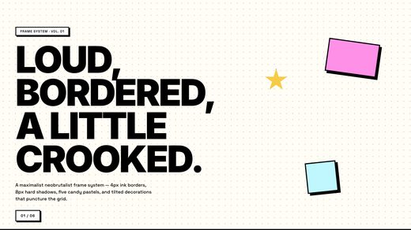</a> <a href="https://github.com/heygen-com/hyperframes">heygen-com/hyperframes</a></td>
<td align="center" valign="top"><a href="https://github.com/digitalsamba/claude-code-video-toolkit">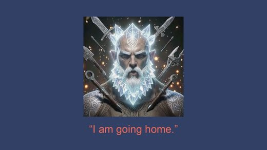</a> <a href="https://github.com/digitalsamba/claude-code-video-toolkit">digitalsamba/claude-code-video-toolkit</a></td>
<td align="center" valign="top"><a href="https://github.com/bangtutorial/bang-motion">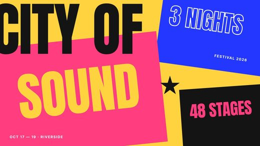</a> <a href="https://github.com/bangtutorial/bang-motion">bangtutorial/bang-motion</a></td>
</tr></table>

| 仓库 | 星数 | 做什么 | 安全评级 |
|---|---:|---|---|
| [heygen-com/hyperframes](https://github.com/heygen-com/hyperframes) | 84.2k | 写 HTML，渲染成视频，为 agent 而建 | [SAFE](https://agentskillshub.top/skill/heygen-com/hyperframes/) |
| [OpenMontageInc/OpenMontage](https://github.com/OpenMontageInc/OpenMontage) | 80.4k | 开源的 agent 视频制作系统：12 条制作流水线、100+ 工具、700+ skill 与知识文件 | [CAUTION](https://agentskillshub.top/skill/OpenMontageInc/OpenMontage/) |
| [hypit-ai/hypit](https://github.com/hypit-ai/hypit) | 29.8k | 用 AI agent 复刻爆款视频的完整流程：换脸、换文案、换 B-roll，一条命令产出 100 个变体 | [SAFE](https://agentskillshub.top/skill/hypit-ai/hypit/) |
| [nexu-io/openmotion](https://github.com/nexu-io/openmotion) | 9.9k | 面向 Opus 5.5 动态视频的开源全栈工作室。逆向分析任意视频。用 HTML 重制、编辑和渲染视频。BYOA + BYOK · Motion.md · 图… | [SAFE](https://agentskillshub.top/skill/nexu-io/openmotion/) |
| [remotion-dev/skills](https://github.com/remotion-dev/skills) | 7.0k | Agent Skills 合集 | [SAFE](https://agentskillshub.top/skill/remotion-dev/skills/) |
| [NarratorAI-Studio/narrator-ai-cli-skill](https://github.com/NarratorAI-Studio/narrator-ai-cli-skill) | 3.2k | AI 解说大师 Agent skill，封装 narrator-ai-cli 供 Claude、Codex 等工具调用 | [SAFE](https://agentskillshub.top/skill/NarratorAI-Studio/narrator-ai-cli-skill/) |
| [digitalsamba/claude-code-video-toolkit](https://github.com/digitalsamba/claude-code-video-toolkit) | 2.6k | 面向 Claude Code 的 AI 原生视频制作工具包 | [SAFE](https://agentskillshub.top/skill/digitalsamba/claude-code-video-toolkit/) |
| [bangtutorial/bang-motion](https://github.com/bangtutorial/bang-motion) | 2.2k | 浏览器动态图形 agent skill：片头、宣传片、动态排版和五种讲解风格，输出单个 index.html | [SAFE](https://agentskillshub.top/skill/bangtutorial/bang-motion/) |
| [vibe-motion/skills](https://github.com/vibe-motion/skills) | 1.7k | vibe motion 的 agent skills | [SAFE](https://agentskillshub.top/skill/vibe-motion/skills/) |
| [iart-ai/motion-skills](https://github.com/iart-ai/motion-skills) | 1.5k | 50 个开源 skill，教 AI 编程 agent 做动态图形、动画和视频，分 14 个安装包 | [SAFE](https://agentskillshub.top/skill/iart-ai/motion-skills/) |
| [JDhruv14/line-art-animation](https://github.com/JDhruv14/line-art-animation) | 699 | Claude skill 与 TypeScript 库，用于制作动画线稿 SVG 组件：可行走并作出反应的墨线人物，以及带昼夜循环的场景。 | [SAFE](https://agentskillshub.top/skill/JDhruv14/line-art-animation/) |
| [GTAI-1/flow-mcp](https://github.com/GTAI-1/flow-mcp) | 625 | 在 Mac 或 Windows 上通过 Claude、Codex 或本地控制面板驱动 Google Flow，使用 Google AI 订阅额度而非按次付费的… | [SAFE](https://agentskillshub.top/skill/GTAI-1/flow-mcp/) |
| [actionow-ai/vvv](https://github.com/actionow-ai/vvv) | 551 | 一次构建视频模板，供编码 agent 复用。提供可编辑的 Remotion 模板和适用于 Claude Code、Codex 及 25+ agents 的 A… | [SAFE](https://agentskillshub.top/skill/actionow-ai/vvv/) |
| [mileson/chaojifeng-video-design](https://github.com/mileson/chaojifeng-video-design) | 539 | 面向 AI Agent 的视频主线、分镜、声画节奏、制作与交付验收 Skill | [SAFE](https://agentskillshub.top/skill/mileson/chaojifeng-video-design/) |
| [0xS4N4TG/kinetograph](https://github.com/0xS4N4TG/kinetograph) | 518 | 面向 agent 的高速程序化视频引擎。 | [SAFE](https://agentskillshub.top/skill/0xS4N4TG/kinetograph/) |
| [squall01337/mixamo-llm-mocap](https://github.com/squall01337/mixamo-llm-mocap) | 440 | 将视频转为 Mixamo 绑定动画：GVHMR 估计、规范驱动重定向，MCP 在 Blender 中应用 FK。支持任意 Mixamo 角色，可由 AI ag… | [SAFE](https://agentskillshub.top/skill/squall01337/mixamo-llm-mocap/) |
| [Moessif/code-video-showcase](https://github.com/Moessif/code-video-showcase) | 434 | A pure-code beat-synced showcase-video Agent Skill: HTML/Canvas/SVG/Three.js frame-by-frame + Python numpy/scipy score + FFmpeg. No generative models. | [SAFE](https://agentskillshub.top/skill/Moessif/code-video-showcase/) |
| [FavioVazquez/showtime](https://github.com/FavioVazquez/showtime) | 331 | 给编程 agent 的本地视频工作室:一句话描述视频,agent 导演、本机渲染,不需要 API key | [SAFE](https://agentskillshub.top/skill/FavioVazquez/showtime/) |
| [Hainrixz/editor-pro-max](https://github.com/Hainrixz/editor-pro-max) | 298 | 由@soyenriquerocha开发的AI视频编辑器，基于 Remotion + Claude Code。用自然语言描述视频，生成MP4。25个组件、9个模… | [SAFE](https://agentskillshub.top/skill/Hainrixz/editor-pro-max/) |
| [kangarooking/director-skills](https://github.com/kangarooking/director-skills) | 288 | 导演 Skill：面向 AI 视频创作的开源 Agent Skills | [SAFE](https://agentskillshub.top/skill/kangarooking/director-skills/) |
| [JuneYaooo/capsule-cinema](https://github.com/JuneYaooo/capsule-cinema) | 249 | Claude Opus 视频效果：用 Claude 创作一次，蒸馏成视频配方，其他模型按配方复刻类似效果。 | [SAFE](https://agentskillshub.top/skill/JuneYaooo/capsule-cinema/) |
| [iart-ai/motion-design-skills](https://github.com/iart-ai/motion-design-skills) | 233 | 可安装的 Claude Code skills，涵盖动效设计基础、引擎和品牌元素，含 After Effects、Remotion 等 | [SAFE](https://agentskillshub.top/skill/iart-ai/motion-design-skills/) |
| [codepawl/creator-generalist](https://github.com/codepawl/creator-generalist) | 185 | 让 AI agent 具备专业的 2D 和 3D 技能 | [SAFE](https://agentskillshub.top/skill/codepawl/creator-generalist/) |
| [video-db/skills](https://github.com/video-db/skills) | 144 | 给 agent 用的服务端视频工作流：导入、理解、搜索、剪辑、流式播放 | [SAFE](https://agentskillshub.top/skill/video-db/skills/) |
| [killkli/minimax-h3-colab-skill](https://github.com/killkli/minimax-h3-colab-skill) | 136 | MiniMax H3 Colab参考图生视频的独立Codex skill | [SAFE](https://agentskillshub.top/skill/killkli/minimax-h3-colab-skill/) |
| [jhartquist/claude-remotion-kickstart](https://github.com/jhartquist/claude-remotion-kickstart) | 124 | 用 Claude Code 和 Remotion 以编程方式制作视频 | [SAFE](https://agentskillshub.top/skill/jhartquist/claude-remotion-kickstart/) |
| [leodavincs/kalem](https://github.com/leodavincs/kalem) | 115 | Claude Code skill：将视频拆分为场景，并为每个场景选择合适的引擎（Paper.js、PixiJS、HyperFrames、Three.js、M… | [SAFE](https://agentskillshub.top/skill/leodavincs/kalem/) |
| [Hype-yolo/claude-motion-skill](https://github.com/Hype-yolo/claude-motion-skill) | 96 | 源码辅助动画 skill：47 个开源案例、可编辑场景和 MP4 导出。公开测试版。 | [SAFE](https://agentskillshub.top/skill/Hype-yolo/claude-motion-skill/) |
| [8533502-dev/deepseek-opus-motion-skill](https://github.com/8533502-dev/deepseek-opus-motion-skill) | 79 | 让 DeepSeek 用和 Claude Opus 5.5 同样的提示词做出接近的 Remotion 动效视频 · A skill for Opus-parity motion design | [SAFE](https://agentskillshub.top/skill/8533502-dev/deepseek-opus-motion-skill/) |
| [dev-isaacmello/extreme-motion-design](https://github.com/dev-isaacmello/extreme-motion-design) | 76 | 基于代码的动效设计 skill（Remotion），支持配乐、旁白和自动 QA。适用于 Claude、Claude Code 和 Codex。 | [SAFE](https://agentskillshub.top/skill/dev-isaacmello/extreme-motion-design/) |
| [Changroro/code-video](https://github.com/Changroro/code-video) | 67 | 调研一个主题,渲染成手绘加 8-bit 风格宣传片(MP4)的 agent skill | [SAFE](https://agentskillshub.top/skill/Changroro/code-video/) |
| [LordVayron/video-factory](https://github.com/LordVayron/video-factory) | 65 | coding agent 可安装运行的 AI 视频工作室：UGC 广告、微短剧、情景喜剧、发布影片、奇幻短片、冥想视频。Claude Code / Codex… | [SAFE](https://agentskillshub.top/skill/LordVayron/video-factory/) |
| [motalim-ai/motion-starter-kit](https://github.com/motalim-ai/motion-starter-kit) | 55 | 用 Remotion 根据任意参考视频制作动态图形视频。Claude Code、Codex、Antigravity 规则相同。 | [SAFE](https://agentskillshub.top/skill/motalim-ai/motion-starter-kit/) |
| [JJenglert1/remotion-claude-video](https://github.com/JJenglert1/remotion-claude-video) | 49 | Remotion + Claude Code 入门套件:不用时间线和 AE,用提示词写代码做视频 | [SAFE](https://agentskillshub.top/skill/JJenglert1/remotion-claude-video/) |
| [Johnson-Jia/video-clipforge](https://github.com/Johnson-Jia/video-clipforge) | 49 | AI 短视频制作系统：给一个想法，完成写稿、配音、画面和成片，基于 Claude Code + HyperFrames | [SAFE](https://agentskillshub.top/skill/Johnson-Jia/video-clipforge/) |
| [autoip/dreamfab](https://github.com/autoip/dreamfab) | 46 | Dreamfab造梦厂：AI Agent影音制作框架。你是导演和制作人，AI Agent用AutoIP+ffmpeg制作短剧、MV、解说视频。 | [SAFE](https://agentskillshub.top/skill/autoip/dreamfab/) |
| [erduo1998-cell/vidmuse-video-creator](https://github.com/erduo1998-cell/vidmuse-video-creator) | 45 | VidMuse 的开源 agent skill:从授权到交付,生成图片、视频和 SRT B-roll | [SAFE](https://agentskillshub.top/skill/erduo1998-cell/vidmuse-video-creator/) |
| [WhiteTowerAI/cut-as-code](https://github.com/WhiteTowerAI/cut-as-code) | 33 | 开源的 agent 视频剪辑 skill,对标 Opus Clip 和剪映 | [SAFE](https://agentskillshub.top/skill/WhiteTowerAI/cut-as-code/) |
| [edotheDev/claude-video-kit](https://github.com/edotheDev/claude-video-kit) | 33 | 用于 Claude Code 编辑视频和用代码制作动态影片的 agent 与 skill：真实影像、真实字体、测量声音。 | [SAFE](https://agentskillshub.top/skill/edotheDev/claude-video-kit/) |
| [ZLHad/OpenVideoHarness](https://github.com/ZLHad/OpenVideoHarness) | 32 | Claude Code 和 Codex 的视频工作台：agent 编写渲染代码并检查画面，由你审核立意、分镜和剪辑；支持 9 类视频、31 种风格，代码生成配… | [SAFE](https://agentskillshub.top/skill/ZLHad/OpenVideoHarness/) |
| [bbylw/hyperframes-cn](https://github.com/bbylw/hyperframes-cn) | 31 | HyperFrames 开源框架：将 HTML、CSS、媒体与可定位动画转为确定性的 MP4 视频，可通过 CLI 或 skills 使用 | [SAFE](https://agentskillshub.top/skill/bbylw/hyperframes-cn/) |
| [GordenSun/react-bits-video](https://github.com/GordenSun/react-bits-video) | 30 | 整合 react-bits、Remotion 和 HyperFrames 的视频生成 Skill | [SAFE](https://agentskillshub.top/skill/GordenSun/react-bits-video/) |
| [PHANTOMTONYT/motion-design-skills](https://github.com/PHANTOMTONYT/motion-design-skills) | 24 | Claude 的五种动画 skill：3D 玩具、动态文字、手绘卡通、系统图、数据图表。描述想法，生成 MP4。 | [SAFE](https://agentskillshub.top/skill/PHANTOMTONYT/motion-design-skills/) |
| [smwbev/framewright](https://github.com/smwbev/framewright) | 24 | 完全用代码生成短视频的 agent skill + 模板：单个 HTML 文件，每一帧都是纯函数 | [SAFE](https://agentskillshub.top/skill/smwbev/framewright/) |
| [abhinavshrivastava950/Montara](https://github.com/abhinavshrivastava950/Montara) | 23 | AI 原生的自主视频制作系统:先理解内容再剪辑,用时间线中间表示规划叙事并调度渲染器和 agent | [SAFE](https://agentskillshub.top/skill/abhinavshrivastava950/Montara/) |
| [AIPMAndy/Andy-Video-Skill](https://github.com/AIPMAndy/Andy-Video-Skill) | 19 | Claude Code 的 12 个视频生成 skill，涵盖 Manim、React Video、Screencast-to-Viral | [SAFE](https://agentskillshub.top/skill/AIPMAndy/Andy-Video-Skill/) |
| [hildlabs/openrig-studio](https://github.com/hildlabs/openrig-studio) | 19 | 用 Claude Code、Codex CLI 或 API 密钥生成 Roblox R15 动画，预览、比较模型并发送到 Roblox Studio。 | [SAFE](https://agentskillshub.top/skill/hildlabs/openrig-studio/) |
| [iart-ai/data-animation-skills](https://github.com/iart-ai/data-animation-skills) | 19 | Claude Code 的数据视频/动态信息图 skills：把 CSV 变成动态图表，每一帧数字都准确 | [SAFE](https://agentskillshub.top/skill/iart-ai/data-animation-skills/) |
| [vawe-hq/vawe](https://github.com/vawe-hq/vawe) | 19 | 编写一个 HTML 页面，生成 MP4。面向 Claude Code、Codex 等 coding agent 的开源 HTML 转视频框架，免费的 Remo… | [SAFE](https://agentskillshub.top/skill/vawe-hq/vawe/) |
| [Neelshah1810/Claude-Video-Skills](https://github.com/Neelshah1810/Claude-Video-Skills) | 18 | 11 个 Claude skill，用 HTML + MP4 制作动态图形视频（发布影片、解说视频、社交广告、数据故事），适用于 Claude 和 Claud… | [SAFE](https://agentskillshub.top/skill/Neelshah1810/Claude-Video-Skills/) |
| [crawfordxx/xiaoma-studio](https://github.com/crawfordxx/xiaoma-studio) | 18 | 用代码制作 Opus 5.5 动效视频和 HTML 幻灯片的 skill：基于30条视频拆解的工作流、审美规则与确定性渲染引擎，适用于 agent | [SAFE](https://agentskillshub.top/skill/crawfordxx/xiaoma-studio/) |
| [Aaryan-Kapoor/video-production-skill](https://github.com/Aaryan-Kapoor/video-production-skill) | 17 | 把 AI agent 变成教育视频制作者:调研、分镜、旁白、动画、渲染、质检到交付 | [SAFE](https://agentskillshub.top/skill/Aaryan-Kapoor/video-production-skill/) |
| [doublesq97-ui/su-card-to-video](https://github.com/doublesq97-ui/su-card-to-video) | 17 | 基于 HyperFrames、GSAP 和 FFmpeg 的极简 HTML/CSS 卡片转视频入门 skill | [SAFE](https://agentskillshub.top/skill/doublesq97-ui/su-card-to-video/) |
| [gloweaseco-leo/hyperdirector](https://github.com/gloweaseco-leo/hyperdirector) | 17 | 基于 HyperFrames 的结构化 AI 视频制作 Hermes Skill Pack：brief → 分镜 → HTML → lint/渲染 | [SAFE](https://agentskillshub.top/skill/gloweaseco-leo/hyperdirector/) |
| [RajaskaJanuardani/motion-craft](https://github.com/RajaskaJanuardani/motion-craft) | 15 | Remotion 的 After Effects 级动态图形与拟人化视频编辑 skill：43 种风格、C1 样条相机、无缝转场和 48kHz 程序化音频 | [SAFE](https://agentskillshub.top/skill/RajaskaJanuardani/motion-craft/) |
| [magichourhq/skills](https://github.com/magichourhq/skills) | 14 | 面向 Codex、Claude Code 等 agent 的 AI 媒体生成 skills，覆盖图片、视频和音频工作流 | [SAFE](https://agentskillshub.top/skill/magichourhq/skills/) |
| [Kimeur/motion-launch-videos](https://github.com/Kimeur/motion-launch-videos) | 13 | Claude Code 插件+skill：把短文案生成循环动态排版视频；单文件HTML，纯seek(t)、闭式弹簧、逐字运动、真实运动模糊，Playwrigh… | [SAFE](https://agentskillshub.top/skill/Kimeur/motion-launch-videos/) |
| [tmakersas/revid-skills](https://github.com/tmakersas/revid-skills) | 12 | 研究热门内容，制作短视频并发布到 TikTok、YouTube、Instagram 和 X。Revid MCP server 插件及 Claude、Curso… | [SAFE](https://agentskillshub.top/skill/tmakersas/revid-skills/) |
| [MakeMyClip/editor](https://github.com/MakeMyClip/editor) | 11 | Open-source AI video editor for Claude Code and any MCP client. Removes silence and repeated takes, edits by transcript with local whisper.cpp, adds… | [SAFE](https://agentskillshub.top/skill/MakeMyClip/editor/) |
| [argus-metis/hermes-video-editing](https://github.com/argus-metis/hermes-video-editing) | 10 | Hermes Agent 的专业剪辑 skill:AI 字幕、去静音、场景检测、防抖和智能重构图 | [CAUTION](https://agentskillshub.top/skill/argus-metis/hermes-video-editing/) |
| [molkex/mcp-flow-google](https://github.com/molkex/mcp-flow-google) | 10 | Google Flow 的 MCP 服务器：在 Claude Code、Cursor 等客户端里用 Veo 生成视频、Nano Banana 生成图片 | [SAFE](https://agentskillshub.top/skill/molkex/mcp-flow-google/) |
| [VasiniDevi/motion-skills](https://github.com/VasiniDevi/motion-skills) | 9 | 给 AI agent 用的编程式动效设计 skills：用 Python 做动态图形、动态排版、数据可视化和幻灯片 | [SAFE](https://agentskillshub.top/skill/VasiniDevi/motion-skills/) |
| [chenyuxiaojin/cyxj-remotion-starter](https://github.com/chenyuxiaojin/cyxj-remotion-starter) | 9 | 用 Claude Code 指挥 Remotion 出视频的工作台脚手架：三层架构 + hooks 守规矩 + skills 编排流程，作者陈与小金 | [SAFE](https://agentskillshub.top/skill/chenyuxiaojin/cyxj-remotion-starter/) |
| [davidcervinka/vibe-editing](https://github.com/davidcervinka/vibe-editing) | 9 | 视频版的 vibe coding：通过和 Claude Code 对话完成发布片、活动回顾片和 Reels 的剪辑、配乐与交付 | [SAFE](https://agentskillshub.top/skill/davidcervinka/vibe-editing/) |
| [diko0071/remotion-video-skills](https://github.com/diko0071/remotion-video-skills) | 9 | Remotion 视频工厂:用代码生成可复现的产品视频,附可复用的动效套件 | [SAFE](https://agentskillshub.top/skill/diko0071/remotion-video-skills/) |
| [resemble-ai/remotion-resemble-skill](https://github.com/resemble-ai/remotion-resemble-skill) | 9 |  | [SAFE](https://agentskillshub.top/skill/resemble-ai/remotion-resemble-skill/) |
| [kmilo93sd/agent-video-editor](https://github.com/kmilo93sd/agent-video-editor) | 8 | AI agents 的视频剪辑判断：节奏、剪辑、字幕、音频、色彩、缩略图；适用于各种视频，含 128 个 CC0 音效、26 个 CC0 图形和 meme 权… | [SAFE](https://agentskillshub.top/skill/kmilo93sd/agent-video-editor/) |
| [mackswendhell/motion-code](https://github.com/mackswendhell/motion-code) | 8 | 完全用代码制作动画视频，支持 AI 配音，并提供视频编辑器（Remotion Studio）。包含 Canvas 2D 和 Blender 3D 风格，由 C… | [SAFE](https://agentskillshub.top/skill/mackswendhell/motion-code/) |
| [patraxo/ltx2-vidgen-skill](https://github.com/patraxo/ltx2-vidgen-skill) | 8 | 通过 Claude Code skill 在自己的 Modal GPU 上自托管 LTX-2.3：t2v、i2v、关键帧、v2v 和同步音频 | [SAFE](https://agentskillshub.top/skill/patraxo/ltx2-vidgen-skill/) |
| [vibe-motion/remotion-starter](https://github.com/vibe-motion/remotion-starter) | 8 | 用 Claude Code 指挥 Remotion 出视频的工作台脚手架：三层架构 + hooks 守规矩 + skills 编排流程，陈与小金维护 | [SAFE](https://agentskillshub.top/skill/vibe-motion/remotion-starter/) |
| [hraness/slopcamera](https://github.com/hraness/slopcamera) | 7 | 让 Codex、Claude Code 从可反复修改的源文件生成图片、图表、动画、3D 场景、Blender 影片和剪辑视频 | [SAFE](https://agentskillshub.top/skill/hraness/slopcamera/) |
| [iart-ai/text-message-video-skills](https://github.com/iart-ai/text-message-video-skills) | 7 | 面向 AI 编程 agent 的短信动画 skill，将聊天脚本转换为 iMessage/WhatsApp/SMS 对话视频，由 messages 数组渲染。 | [SAFE](https://agentskillshub.top/skill/iart-ai/text-message-video-skills/) |
| [liaojianquan9-source/ljq-broll-video-generator](https://github.com/liaojianquan9-source/ljq-broll-video-generator) | 7 | 基于参考素材打点、抽帧、拆解,用 Remotion 生成可编辑 B-roll 的 Codex Skill | [SAFE](https://agentskillshub.top/skill/liaojianquan9-source/ljq-broll-video-generator/) |
| [oxygenframe/oxframe-sdk](https://github.com/oxygenframe/oxframe-sdk) | 7 | AI agent 的 Rust 动态图形：async fn 场景；oxframe check 返回分镜和修复报告；确定性渲染MP4等格式，无需浏览器或Node | [SAFE](https://agentskillshub.top/skill/oxygenframe/oxframe-sdk/) |
| [shaderera/shaderera](https://github.com/shaderera/shaderera) | 7 | 用代码为专家及其 AI agents 制作视频：影片是 render(t)。支持确定性检查、H.264/ProRes 渲染、审核和按版位交付，提供 MCP s… | [SAFE](https://agentskillshub.top/skill/shaderera/shaderera/) |
| [synchronicity-labs/skills](https://github.com/synchronicity-labs/skills) | 7 | labs agent skills：口型同步、说话照片、AI视频对话、配音、本地化、批量同步；支持Claude Code、Codex、Cursor等 | [SAFE](https://agentskillshub.top/skill/synchronicity-labs/skills/) |
| [AnmolChandiok/claude-after-effects-skill](https://github.com/AnmolChandiok/claude-after-effects-skill) | 5 | Claude skill：将代码视频转换为可编辑的 After Effects 项目，含实时文本、形状图层、预合成、关键帧摄像机和音频。 | [SAFE](https://agentskillshub.top/skill/AnmolChandiok/claude-after-effects-skill/) |
| [DbgKinggg/plotbeat](https://github.com/DbgKinggg/plotbeat) | 5 | HyperFrames 原生数据可视化模板与生成确定性图表视频的 AI skill | [SAFE](https://agentskillshub.top/skill/DbgKinggg/plotbeat/) |
| [Shugar86/vids-studio](https://github.com/Shugar86/vids-studio) | 5 | 用 Codex 和 Claude Code 编辑 Google Vids 视频与系列；skill、本地 MCP 桥接、Chrome 扩展和共享监视器·RU/EN | [SAFE](https://agentskillshub.top/skill/Shugar86/vids-studio/) |
| [chrisopal/narrated-video-studio](https://github.com/chrisopal/narrated-video-studio) | 5 | Claude 视频制作 skill 和工具箱：题材模板、风格包、检查与模板迭代 | [CAUTION](https://agentskillshub.top/skill/chrisopal/narrated-video-studio/) |
| [fahmid-juboraj/reelforge](https://github.com/fahmid-juboraj/reelforge) | 5 | Make videos with Claude Code: AI motion graphics, YouTube Shorts & TikTok captions, kinetic typography, 3D shaders. GPU-rendered MP4 with beat-synced… | [SAFE](https://agentskillshub.top/skill/fahmid-juboraj/reelforge/) |
| [siegerts/skill-canvas-video](https://github.com/siegerts/skill-canvas-video) | 5 | 使用 HTML5 Canvas 和 JavaScript 创建可导出为 MP4 的动画视频的 agent skill | [SAFE](https://agentskillshub.top/skill/siegerts/skill-canvas-video/) |
| [superyhee/hypr-video-skills](https://github.com/superyhee/hypr-video-skills) | 5 | Claude Code skill：将自然语言转换为MP4视频，支持动画、转场、字幕和50多种效果，可通过终端npx使用。 | [SAFE](https://agentskillshub.top/skill/superyhee/hypr-video-skills/) |
| [wzslr321/fixtape](https://github.com/wzslr321/fixtape) | 5 | 将 bug 及其修复录制成一个简短的前后对比 MP4。适用于 Claude Code 和 Codex 的 agent skill。 | [SAFE](https://agentskillshub.top/skill/wzslr321/fixtape/) |
| [huaxialucaicaizi/opus5.5-video-skills-](https://github.com/huaxialucaicaizi/opus5.5-video-skills-) | 1 | 让 Claude Code、Codex 等 AI Agent 通过代码制作视频：分镜、逐帧渲染、MP4、质检与审片 | [CAUTION](https://agentskillshub.top/skill/huaxialucaicaizi/opus5.5-video-skills-/) |
| [zenitlab/video-as-code](https://github.com/zenitlab/video-as-code) | 1 | 用 Claude Opus 5.5 编写代码制作视频：研究、脚本、配音、音乐、剪辑、自动检查，并导出抖音、小红书和微信视频号竖屏剪辑。 | [SAFE](https://agentskillshub.top/skill/zenitlab/video-as-code/) |

## 📣 产品宣传与演示

[在在线页面打开这一类,按星数排序 →](https://agentskillshub.top/best/claude-video-skills/#type-promo)

<table><tr>
<td align="center" valign="top"> <a href="https://github.com/Tejashmakwana/motionmaxxing">Tejashmakwana/motionmaxxing</a></td>
<td align="center" valign="top"> <a href="https://github.com/charlie947/motion-graphics-skills">charlie947/motion-graphics-skills</a></td>
<td align="center" valign="top"> <a href="https://github.com/AbubakrChan/product-launch-motion">AbubakrChan/product-launch-motion</a></td>
</tr></table>

| 仓库 | 星数 | 做什么 | 安全评级 |
|---|---:|---|---|
| [feitangyuan/onetake](https://github.com/feitangyuan/onetake) | 4.1k | 一镜到底的动效影片 skill:每个节拍由上一个自然生长,用于产品发布片和功能演示 | [SAFE](https://agentskillshub.top/skill/feitangyuan/onetake/) |
| [Tejashmakwana/motionmaxxing](https://github.com/Tejashmakwana/motionmaxxing) | 1.6k | 用于提升动态设计效果的 agent skill，将 AI slop 视频处理成动态设计师制作的影片。 | [SAFE](https://agentskillshub.top/skill/Tejashmakwana/motionmaxxing/) |
| [echris6/motion-video-kit](https://github.com/echris6/motion-video-kit) | 1.4k | 商业视频的 Claude Code skill 套件:独立评审循环、28 部发布片提炼的动效原则、音效设计和 Three.js 模式 | [SAFE](https://agentskillshub.top/skill/echris6/motion-video-kit/) |
| [op7418/guizang-product-video-skill](https://github.com/op7418/guizang-product-video-skill) | 940 | 归藏 product video skill：复用真实产品组件和设计语言，用代码制作软件更新宣传片，支持 Claude Code 和 Codex | [SAFE](https://agentskillshub.top/skill/op7418/guizang-product-video-skill/) |
| [howseen-ai/claude-motion-design](https://github.com/howseen-ai/claude-motion-design) | 825 | 用纯代码做动效设计视频的 Claude Code skill:HTML + Playwright + ffmpeg,不用 AE 和 Remotion | [CAUTION](https://agentskillshub.top/skill/howseen-ai/claude-motion-design/) |
| [charlie947/motion-graphics-skills](https://github.com/charlie947/motion-graphics-skills) | 675 | 13 个发布级动效 Claude Code skill,每一帧都是代码,不用 AE 和视频生成模型 | [SAFE](https://agentskillshub.top/skill/charlie947/motion-graphics-skills/) |
| [geekjourneyx/hyperframes-motion-director](https://github.com/geekjourneyx/hyperframes-motion-director) | 483 | 中文优先的 HyperFrames 动效视频制作 Agent Skill，素材可来自文章、产品、网站和 README | [SAFE](https://agentskillshub.top/skill/geekjourneyx/hyperframes-motion-director/) |
| [AbubakrChan/product-launch-motion](https://github.com/AbubakrChan/product-launch-motion) | 463 | 代码生成产品发布视频的 Claude Code skill：单形连续变形、弹簧动效、光标驱动变化、节拍同步 SFX、60 fps 动态模糊。v2适配 Clau… | [SAFE](https://agentskillshub.top/skill/AbubakrChan/product-launch-motion/) |
| [Jane-xiaoer/paper-collage-ad-codex](https://github.com/Jane-xiaoer/paper-collage-ad-codex) | 427 | 用于完整剪纸拼贴广告制作的 Codex skill，支持本地 IndexTTS-2 声音克隆、动画、音频和 MP4 质检 | [SAFE](https://agentskillshub.top/skill/Jane-xiaoer/paper-collage-ad-codex/) |
| [Kianzzz/xilo-opus-video](https://github.com/Kianzzz/xilo-opus-video) | 403 | 用 Claude Opus 5.5 写代码做视频:先给三个方案和预览,确认后逐帧渲染成片 | [SAFE](https://agentskillshub.top/skill/Kianzzz/xilo-opus-video/) |
| [aaitor/skill-video-studio](https://github.com/aaitor/skill-video-studio) | 397 | Claude Code 产品视频 skill：真实浏览器录制、品牌构图和本地母版制作。 | [SAFE](https://agentskillshub.top/skill/aaitor/skill-video-studio/) |
| [talsiach/take-one](https://github.com/talsiach/take-one) | 282 | 用一行文字制作短片的 Claude Code skill | [SAFE](https://agentskillshub.top/skill/talsiach/take-one/) |
| [tugrawork-creator/saas-motion-kit](https://github.com/tugrawork-creator/saas-motion-kit) | 257 | 用 HyperFrames + Claude Code 为软件产品做宣传和动效视频：调性矩阵、多样性审查、24 种转场、100 个分镜主题 | [SAFE](https://agentskillshub.top/skill/tugrawork-creator/saas-motion-kit/) |
| [Finderchangchang/promo-video-skill](https://github.com/Finderchangchang/promo-video-skill) | 187 | 让 DeepSeek 这类便宜模型也能用 Remotion 做竖版宣传片的 skill，覆盖软件、餐饮、电商、教育、美业、文旅，中英双语 | [SAFE](https://agentskillshub.top/skill/Finderchangchang/promo-video-skill/) |
| [Sunwood-ai-labs/hyperframes-motion-reel-skill](https://github.com/Sunwood-ai-labs/hyperframes-motion-reel-skill) | 186 | Claude Code skill：HyperFrames节拍同步动画（HTML+GSAP+SVG+Canvas），120BPM/60FPS转MP4 | [SAFE](https://agentskillshub.top/skill/Sunwood-ai-labs/hyperframes-motion-reel-skill/) |
| [kingselyjoe/video-shotcraft-dsh](https://github.com/kingselyjoe/video-shotcraft-dsh) | 154 | 面向 DeepSeek Harness 的电影感产品视频 Agent Skill，含 152 张镜头配方卡、Remotion 模板和音频资产 | [SAFE](https://agentskillshub.top/skill/kingselyjoe/video-shotcraft-dsh/) |
| [bestagentkits/motion-video-skill](https://github.com/bestagentkits/motion-video-skill) | 145 | 用 HyperFrames（HTML + GSAP）做卡点 1080p 动态图形视频的 agent skill，含 AI 配音、字幕、音效和配乐 | [SAFE](https://agentskillshub.top/skill/bestagentkits/motion-video-skill/) |
| [kangarooking/promo-creator-skills](https://github.com/kangarooking/promo-creator-skills) | 120 | 产品宣传视频创作 Skills：从产品判断、分镜、素材、HyperFrames 剪辑到 BGM 设计的完整 agent 工作流 | [SAFE](https://agentskillshub.top/skill/kangarooking/promo-creator-skills/) |
| [gmpetrov/agent-screenplay](https://github.com/gmpetrov/agent-screenplay) | 117 | Beautiful screen recordings, made by your favorite AI agent. | [SAFE](https://agentskillshub.top/skill/gmpetrov/agent-screenplay/) |
| [leosssvip-dot/remotion-ad-video-skill](https://github.com/leosssvip-dot/remotion-ad-video-skill) | 110 | 让 AI 编程 agent 根据 URL 创建 Remotion 广告视频项目，无需视频生成模型 | [SAFE](https://agentskillshub.top/skill/leosssvip-dot/remotion-ad-video-skill/) |
| [Avijit07x/cursorcam](https://github.com/Avijit07x/cursorcam) | 96 | 让 AI agent 制作演示视频。CursorCam 点击 Web 应用并生成 MP4，放大每次点击，支持 MCP agent、Claude Code 或… | [SAFE](https://agentskillshub.top/skill/Avijit07x/cursorcam/) |
| [Mort1d/motion-graphics-skills](https://github.com/Mort1d/motion-graphics-skills) | 80 | 用代码做展示级动态图形,每支视频配原创配乐的 agent skill | [SAFE](https://agentskillshub.top/skill/Mort1d/motion-graphics-skills/) |
| [revfactory/showreel](https://github.com/revfactory/showreel) | 74 | 端到端制作韩语动态图形视频的 Claude Code skill：简报、研究、脚本、ElevenLabs 旁白、音乐、图像、确定性 HTML 渲染、混音和自动… | [SAFE](https://agentskillshub.top/skill/revfactory/showreel/) |
| [noamdorr/saas-product-demo-video](https://github.com/noamdorr/saas-product-demo-video) | 71 | 用于在 Remotion 中制作 20-45 秒 SaaS 产品演示视频的 skill，使用 Claude Code 构建，方法不依赖特定 LLM。 | [SAFE](https://agentskillshub.top/skill/noamdorr/saas-product-demo-video/) |
| [norahe0304-art/30x-video](https://github.com/norahe0304-art/30x-video) | 64 | 输入一个 URL，输出产品发布视频的 Claude Code skill（Remotion + React），内置 16 条审美准则，不用模板 | [SAFE](https://agentskillshub.top/skill/norahe0304-art/30x-video/) |
| [krisyangdev/motionboard](https://github.com/krisyangdev/motionboard) | 63 | Apple、Linear发布影片的镜头语言，以代码重构供你的agent使用。含38种配方和制作产品发布影片的skill。 | [SAFE](https://agentskillshub.top/skill/krisyangdev/motionboard/) |
| [rjmahesh/ui-redline-walkthrough](https://github.com/rjmahesh/ui-redline-walkthrough) | 61 | Claude skill：将前后 UI 截图制作成动画红线演示视频（红色墨迹标注、UI 变形、MP4 导出） | [SAFE](https://agentskillshub.top/skill/rjmahesh/ui-redline-walkthrough/) |
| [imMamdouhaboammar/motion-graphics-skills](https://github.com/imMamdouhaboammar/motion-graphics-skills) | 55 | 基于 HyperFrames 的动态图形 skill:创意指导加制作,做品牌片、动态文字、2D/3D 和程序化视频 | [SAFE](https://agentskillshub.top/skill/imMamdouhaboammar/motion-graphics-skills/) |
| [axtonliu/video-illustrator](https://github.com/axtonliu/video-illustrator) | 52 | 用你的声音和真实素材做短片的 agent skill,画风可任选 | [SAFE](https://agentskillshub.top/skill/axtonliu/video-illustrator/) |
| [trunghaiy/appshot](https://github.com/trunghaiy/appshot) | 52 | 用 TypeScript 配置生成 App Store 和 Google Play 预览视频与截图，基于 Remotion，附带 agent skills | [SAFE](https://agentskillshub.top/skill/trunghaiy/appshot/) |
| [Zane-0x5a/remotion-director](https://github.com/Zane-0x5a/remotion-director) | 51 | Claude Code 插件:从一句话需求设计并制作完整动效作品,按真实渲染帧做评审循环 | [SAFE](https://agentskillshub.top/skill/Zane-0x5a/remotion-director/) |
| [new-xp/ultrademo](https://github.com/new-xp/ultrademo) | 47 | 为网站、SaaS 应用等自动生成演示视频的工具，通过 Claude Code skill 执行 | [SAFE](https://agentskillshub.top/skill/new-xp/ultrademo/) |
| [BayramAnnakov/remotion-video-director](https://github.com/BayramAnnakov/remotion-video-director) | 45 | 交互式 Claude Code skill，通过专家引导的讨论来制作 Remotion 视频 | [SAFE](https://agentskillshub.top/skill/BayramAnnakov/remotion-video-director/) |
| [mattivilola/brag-codex](https://github.com/mattivilola/brag-codex) | 41 | latent-spaces/brag 的 Codex 兼容版，用于制作 HyperFrames 发布视频 | [SAFE](https://agentskillshub.top/skill/mattivilola/brag-codex/) |
| [crimeacs/product-demo-director](https://github.com/crimeacs/product-demo-director) | 38 | 把产品素材和原始录屏做成按旁白节奏剪辑的演示片,由 Codex 或 Claude Code 指挥剪辑、缩放、渲染和质检 | [SAFE](https://agentskillshub.top/skill/crimeacs/product-demo-director/) |
| [every-app/video-skills](https://github.com/every-app/video-skills) | 34 | Make great videos about your product 10x faster. | [SAFE](https://agentskillshub.top/skill/every-app/video-skills/) |
| [Hainrixz/motion-architect](https://github.com/Hainrixz/motion-architect) | 30 | Claude Code 的动态影像 agent：输入视频、图片和品牌素材，设计、动画制作并本地渲染 9:16、16:9、1:1 和 4:5。 | [SAFE](https://agentskillshub.top/skill/Hainrixz/motion-architect/) |
| [gorkem-bwl/onboarding-video-generator](https://github.com/gorkem-bwl/onboarding-video-generator) | 30 | 用 Remotion 制作栏宽尺寸 Web 应用引导视频的 Claude Code skill | [SAFE](https://agentskillshub.top/skill/gorkem-bwl/onboarding-video-generator/) |
| [SallyRS/video-director](https://github.com/SallyRS/video-director) | 28 | Claude Code skill：指导短视频从简报到渲染，涵盖设计、分镜、动效、HyperFrames构建与渲染检查。规则来自59部影片，含8种类型、57种… | [SAFE](https://agentskillshub.top/skill/SallyRS/video-director/) |
| [dlazy-ai/ai-product-video](https://github.com/dlazy-ai/ai-product-video) | 28 | 把产品做成电影感宣传视频的 agent skill：152 张镜头配方卡、209 种风格变体、149 个音效、10 镜头模板 | [SAFE](https://agentskillshub.top/skill/dlazy-ai/ai-product-video/) |
| [Arman-Luthra/aftr](https://github.com/Arman-Luthra/aftr) | 27 | After Effects 版的 Puppeteer：用 Claude Code 操作 AE 制作可用于生产的视频 | [SAFE](https://agentskillshub.top/skill/Arman-Luthra/aftr/) |
| [useapi/muse-api](https://github.com/useapi/muse-api) | 26 | Meta Muse API（muse.ai）和托管MCP server，支持Claude Code、Cursor、VS Code，生成图片和带声音的10秒视频。 | [SAFE](https://agentskillshub.top/skill/useapi/muse-api/) |
| [memex-lab/product-launch-video-skill](https://github.com/memex-lab/product-launch-video-skill) | 25 | 用 Remotion 制作电影感产品发布视频的 AI agent skill | [SAFE](https://agentskillshub.top/skill/memex-lab/product-launch-video-skill/) |
| [IskakovDamir/apple-motion](https://github.com/IskakovDamir/apple-motion) | 24 | 用于 Remotion 制作 Apple 风格动态文字回顾视频的 Claude skill，基于逐帧精确测量构建 | [SAFE](https://agentskillshub.top/skill/IskakovDamir/apple-motion/) |
| [derrickgong87/demo-video-creation-skill](https://github.com/derrickgong87/demo-video-creation-skill) | 24 | 可复用的 Codex skill：根据公司 URL、截图和产品流程制作 SaaS 与产品演示视频 | [SAFE](https://agentskillshub.top/skill/derrickgong87/demo-video-creation-skill/) |
| [iart-ai/ad-video-skills](https://github.com/iart-ai/ad-video-skills) | 22 | Claude Code 的广告视频 skills：把一个动态图形模板批量做成符合品牌、可 A/B 测试的广告素材、发布片和用户证言短片 | [SAFE](https://agentskillshub.top/skill/iart-ai/ad-video-skills/) |
| [timscheuerai/launch-video-kit](https://github.com/timscheuerai/launch-video-kit) | 22 | 将网站制作成自有品牌发布视频：URL品牌套件、钩子+主体模板、Claude Code和Codex的10个agent skill、免费音频方案。MIT。 | [SAFE](https://agentskillshub.top/skill/timscheuerai/launch-video-kit/) |
| [AmazingAng/ccvideo](https://github.com/AmazingAng/ccvideo) | 21 | 基于真实界面采集制作 Claude 风格宣传视频的 Claude Code skill（Remotion） | [SAFE](https://agentskillshub.top/skill/AmazingAng/ccvideo/) |
| [cblain100-prog/motion-design-claude-code](https://github.com/cblain100-prog/motion-design-claude-code) | 21 | 用 Claude Code + HyperFrames（HeyGen）制作发布动效：无需编程，介绍 skill 方法、56 部影片模式、模型和 3 个示例。 | [SAFE](https://agentskillshub.top/skill/cblain100-prog/motion-design-claude-code/) |
| [chacha95/demo-video-creator](https://github.com/chacha95/demo-video-creator) | 20 | Agent skill：产品 URL → 16:9 发布影片（EN/KO）。真实 UI 录屏、一次性 VO、节拍同步动效、−14 LUFS MP4。 | [SAFE](https://agentskillshub.top/skill/chacha95/demo-video-creator/) |
| [huypham85/app-3d-video-skill](https://github.com/huypham85/app-3d-video-skill) | 18 | Claude Code skills：为 iOS app 制作 20 秒 3D 视频（SceneKit iPhone、按压 UI 的吉祥物、原创配乐），完全在… | [SAFE](https://agentskillshub.top/skill/huypham85/app-3d-video-skill/) |
| [iart-ai/ecommerce-video-skills](https://github.com/iart-ai/ecommerce-video-skills) | 17 | 从截图、价格和图片文件夹直接生成电商视频：产品演示、促销视频和图片幻灯片。 | [SAFE](https://agentskillshub.top/skill/iart-ai/ecommerce-video-skills/) |
| [mrieck/demoday-claude-plugin](https://github.com/mrieck/demoday-claude-plugin) | 17 | 为项目制作演示视频的 Claude Code 插件：操作浏览器/CLI 录制，再用 Remotion 等合成带转场的视频 | [SAFE](https://agentskillshub.top/skill/mrieck/demoday-claude-plugin/) |
| [smit-vanani/claude-promo-video](https://github.com/smit-vanani/claude-promo-video) | 17 | 用 Remotion 把网站 URL 做成卡点产品宣传视频，场景对齐音乐起音，渲染自检，输出横竖屏和缩略图 | [SAFE](https://agentskillshub.top/skill/smit-vanani/claude-promo-video/) |
| [AmirSbss/spotlight](https://github.com/AmirSbss/spotlight) | 16 | 把网站、视频素材或主题交给 AI agent，生成发布展示、宣传或说明视频。适用于 Claude Code、Codex、Hermes 等的 Agent Ski… | [SAFE](https://agentskillshub.top/skill/AmirSbss/spotlight/) |
| [mad-helpers/motion-harness](https://github.com/mad-helpers/motion-harness) | 15 | Claude Sonnet、GSAP、HyperFrames 和 Jev System 1 驱动的自主程序化视频与认知动效流水线 | [SAFE](https://agentskillshub.top/skill/mad-helpers/motion-harness/) |
| [kiki-lgtm-dot/cinematic-product-promo-skill](https://github.com/kiki-lgtm-dot/cinematic-product-promo-skill) | 14 | Remotion 产品宣传片 Agent Skill：150+ 镜头配方、200+ 动效预览、2.5D 运镜、节奏剪辑与声音设计 | [SAFE](https://agentskillshub.top/skill/kiki-lgtm-dot/cinematic-product-promo-skill/) |
| [suntay44/motionable](https://github.com/suntay44/motionable) | 14 | Claude Code插件：应用/网站/项目生成节拍同步9:16 MP4，原创配乐；macOS Swift引擎，无需安装，支持Codex Agent Skil… | [SAFE](https://agentskillshub.top/skill/suntay44/motionable/) |
| [welingtondesosa/video-motion](https://github.com/welingtondesosa/video-motion) | 14 | 用代码为任意品牌做动效视频的 Claude Code skill:品牌套件、合成配乐、审片后的 MP4 | [SAFE](https://agentskillshub.top/skill/welingtondesosa/video-motion/) |
| [jammaru/launch-video-craft](https://github.com/jammaru/launch-video-craft) | 13 | 使用 Remotion 创建带真实 UI 的产品发布视频的 agent skill，适用于 Cursor、Claude Code、Codex 和 Copilo… | [SAFE](https://agentskillshub.top/skill/jammaru/launch-video-craft/) |
| [opus-pro/opusclip-video-tools](https://github.com/opus-pro/opusclip-video-tools) | 13 | OpusClip 为 Codex 和 Claude Code 提供的视频工具:可编辑的发布视频模板和托管的素材生成 | [SAFE](https://agentskillshub.top/skill/opus-pro/opusclip-video-tools/) |
| [syklayou-glitch/video-shotcraft](https://github.com/syklayou-glitch/video-shotcraft) | 13 | 用 Remotion 制作电影感产品视频的 AI agent skill：152 张镜头配方卡、2.5D 镜头运动、节拍同步剪辑和电影级 SFX。 | [SAFE](https://agentskillshub.top/skill/syklayou-glitch/video-shotcraft/) |
| [JohnChow90/video-shotcraft](https://github.com/JohnChow90/video-shotcraft) | 12 | 产品视频 skill：157 张镜头配方卡、Remotion 模板、2.5D 摄影机运动与声音设计（原作者：Vincentwei1021） | [SAFE](https://agentskillshub.top/skill/JohnChow90/video-shotcraft/) |
| [y-wi/horizon-montage-generic](https://github.com/y-wi/horizon-montage-generic) | 11 | Claude Code skill：用 Remotion 制作共享地平线匹配剪辑短片，适用于任何图像模型 | [SAFE](https://agentskillshub.top/skill/y-wi/horizon-montage-generic/) |
| [Karnaf0katom/taskfilm](https://github.com/Karnaf0katom/taskfilm) | 10 | Make short videos that teach people how to use your software. Local CLI and agent skill for feature walkthroughs and tool demos. | [CAUTION](https://agentskillshub.top/skill/Karnaf0katom/taskfilm/) |
| [sub-level/marketing-videos](https://github.com/sub-level/marketing-videos) | 10 | 用 coding agent 制作视频：Remotion、Claude Code skills 与 AI 素材流程 | [SAFE](https://agentskillshub.top/skill/sub-level/marketing-videos/) |
| [david-d2c2/motion-promo-reels](https://github.com/david-d2c2/motion-promo-reels) | 9 | Claude skill：代码生成宣传视频（canvas + ffmpeg），适用于人物、产品和商品目录。安装：npx skills add david-d2… | [SAFE](https://agentskillshub.top/skill/david-d2c2/motion-promo-reels/) |
| [precious112/demo-director](https://github.com/precious112/demo-director) | 9 | 为 coding agent 规划并渲染产品演示视频的 skill：先做分镜，制作忠实的应用演示与动态设计影片 | [SAFE](https://agentskillshub.top/skill/precious112/demo-director/) |
| [Anshgrover23/product-demo-playbook](https://github.com/Anshgrover23/product-demo-playbook) | 8 | 让编程 agent 制作产品演示视频的 skill,附模板和完整手册 | [SAFE](https://agentskillshub.top/skill/Anshgrover23/product-demo-playbook/) |
| [xsourabhsharma/remotion-marketing-video-skill](https://github.com/xsourabhsharma/remotion-marketing-video-skill) | 8 | Agent skill for creating premium Remotion marketing videos product demos, SaaS promos, motion graphics, UI walkthroughs, social ads, and explainers u… | [SAFE](https://agentskillshub.top/skill/xsourabhsharma/remotion-marketing-video-skill/) |
| [ChenShuo2004/cs-shotcraft-skill](https://github.com/ChenShuo2004/cs-shotcraft-skill) | 7 | CS Skills 产品宣传片 skill：真实产品界面、镜头表运镜、152 张镜头配方卡与 Ink Press 模板，Remotion 出片 | [SAFE](https://agentskillshub.top/skill/ChenShuo2004/cs-shotcraft-skill/) |
| [hamen/app-promo-reel](https://github.com/hamen/app-promo-reel) | 7 | Claude Code skill：制作节拍同步的 9:16 应用宣传短视频 | [SAFE](https://agentskillshub.top/skill/hamen/app-promo-reel/) |
| [haxzie/genmotion](https://github.com/haxzie/genmotion) | 7 | 用 Claude Code 制作动态图形和发布视频 | [SAFE](https://agentskillshub.top/skill/haxzie/genmotion/) |
| [holy-templar/static-to-video-ad](https://github.com/holy-templar/static-to-video-ad) | 7 | 将静态广告制作成视频广告：真实手部出镜制作，或实拍画面推进至照片并定格。MaxFusion AI MCP 的 Claude skill。 | [SAFE](https://agentskillshub.top/skill/holy-templar/static-to-video-ad/) |
| [lumian2015/opus-5-5-video-templates](https://github.com/lumian2015/opus-5-5-video-templates) | 7 | 30 个由 Claude Opus 5.5 视频重制的动态图形模板，以及一个可用 Claude Code 重新设计模板并用 HyperFrames 渲染为 M… | [SAFE](https://agentskillshub.top/skill/lumian2015/opus-5-5-video-templates/) |
| [dauletbekalim/motion-ui-videos](https://github.com/dauletbekalim/motion-ui-videos) | 6 | 用 Claude Code skill 从应用仓库制作 reels、发布影片、循环视频和封面；用代码重建 UI，声音按帧同步。 | [SAFE](https://agentskillshub.top/skill/dauletbekalim/motion-ui-videos/) |
| [farming-labs/product-film-skill](https://github.com/farming-labs/product-film-skill) | 6 | 用一个 HTML 文件做产品发布视频并导出 MP4 的 Claude skill | [SAFE](https://agentskillshub.top/skill/farming-labs/product-film-skill/) |
| [hub-ki/video-generation](https://github.com/hub-ki/video-generation) | 6 | 把应用或网站做成设计过的演示视频的 agent skill:先定概念和脚本,再录屏、配音、校验并渲染 4K | [SAFE](https://agentskillshub.top/skill/hub-ki/video-generation/) |
| [muayadjamal/flow-video-recorder](https://github.com/muayadjamal/flow-video-recorder) | 6 | agent skill：录制带旁白和字幕的 Web（Playwright）及原生 iOS（Maestro）应用演示视频，配合 ElevenLabs 配音和动态… | [SAFE](https://agentskillshub.top/skill/muayadjamal/flow-video-recorder/) |
| [patryk-penczek/ship-video](https://github.com/patryk-penczek/ship-video) | 6 | Claude Code/Codex 的 agent skill：音乐同步发布片，捕获真实UI，按拍剪辑，Playwright、GSAP、ffmpeg生成帧精确… | [SAFE](https://agentskillshub.top/skill/patryk-penczek/ship-video/) |
| [10291124jcjc-dotcom/motion-reel](https://github.com/10291124jcjc-dotcom/motion-reel) | 5 | Claude Code skill：一句话生成代码绘制、音乐节拍同步的动态视频（9:16/1:1/16:9）。 | [SAFE](https://agentskillshub.top/skill/10291124jcjc-dotcom/motion-reel/) |
| [AlexAnsart/demo-studio](https://github.com/AlexAnsart/demo-studio) | 5 | 网页应用演示视频 agent skill：Playwright 录制、智能缩放、ElevenLabs 配音、Whisper 同步及内嵌字幕 | [SAFE](https://agentskillshub.top/skill/AlexAnsart/demo-studio/) |
| [GoRenku/studio](https://github.com/GoRenku/studio) | 5 | 开源本地电影工作室，可用 Codex 或 Claude Code 操作。在电脑上整合剧本、演员、场景、分镜、Blender 预演和 AI 生成镜头。 | [SAFE](https://agentskillshub.top/skill/GoRenku/studio/) |
| [Teseife/diffusion-studio-codex](https://github.com/Teseife/diffusion-studio-codex) | 5 | 使用 Diffusion Studio 进行本地视频编辑的独立 Codex 和 Claude Code 插件。 | [SAFE](https://agentskillshub.top/skill/Teseife/diffusion-studio-codex/) |
| [YahyaLendani/motionbrief-claude-skills](https://github.com/YahyaLendani/motionbrief-claude-skills) | 5 | 用于按固定 brief 制作动态图形的 Claude Code skill：校验 brief.json，渲染前核对构建结果，支持 HyperFrames 或… | [CAUTION](https://agentskillshub.top/skill/YahyaLendani/motionbrief-claude-skills/) |
| [echoD886/dramacanvas-ai-filmmaking-mcp](https://github.com/echoD886/dramacanvas-ai-filmmaking-mcp) | 5 | DramaCanvas AI 影视制作 MCP server：用 Claude、Codex 和 Cursor 制作短剧、分镜和 AI 视频 | [SAFE](https://agentskillshub.top/skill/echoD886/dramacanvas-ai-filmmaking-mcp/) |
| [isaaclins/demo-video-skill](https://github.com/isaaclins/demo-video-skill) | 5 | Claude Code skill：将网站 URL 制作成 Screen-Studio 风格产品演示视频（Playwright + ElevenLabs +… | [SAFE](https://agentskillshub.top/skill/isaaclins/demo-video-skill/) |
| [murathany7/reel-studio](https://github.com/murathany7/reel-studio) | 5 | Claude Code 制作营销短片、广告和帖子。免费开源，无按视频收费。HTML 一键转 MP4。 | [SAFE](https://agentskillshub.top/skill/murathany7/reel-studio/) |
| [surajshetty3416/demo-video-skill](https://github.com/surajshetty3416/demo-video-skill) | 5 | Claude Code skill：通过 Playwright + Pillow + ffmpeg 制作任意 web app 的 60fps ScreenSt… | [SAFE](https://agentskillshub.top/skill/surajshetty3416/demo-video-skill/) |
| [samuelstroschein/opus-video-generator](https://github.com/samuelstroschein/opus-video-generator) | 3 | 用 Claude Opus 5.5 在浏览器制作发布视频，使用自己的 Claude 订阅。npx opus-video-generator | [SAFE](https://agentskillshub.top/skill/samuelstroschein/opus-video-generator/) |

## 🎓 讲解科普

[在在线页面打开这一类,按星数排序 →](https://agentskillshub.top/best/claude-video-skills/#type-explainer)

<table><tr>
<td align="center" valign="top"><a href="https://github.com/Alisa0808/vox-director">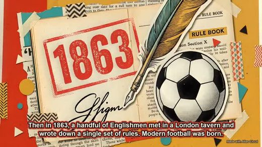</a> <a href="https://github.com/Alisa0808/vox-director">Alisa0808/vox-director</a></td>
<td align="center" valign="top"><a href="https://github.com/vincentsch/explainroo">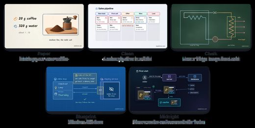</a> <a href="https://github.com/vincentsch/explainroo">vincentsch/explainroo</a></td>
<td align="center" valign="top"><a href="https://github.com/hi-nikola/hand-drawn-explainer-video-nikola">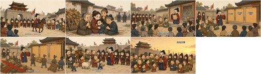</a> <a href="https://github.com/hi-nikola/hand-drawn-explainer-video-nikola">hi-nikola/hand-drawn-explainer-video-nikola</a></td>
</tr></table>

| 仓库 | 星数 | 做什么 | 安全评级 |
|---|---:|---|---|
| [Alisa0808/vox-director](https://github.com/Alisa0808/vox-director) | 2.8k | 把一个选题做成 Vox 风格纸拼贴讲解或广告视频的 agent skill，基于 Atlas Cloud + ffmpeg 全流程自动化 | [SAFE](https://agentskillshub.top/skill/Alisa0808/vox-director/) |
| [adithya-s-k/manim_skill](https://github.com/adithya-s-k/manim_skill) | 1.3k | 用 Manim 制作 3Blue1Brown 风格动画的 agent skills | [SAFE](https://agentskillshub.top/skill/adithya-s-k/manim_skill/) |
| [vincentsch/explainroo](https://github.com/vincentsch/explainroo) | 1.3k | 由 AI agent 制作讲解视频和产品演示:本地 Kokoro 配音、Whisper 对字、canvas 渲染,把脚本做成带旁白的 MP4 | [SAFE](https://agentskillshub.top/skill/vincentsch/explainroo/) |
| [GTKottman/mortiflix-oss](https://github.com/GTKottman/mortiflix-oss) | 702 | 本机上的动态设计工作室：Claude 分步制作视频，你逐步确认。使用自己的 Claude Code 或 API 密钥。 | [SAFE](https://agentskillshub.top/skill/GTKottman/mortiflix-oss/) |
| [HeyChengC/wallstreet-explainer](https://github.com/HeyChengC/wallstreet-explainer) | 696 | 财经/科技解读短片 skill：设计思路、风格语言及找片、截图、配音、渲染、混音工具。 | [SAFE](https://agentskillshub.top/skill/HeyChengC/wallstreet-explainer/) |
| [hi-nikola/hand-drawn-explainer-video-nikola](https://github.com/hi-nikola/hand-drawn-explainer-video-nikola) | 480 | 中文手绘知识讲解视频 Codex Skill：逐笔故事、双语义岛、让怪诞小黑动起来与程序动画 | [SAFE](https://agentskillshub.top/skill/hi-nikola/hand-drawn-explainer-video-nikola/) |
| [wshuyi/remotion-video-skill](https://github.com/wshuyi/remotion-video-skill) | 476 | 用 Remotion 框架以编程方式制作视频的 Claude Code Skill | [CAUTION](https://agentskillshub.top/skill/wshuyi/remotion-video-skill/) |
| [moguzbulbul/blueprint-animation](https://github.com/moguzbulbul/blueprint-animation) | 434 | Claude Design skill：通过蓝图绘图逐步讲解动画化的改版前→改版后 UX 设计，作者 @moguzbulbul。 | [SAFE](https://agentskillshub.top/skill/moguzbulbul/blueprint-animation/) |
| [shuyicc/MathLens](https://github.com/shuyicc/MathLens) | 350 | 数学题视频讲解 Agent Skill：粘贴一道题，自动完成分析、可视化讲解、配音脚本到 Manim 动画视频 | [SAFE](https://agentskillshub.top/skill/shuyicc/MathLens/) |
| [Anil-matcha/vox-ai-motion-graphics-generator](https://github.com/Anil-matcha/vox-ai-motion-graphics-generator) | 349 | 把任意选题做成 Vox 风格纸拼贴讲解视频的 agent skill，脚本、关键帧、动画、配音、配乐和字幕全自动 | [SAFE](https://agentskillshub.top/skill/Anil-matcha/vox-ai-motion-graphics-generator/) |
| [Moh4696/cinematic-skill](https://github.com/Moh4696/cinematic-skill) | 345 | 旁白电影制作 agent skill：全程代码构建，在照片、地图和卡片间连续运镜，与声音同步。支持 Claude Code、Codex、Cursor、Gemi… | [SAFE](https://agentskillshub.top/skill/Moh4696/cinematic-skill/) |
| [chuspeeism/dashi-animationstyle](https://github.com/chuspeeism/dashi-animationstyle) | 195 | 将中文知识口播制作成7种画风的讲解动画（Claude Code skill）：由 Claude 编写 HTML/Canvas 代码逐帧绘制，无需生图模型 | [SAFE](https://agentskillshub.top/skill/chuspeeism/dashi-animationstyle/) |
| [haiderfarooq3/khan-explainer](https://github.com/haiderfarooq3/khan-explainer) | 157 | Claude Code skill：Khan Academy 风格讲解视频，画笔绘图并配音讲解，免费本地运行，无需 API 密钥。 | [SAFE](https://agentskillshub.top/skill/haiderfarooq3/khan-explainer/) |
| [derek-zhuolin/motion-skill](https://github.com/derek-zhuolin/motion-skill) | 128 | 不出镜，用文案或录音制作视频。用 Codex 和 Remotion 制作动态图形：实拍画面、字幕、可编辑项目和 96 个动效研究。 | [SAFE](https://agentskillshub.top/skill/derek-zhuolin/motion-skill/) |
| [runesleo/claude-video-kit](https://github.com/runesleo/claude-video-kit) | 124 | Agent Skill + Remotion 流水线：brief/脚本 → 审核回执 → 带旁白的 9:16 讲解视频 | [SAFE](https://agentskillshub.top/skill/runesleo/claude-video-kit/) |
| [iart-ai/explainer-video-skills](https://github.com/iart-ai/explainer-video-skills) | 107 | Claude Code 的讲解视频 skills：编写脚本、分镜并渲染带旁白的讲解视频、年度回顾和动态图解 | [SAFE](https://agentskillshub.top/skill/iart-ai/explainer-video-skills/) |
| [holy-templar/vox-animated-ad-mcp](https://github.com/holy-templar/vox-animated-ad-mcp) | 80 | 给 AI agent 用的 Vox 风格纸拼贴动画视频 skill，在对话中输入一句话即可生成讲解或广告视频 | [SAFE](https://agentskillshub.top/skill/holy-templar/vox-animated-ad-mcp/) |
| [GODGOD126/opus-5-5-86-styles-in-motion](https://github.com/GODGOD126/opus-5-5-86-styles-in-motion) | 76 | 86 种代码驱动的解说动画视觉风格。Codex skill：选择风格，预览 20 秒，再生成完整 HTML 视频。 | [SAFE](https://agentskillshub.top/skill/GODGOD126/opus-5-5-86-styles-in-motion/) |
| [sunxiayi/make-blender-education-video-skill](https://github.com/sunxiayi/make-blender-education-video-skill) | 69 | 用 Blender 制作经事实核查的电影感教学视频的 Codex 和 Claude Code skill | [SAFE](https://agentskillshub.top/skill/sunxiayi/make-blender-education-video-skill/) |
| [threerocks/sweety-statechart-video](https://github.com/threerocks/sweety-statechart-video) | 69 | 格物：一句话制作动态蜡笔状态图短片，支持3:4、2-3分钟、四款合成旁白、自己的声音、章节海报和批量出片；支持Codex、Claude Code、Grok。 | [SAFE](https://agentskillshub.top/skill/threerocks/sweety-statechart-video/) |
| [znyupup/knowledge-explainer-skill](https://github.com/znyupup/knowledge-explainer-skill) | 67 | 把一份 markdown 文稿自动生成讲解动画视频，基于 Remotion + AI Agent | [SAFE](https://agentskillshub.top/skill/znyupup/knowledge-explainer-skill/) |
| [SpeedPainterOrg/explainer-video](https://github.com/SpeedPainterOrg/explainer-video) | 59 | 将文本、URL 和文档转换为带旁白的手绘讲解视频的 Codex 插件。 | [SAFE](https://agentskillshub.top/skill/SpeedPainterOrg/explainer-video/) |
| [Anil-matcha/zack-d-films-ai-video-generator](https://github.com/Anil-matcha/zack-d-films-ai-video-generator) | 58 | 把选题做成 Zack D Films 风格 3D 动画短片的 agent skill，脚本、角色、关键帧、配音和字幕全自动 | [SAFE](https://agentskillshub.top/skill/Anil-matcha/zack-d-films-ai-video-generator/) |
| [howoneai/xiaolin-explainer-packaging](https://github.com/howoneai/xiaolin-explainer-packaging) | 50 | 小Lin说风格讲解视频包装 skill：Remotion版式、关键词计时分镜、混音、逐帧质检、非官方资料检索 | [SAFE](https://agentskillshub.top/skill/howoneai/xiaolin-explainer-packaging/) |
| [SunandBean/paper2video](https://github.com/SunandBean/paper2video) | 49 | Claude Code skill：将 arXiv 论文制作成带旁白、事实核查的科普视频（Three.js 场景、本地 Kokoro TTS、ffmpeg）。 | [SAFE](https://agentskillshub.top/skill/SunandBean/paper2video/) |
| [AmitSubhash/3brown1blue](https://github.com/AmitSubhash/3brown1blue) | 47 | 从第一性原理出发的 Manim skill:数学动画、论文讲解模式,附 21 份规则文件 | [SAFE](https://agentskillshub.top/skill/AmitSubhash/3brown1blue/) |
| [vibe-motion/remotion-code-motion-explainer](https://github.com/vibe-motion/remotion-code-motion-explainer) | 42 | 制作连贯、可编辑的 Remotion 讲解视频的 AI Agent skill，作者 Bingo | [SAFE](https://agentskillshub.top/skill/vibe-motion/remotion-code-motion-explainer/) |
| [Agentchengfeng/chengfeng-video-styles](https://github.com/Agentchengfeng/chengfeng-video-styles) | 36 | 15 种代码视频风格 Skill：让 Claude Code / Codex 用纯代码做 10 秒知识讲解短片 | [SAFE](https://agentskillshub.top/skill/Agentchengfeng/chengfeng-video-styles/) |
| [santmun/video-vox](https://github.com/santmun/video-vox) | 35 | 用 Claude Code + Remotion 就任意主题制作 Vox 风格竖屏动画短视频（卡通 + 配音 + 音乐 + 音效） | [SAFE](https://agentskillshub.top/skill/santmun/video-vox/) |
| [Mr-funny/hbg-douyin-code-explainer-video](https://github.com/Mr-funny/hbg-douyin-code-explainer-video) | 33 | HBG Codex skill：中文 9:16 HyperFrames 讲解视频，含对话 TTS、Whisper 同步、BGM 和成片视觉 QA | [SAFE](https://agentskillshub.top/skill/Mr-funny/hbg-douyin-code-explainer-video/) |
| [vakovalskii/nd-video-studio](https://github.com/vakovalskii/nd-video-studio) | 33 | 用 HTML 做讲解视频(HyperFrames → MP4),带 AI 旁白、配乐和混音的 Claude Code / Codex skill | [SAFE](https://agentskillshub.top/skill/vakovalskii/nd-video-studio/) |
| [dy-hashiqi/VibeDS-skill](https://github.com/dy-hashiqi/VibeDS-skill) | 30 | 豆包本地电脑模式skill：分镜脚本生成16:9科普短视频，基于HyperFrames+GSAP的HTML工程，lint/preview/render导出MP4 | [SAFE](https://agentskillshub.top/skill/dy-hashiqi/VibeDS-skill/) |
| [ahmdd4vd/MotionCraft](https://github.com/ahmdd4vd/MotionCraft) | 28 | 让 AI agent 用 Remotion 制作简洁动态图形视频的 Agent Skill，一条命令安装 | [SAFE](https://agentskillshub.top/skill/ahmdd4vd/MotionCraft/) |
| [paullabs/espaco-em-codigo](https://github.com/paullabs/espaco-em-codigo) | 28 | 代码化太空与科学视频：Three.js制作3D行星、潮汐和爆炸，支持电影摄影机、配音和逐帧检查。Claude Code插件。专有许可，必须加水印。 | [SAFE](https://agentskillshub.top/skill/paullabs/espaco-em-codigo/) |
| [BusyBee3333/animated-explainer-skills](https://github.com/BusyBee3333/animated-explainer-skills) | 27 | 把动画讲解视频做成单个 HTML 文件的 Claude Code skills：GSAP 编排模式、重叠检查器、ElevenLabs 配音 | [SAFE](https://agentskillshub.top/skill/BusyBee3333/animated-explainer-skills/) |
| [124zhe/xigua-msvideo-skill](https://github.com/124zhe/xigua-msvideo-skill) | 26 | 用于 YouTube 好奇心故事、MS Paint 分镜、旁白和视频组装的 Codex skill | [SAFE](https://agentskillshub.top/skill/124zhe/xigua-msvideo-skill/) |
| [Phantomlau3674/voxstylehub-steven](https://github.com/Phantomlau3674/voxstylehub-steven) | 26 | 独立的 Codex skill：制作 Vox 风格的编辑式拼贴知识视频，用 Remotion 确定性合成，可选生成式动效 | [SAFE](https://agentskillshub.top/skill/Phantomlau3674/voxstylehub-steven/) |
| [iart-ai/map-animation-skills](https://github.com/iart-ai/map-animation-skills) | 25 | 给 AI 编程 agent 的地图动画 skill:绘制路线、缩放定位和数据驱动的地图动画,渲染成视频 | [SAFE](https://agentskillshub.top/skill/iart-ai/map-animation-skills/) |
| [indieshade/video-director-workflow](https://github.com/indieshade/video-director-workflow) | 25 | 以设计为导向的 AI 视频流程：director skill、美学指导、盲测对比和可复现的 HyperFrames 拼贴示例 | [SAFE](https://agentskillshub.top/skill/indieshade/video-director-workflow/) |
| [Matteoikarieth96/whiteboard-video-skill](https://github.com/Matteoikarieth96/whiteboard-video-skill) | 24 | Claude Code skill：将主题制作成带配音和字幕的手绘白板讲解视频 | [SAFE](https://agentskillshub.top/skill/Matteoikarieth96/whiteboard-video-skill/) |
| [Mng-dev-ai/explainer-video](https://github.com/Mng-dev-ai/explainer-video) | 23 | 把任意主题做成带旁白动画讲解视频的 AI skill，本地运行、免费，支持 Claude Code / Codex / Cursor | [SAFE](https://agentskillshub.top/skill/Mng-dev-ai/explainer-video/) |
| [aijiduonadegou/Paper-Cut](https://github.com/aijiduonadegou/Paper-Cut) | 22 | 无需视频模型的拼贴动画 skill：图像模型定稿、原图拆层与 HyperFrames 代码动画，做纸拼贴科普视频 | [SAFE](https://agentskillshub.top/skill/aijiduonadegou/Paper-Cut/) |
| [reedodev/explainer-studio](https://github.com/reedodev/explainer-studio) | 21 | 输入一行文字，输出八种手绘风格的解释视频（Claude Code skill） | [SAFE](https://agentskillshub.top/skill/reedodev/explainer-studio/) |
| [cclank/lanshu-html2video-skill](https://github.com/cclank/lanshu-html2video-skill) | 19 | 用 Codex 和 Remotion 把网页文章做成 1080p 视频 | [SAFE](https://agentskillshub.top/skill/cclank/lanshu-html2video-skill/) |
| [chenyuxiaojin/cyxj-hyperframes](https://github.com/chenyuxiaojin/cyxj-hyperframes) | 18 | 开源的 HTML + GSAP 视频项目与可复用工具包，用于制作 Claude Code 教程视频，基于 HeyGen HyperFrames | [SAFE](https://agentskillshub.top/skill/chenyuxiaojin/cyxj-hyperframes/) |
| [syydaniel/kazi](https://github.com/syydaniel/kazi) | 18 | 卡字 kazi：让 AI coding assistants 制作画面对应旁白关键词的讲解动画。 | [SAFE](https://agentskillshub.top/skill/syydaniel/kazi/) |
| [chenjun198711/book-video-generator](https://github.com/chenjun198711/book-video-generator) | 17 | 《三分钟精读一本书》视频生成器，移植自扣子工作流，支持 WorkBuddy、OpenClaw、Codex、TRAE Work、Claude。 | [SAFE](https://agentskillshub.top/skill/chenjun198711/book-video-generator/) |
| [liuliu-66-create/ll-video-edit](https://github.com/liuliu-66-create/ll-video-edit) | 17 | Codex + Remotion 六步自动剪辑 skill 与视频动效素材库 | [SAFE](https://agentskillshub.top/skill/liuliu-66-create/ll-video-edit/) |
| [feicaiclub/knowledge-easy](https://github.com/feicaiclub/knowledge-easy) | 16 | Knowledge Easy — 一个 Codex skill，用于制作中英文故事驱动的科普影片：研究、旁白、动态图形、剪辑和逐帧审查。 | [SAFE](https://agentskillshub.top/skill/feicaiclub/knowledge-easy/) |
| [jaredcassoutt/vox-editorial](https://github.com/jaredcassoutt/vox-editorial) | 15 | 把一个调研主题做成竖屏讲解短片的 Claude Code skill:纸片分层动画、本地免费配音、ffmpeg 合成 | [SAFE](https://agentskillshub.top/skill/jaredcassoutt/vox-editorial/) |
| [kakaxi12/vox-director-codex](https://github.com/kakaxi12/vox-director-codex) | 14 | 用 ImageGen、HyperFrames 和 MiniMax 旁白制作 Vox 风格编辑式纸拼贴视频的 Codex skill | [SAFE](https://agentskillshub.top/skill/kakaxi12/vox-director-codex/) |
| [Science-Prof-Robot/recursive-math-animator](https://github.com/Science-Prof-Robot/recursive-math-animator) | 13 | Cursor 和 Claude Code 的 Manim 动画 skill:配音、基于 git 的场景版本管理,可选 Gemini 配音 | [SAFE](https://agentskillshub.top/skill/Science-Prof-Robot/recursive-math-animator/) |
| [fltman/infofilm](https://github.com/fltman/infofilm) | 12 | Claude Code skill：信息图解说片，1950年代新闻卡片、ElevenLabs旁白、Suno音乐、Gemini图像、Remotion语音同步场景 | [SAFE](https://agentskillshub.top/skill/fltman/infofilm/) |
| [gquthier/autonomous-sop-video](https://github.com/gquthier/autonomous-sop-video) | 11 | CREATIVE · SOP VIDEO — Turn any workflow into a narrated tutorial. Agent skill, screenshots, button zooms, checklists and chapters. | [SAFE](https://agentskillshub.top/skill/gquthier/autonomous-sop-video/) |
| [mathruffian-dot/claude-motion-explainer-images](https://github.com/mathruffian-dot/claude-motion-explainer-images) | 11 | 让 coding agent 制作含授权照片和 AI 示意图的原理解说动画（HyperFrames＋中文旁白） | [SAFE](https://agentskillshub.top/skill/mathruffian-dot/claude-motion-explainer-images/) |
| [Lunamos/paper2video](https://github.com/Lunamos/paper2video) | 10 | Claude Code skill：用 Remotion 将论文或项目制作成 3Blue1Brown 风格讲解视频，含脚本、旁白、真实数据动画、字幕、封面及… | [SAFE](https://agentskillshub.top/skill/Lunamos/paper2video/) |
| [undsky/doudou-remotion-whiteboard-skill](https://github.com/undsky/doudou-remotion-whiteboard-skill) | 10 | Remotion 通用手绘白板、纸张与草图动效引擎。 | [SAFE](https://agentskillshub.top/skill/undsky/doudou-remotion-whiteboard-skill/) |
| [lewislf/claude-code-video-studio](https://github.com/lewislf/claude-code-video-studio) | 9 | 使用 Claude Code 本地制作的旁白解说视频：OmniVoice、MusicGen、HyperFrames、SDXL | [SAFE](https://agentskillshub.top/skill/lewislf/claude-code-video-studio/) |
| [rocketmandrey/stickman-director](https://github.com/rocketmandrey/stickman-director) | 9 | 输入一个问题，输出完整的火柴人讲解视频。驱动 Google Vids 全流程的 Claude skill。 | [SAFE](https://agentskillshub.top/skill/rocketmandrey/stickman-director/) |
| [sepi2p/research-explainer-skill](https://github.com/sepi2p/research-explainer-skill) | 9 | Claude Code skill：制作英语和波斯语研究科普视频与幻灯片，含论断核查和真实数据图表 | [CAUTION](https://agentskillshub.top/skill/sepi2p/research-explainer-skill/) |
| [ssrajadh/paperview](https://github.com/ssrajadh/paperview) | 9 | 把论文、代码库等做成讲解视频，本地渲染 + TTS，Claude Code 插件 | [SAFE](https://agentskillshub.top/skill/ssrajadh/paperview/) |
| [0x68616F4C/auto-popsci](https://github.com/0x68616F4C/auto-popsci) | 8 | 用 Manim 加 AI 旁白生成数学和科学科普视频的 agent skill | [SAFE](https://agentskillshub.top/skill/0x68616F4C/auto-popsci/) |
| [cymcymcymcym/notes-to-video](https://github.com/cymcymcymcym/notes-to-video) | 8 | 把笔记做成 3Blue1Brown 风格的动画讲解视频，Claude Code skill + Manim + TTS + ffmpeg | [SAFE](https://agentskillshub.top/skill/cymcymcymcym/notes-to-video/) |
| [mathruffian-dot/claude-motion-explainer-video](https://github.com/mathruffian-dot/claude-motion-explainer-video) | 8 | 動畫講原理、照片作證、MiniMax H3 生成帶情緒的原理解說動畫（HyperFrames + 中文旁白） | [SAFE](https://agentskillshub.top/skill/mathruffian-dot/claude-motion-explainer-video/) |
| [sanskarprajapati/parallax-doc](https://github.com/sanskarprajapati/parallax-doc) | 8 | 为 Claude Code 制作电影感单机位历史纪录片：分层2.5D画面、无硬切、打字文字含一个红色词，复古胶片质感。 | [SAFE](https://agentskillshub.top/skill/sanskarprajapati/parallax-doc/) |
| [sukai213/bilibili-ai-video](https://github.com/sukai213/bilibili-ai-video) | 8 | AI 科技测评视频制作与 B 站自动发布 Codex Skill：原创文案、Qwen3-TTS 配音、ffmpeg 剪辑、投稿 API 发布 | [SAFE](https://agentskillshub.top/skill/sukai213/bilibili-ai-video/) |
| [Acorn2/frame-loom](https://github.com/Acorn2/frame-loom) | 7 | 面向 Coding Agents 的开源 skill，可用 Remotion 将文档转换为视频。 | [SAFE](https://agentskillshub.top/skill/Acorn2/frame-loom/) |
| [Ali-Aria/aria-animator](https://github.com/Ali-Aria/aria-animator) | 7 | 阿梨动画机（Aria Animator）：用 Remotion、豆包配音和霞鹜文楷制作可编辑动画讲解视频的 AI Agent Skill。 | [SAFE](https://agentskillshub.top/skill/Ali-Aria/aria-animator/) |
| [aliangSSS/aliang-knowledge-video](https://github.com/aliangSSS/aliang-knowledge-video) | 7 | Claude Code skill：输入主题，生成「Vibe 知识大赏」风格中文知识短片（Remotion、卡点动效、拟音） | [SAFE](https://agentskillshub.top/skill/aliangSSS/aliang-knowledge-video/) |
| [alireza12t/foldline](https://github.com/alireza12t/foldline) | 7 | Mac上用WebCodecs硬件H.264无头Chrome渲染canvas为MP4；Claude Code、Codex、Cursor的MCP；66种lemo-… | [SAFE](https://agentskillshub.top/skill/alireza12t/foldline/) |
| [coding-ax/docvideoer](https://github.com/coding-ax/docvideoer) | 7 | 文档转视频 skills：把文档 URL、网页文章、Markdown 或文本转成带中文旁白的 Remotion 讲解视频 | [SAFE](https://agentskillshub.top/skill/coding-ax/docvideoer/) |
| [crawfordxx/paper-cut-video-skill](https://github.com/crawfordxx/paper-cut-video-skill) | 7 | 脚本驱动的中文剪纸风讲解视频:匹配内容的角色、Remotion、豆包配音和语义字幕 | [SAFE](https://agentskillshub.top/skill/crawfordxx/paper-cut-video-skill/) |
| [isabellagreco1997/script-to-video](https://github.com/isabellagreco1997/script-to-video) | 7 | Turn a script into a narrated, word-synced explainer video (16:9 YouTube or 9:16 Reels/Shorts). Free local Kokoro voice, licensed web images, clips,… | [SAFE](https://agentskillshub.top/skill/isabellagreco1997/script-to-video/) |
| [jinjin1/scenewright](https://github.com/jinjin1/scenewright) | 7 | Claude Code 原生流水线：把源文本做成带旁白、Remotion 渲染的 YouTube 讲解视频，本地韩语 TTS | [SAFE](https://agentskillshub.top/skill/jinjin1/scenewright/) |
| [jjietay/clayducation](https://github.com/jjietay/clayducation) | 7 | 用柔和3D黏土风和无声吉祥物制作旁白教学视频的 Claude Code skill。语音生成前由一个 agent 检查脚本。 | [SAFE](https://agentskillshub.top/skill/jjietay/clayducation/) |
| [pjecuacion/script-to-video-skill](https://github.com/pjecuacion/script-to-video-skill) | 7 | 面向 HyperFrames 工作流的公开版脚本转视频 skill，路径已脱敏，示例不含密钥 | [SAFE](https://agentskillshub.top/skill/pjecuacion/script-to-video-skill/) |
| [Nealsun1993/talk-workbench](https://github.com/Nealsun1993/talk-workbench) | 6 | 口播工作台：配音驱动的竖屏讲解视频 skill、Remotion 组件库与动效规范。 | [SAFE](https://agentskillshub.top/skill/Nealsun1993/talk-workbench/) |
| [OnurGumus/codebase-video](https://github.com/OnurGumus/codebase-video) | 6 | 将代码库转成经事实核查的旁白视频。Claude Code 插件：一个 agent 阅读代码，其他 agent 核验每条陈述，然后在本地制作视频。 | [SAFE](https://agentskillshub.top/skill/OnurGumus/codebase-video/) |
| [centraltowerlabs/diagram-tour](https://github.com/centraltowerlabs/diagram-tour) | 6 | 为代码库（或其他复杂系统）生成讲解导览视频的 Claude Skill | [SAFE](https://agentskillshub.top/skill/centraltowerlabs/diagram-tour/) |
| [ekomen77/erko-ai-video-engine](https://github.com/ekomen77/erko-ai-video-engine) | 6 | 将录音转换为 ekomen77 风格的 1080p 讲解视频引擎：Canvas + headless Chrome + FFmpeg 流程，agent ski… | [SAFE](https://agentskillshub.top/skill/ekomen77/erko-ai-video-engine/) |
| [hdduytran/one-studio-skill](https://github.com/hdduytran/one-studio-skill) | 6 | 一体化视频创作 skill | [SAFE](https://agentskillshub.top/skill/hdduytran/one-studio-skill/) |
| [AlbertPine/vibe-knowledge-video-director](https://github.com/AlbertPine/vibe-knowledge-video-director) | 5 | 用于制作基于研究、故事优先的中文知识视频的 Codex skill，含连续动态图形、语义化屏幕文字和渲染级质量检查。 | [SAFE](https://agentskillshub.top/skill/AlbertPine/vibe-knowledge-video-director/) |
| [arthurkatcher/explainer-video](https://github.com/arthurkatcher/explainer-video) | 5 | Agent skill: motion-graphics explainer videos made entirely in code (Remotion + numpy music) | [SAFE](https://agentskillshub.top/skill/arthurkatcher/explainer-video/) |
| [bassimeledath/manimate](https://github.com/bassimeledath/manimate) | 5 | 用自然语言和 Manim 生成图示/动画视频，适用于 Claude Code、Codex 等 AI agent 的 skill。 | [SAFE](https://agentskillshub.top/skill/bassimeledath/manimate/) |
| [beriki770-ship-it/code-animations](https://github.com/beriki770-ship-it/code-animations) | 5 | Claude Code skill：用程序绘制每帧视频（Canvas 2D + Web Audio），无头渲染为 MP4，支持 16:9 / 9:16 / 4… | [SAFE](https://agentskillshub.top/skill/beriki770-ship-it/code-animations/) |
| [tmoody1973/pasteup](https://github.com/tmoody1973/pasteup) | 5 | Claude Code 半调纸张拼贴定格动画。剪切、粘贴、摇摆。从空白确定性组装，内置手工定格摇摆效果，无需付费视频模型。 | [SAFE](https://agentskillshub.top/skill/tmoody1973/pasteup/) |
| [RohanRatwani/explainer-video-opus-5.5](https://github.com/RohanRatwani/explainer-video-opus-5.5) | 2 | Claude Code skill: turn a topic into a motion-design explainer video (YouTube 16:9 or Shorts) with an AI voice or your own, every animation timed to… | [SAFE](https://agentskillshub.top/skill/RohanRatwani/explainer-video-opus-5.5/) |
| [git-story-film](https://github.com/EverMind-AI/Raven/tree/HEAD/skills/git-story-film) | 所在仓库 EverMind-AI/Raven: 6.2k | 把一个仓库的 Git 历史拍成两分钟左右的手绘动画短片：故事、角色、分镜、浏览器预览，最后渲染 4K/60fps MP4 | [SAFE](https://agentskillshub.top/skill/EverMind-AI/Raven/) |

## ✂️ 剪辑与后期

[在在线页面打开这一类,按星数排序 →](https://agentskillshub.top/best/claude-video-skills/#type-editing)

<table><tr>
<td align="center" valign="top"> <a href="https://github.com/FireRedTeam/FireRed-OpenStoryline">FireRedTeam/FireRed-OpenStoryline</a></td>
<td align="center" valign="top"><a href="https://github.com/hetpatel-11/Adobe_Premiere_Pro_MCP">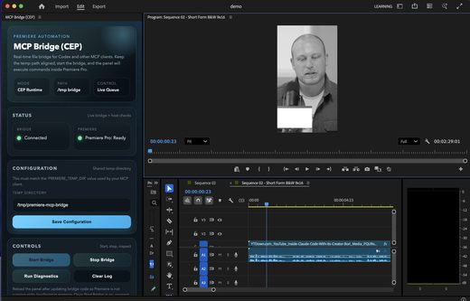</a> <a href="https://github.com/hetpatel-11/Adobe_Premiere_Pro_MCP">hetpatel-11/Adobe_Premiere_Pro_MCP</a></td>
<td align="center" valign="top"><a href="https://github.com/zenstory-ai/video-recap-skills">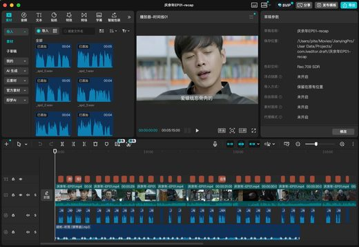</a> <a href="https://github.com/zenstory-ai/video-recap-skills">zenstory-ai/video-recap-skills</a></td>
</tr></table>

| 仓库 | 星数 | 做什么 | 安全评级 |
|---|---:|---|---|
| [FireRedTeam/FireRed-OpenStoryline](https://github.com/FireRedTeam/FireRed-OpenStoryline) | 3.7k | AI 视频剪辑 agent：用自然语言交互、LLM 规划和工具编排做导演式剪辑，支持可复用的 Style Skills | [SAFE](https://agentskillshub.top/skill/FireRedTeam/FireRed-OpenStoryline/) |
| [Agentchengfeng/chengfeng-videocut-skills](https://github.com/Agentchengfeng/chengfeng-videocut-skills) | 3.2k | 用 Claude Code Skills 做的视频剪辑 agent | [SAFE](https://agentskillshub.top/skill/Agentchengfeng/chengfeng-videocut-skills/) |
| [0xsline/OpenChatCut](https://github.com/0xsline/OpenChatCut) | 3.1k | 开源、本地优先的对话式 AI 视频编辑器，带专业多轨时间线、Agent Skills、MCP 集成和 Remotion 渲染 | [SAFE](https://agentskillshub.top/skill/0xsline/OpenChatCut/) |
| [JimLiu/baocut](https://github.com/JimLiu/baocut) | 1.8k | 驱动 BaoCut 应用的开源 agent skill：在 Claude Code、Codex 里完成转写、字幕、翻译和剪辑 | [SAFE](https://agentskillshub.top/skill/JimLiu/baocut/) |
| [pireel/pireel](https://github.com/pireel/pireel) | 1.4k | Capcut 的开源替代品 ChatCut。任何 AI agent 都可通过 MCP 驱动。 | [SAFE](https://agentskillshub.top/skill/pireel/pireel/) |
| [Barty-Bart/motion-graphics](https://github.com/Barty-Bart/motion-graphics) | 1.3k | Claude Code 和 Codex 的动态图形制作技能。 | [SAFE](https://agentskillshub.top/skill/Barty-Bart/motion-graphics/) |
| [Vibha-Ramprakash/claude-video-effects](https://github.com/Vibha-Ramprakash/claude-video-effects) | 938 | Claude Code：51个视频特效，输入 /effects orbit；支持面部跟踪和头后图层。Hop Studio/@vibha.in.progress | [SAFE](https://agentskillshub.top/skill/Vibha-Ramprakash/claude-video-effects/) |
| [hetpatel-11/Adobe_Premiere_Pro_MCP](https://github.com/hetpatel-11/Adobe_Premiere_Pro_MCP) | 871 | Adobe Premiere Pro MCP：通过 MCP 为 Codex、Claude 等客户端提供 AI 驱动的视频剪辑工具 | [SAFE](https://agentskillshub.top/skill/hetpatel-11/Adobe_Premiere_Pro_MCP/) |
| [cartesiancs/cartcut](https://github.com/cartesiancs/cartcut) | 832 | 给 AI agent 用的视频编辑器，相信开源可以胜过商业工具 | [SAFE](https://agentskillshub.top/skill/cartesiancs/cartcut/) |
| [zenstory-ai/video-recap-skills](https://github.com/zenstory-ai/video-recap-skills) | 624 | 用 Claude Code skills 把视频做成中文解说成片，可选一键导出可编辑剪映草稿 | [SAFE](https://agentskillshub.top/skill/zenstory-ai/video-recap-skills/) |
| [leancoderkavy/premiere-pro-mcp](https://github.com/leancoderkavy/premiere-pro-mcp) | 530 | 独立、本地优先的 Adobe Premiere Pro MCP 服务器，通过本地 CEP 桥接连接 Claude、Codex 或 Cursor | [SAFE](https://agentskillshub.top/skill/leancoderkavy/premiere-pro-mcp/) |
| [kurbaitaev/ghost-editor](https://github.com/kurbaitaev/ghost-editor) | 509 | 口播 Reels 的 AI 视频剪辑 skill，基于 HyperFrames：7 种风格、避开人脸的字幕、动效场景，可逆向还原参考剪辑 | [SAFE](https://agentskillshub.top/skill/kurbaitaev/ghost-editor/) |
| [YeJe-cpu/SeeCut](https://github.com/YeJe-cpu/SeeCut) | 461 | 会自己看成片的 AI 剪辑 skill：数字人或真人口播 → 自动精剪成网感动效短视频，可选导出剪映分层草稿 | [SAFE](https://agentskillshub.top/skill/YeJe-cpu/SeeCut/) |
| [AgriciDaniel/claude-shorts](https://github.com/AgriciDaniel/claude-shorts) | 389 | 交互式长视频转短视频的 Claude Code skill：Remotion 渲染动态字幕、AI 片段评分、光标跟踪和音频感知的边界吸附 | [SAFE](https://agentskillshub.top/skill/AgriciDaniel/claude-shorts/) |
| [hassancs91/claude-youtube-editor](https://github.com/hassancs91/claude-youtube-editor) | 379 | 录好口播，其余交给 Claude Code：剪辑、画面、配音、音效、封面和 YouTube 上传 | [SAFE](https://agentskillshub.top/skill/hassancs91/claude-youtube-editor/) |
| [erduo1998-cell/erduo-broll-loop-engineering](https://github.com/erduo1998-cell/erduo-broll-loop-engineering) | 249 | SRT 驱动的双后端 B-roll Agent Skill：自动路由 HyperFrames / Remotion，集成 152 张镜头卡 | [SAFE](https://agentskillshub.top/skill/erduo1998-cell/erduo-broll-loop-engineering/) |
| [Cassette-Editor/oh-my-cassette](https://github.com/Cassette-Editor/oh-my-cassette) | 220 | 你的随身 AI 剪辑搭档：面向 Claude Code、Codex、Hermes 和 OpenCode 的 AI 视频剪辑插件与 MCP 服务器 | [SAFE](https://agentskillshub.top/skill/Cassette-Editor/oh-my-cassette/) |
| [znyupup/ai-video-editing-skill](https://github.com/znyupup/ai-video-editing-skill) | 180 | 自动剪辑 vlog 的 AI Agent Skill：输入原始素材，输出成片，基于 ffmpeg + Whisper + Vision API | [SAFE](https://agentskillshub.top/skill/znyupup/ai-video-editing-skill/) |
| [mrpaidsocial/mrpaidsocial-video-editor-agent](https://github.com/mrpaidsocial/mrpaidsocial-video-editor-agent) | 166 | Claude Code skill 包：端到端编辑短视频，复刻参考视频风格，制作品牌动效，使用 ElevenLabs 设计声音，逐帧质检和时间线评论审核 | [SAFE](https://agentskillshub.top/skill/mrpaidsocial/mrpaidsocial-video-editor-agent/) |
| [ayushozha/AdobePremiereProMCP](https://github.com/ayushozha/AdobePremiereProMCP) | 147 | Adobe Premiere Pro 的 MCP 服务器：1,027 个工具，覆盖时间线剪辑、调色、混音、特效和导出 | [SAFE](https://agentskillshub.top/skill/ayushozha/AdobePremiereProMCP/) |
| [Xiangyu-CAS/rea-capcut](https://github.com/Xiangyu-CAS/rea-capcut) | 146 | ReaCut：REA × CapCut，基于 REA 辅助的授权本地行为与格式研究重建的开源视频编辑器；不含 CapCut 专有代码或资源。离线桌面应用与 C… | [SAFE](https://agentskillshub.top/skill/Xiangyu-CAS/rea-capcut/) |
| [naive-kun/naive-video-skill](https://github.com/naive-kun/naive-video-skill) | 137 | 把口播视频做成带字幕和动效成片的 Codex skill | [SAFE](https://agentskillshub.top/skill/naive-kun/naive-video-skill/) |
| [louisedesadeleer/cut-video](https://github.com/louisedesadeleer/cut-video) | 121 | Claude Code skill：精简长录制内容，去掉静音、语气词和空白，保留笑声和喜剧停顿，在 Apple Silicon 上运行快 | [SAFE](https://agentskillshub.top/skill/louisedesadeleer/cut-video/) |
| [Monet-AI-Editor/Monet](https://github.com/Monet-AI-Editor/Monet) | 119 | 用 Claude Code 或 Codex 剪辑视频、设计图片 | [SAFE](https://agentskillshub.top/skill/Monet-AI-Editor/Monet/) |
| [AKMessi/vex](https://github.com/AKMessi/vex) | 100 | 视频剪辑版的 Claude Code | [SAFE](https://agentskillshub.top/skill/AKMessi/vex/) |
| [JUNKDOGE-JOE/after-effects-mcp](https://github.com/JUNKDOGE-JOE/after-effects-mcp) | 96 | agent 驱动的 After Effects 自动化：MCP 服务器 + CEP 插件，提供 30 个 ae.* 工具 | [SAFE](https://agentskillshub.top/skill/JUNKDOGE-JOE/after-effects-mcp/) |
| [AISEO-VirtualabDigital/mcp-video-editor](https://github.com/AISEO-VirtualabDigital/mcp-video-editor) | 80 | 免费CapCut/OpenCut MCP server，支持Cursor、Claude、Codex等；58个工具含时间线、特效、配音、Remotion/Hyp… | [SAFE](https://agentskillshub.top/skill/AISEO-VirtualabDigital/mcp-video-editor/) |
| [artemnovitckii/claude-editing-skills](https://github.com/artemnovitckii/claude-editing-skills) | 76 | 用 Claude Code skills 将口播片段剪成短视频：试播、人物幕后、讲解、分屏、榜单、故事。本地用 HyperFrames 渲染。 | [SAFE](https://agentskillshub.top/skill/artemnovitckii/claude-editing-skills/) |
| [alisadiq-ai/favstash-ai-video-editing-skills](https://github.com/alisadiq-ai/favstash-ai-video-editing-skills) | 73 | 用自适应 AI 剪辑、字幕和动态图形制作 Instagram Reels、TikTok 和 YouTube Shorts，连接 FavStash 进行规划、发… | [SAFE](https://agentskillshub.top/skill/alisadiq-ai/favstash-ai-video-editing-skills/) |
| [RoverEva/eva-video-style](https://github.com/RoverEva/eva-video-style) | 59 | Eva Video Style 是开源 AI 视频编辑 skill，支持为口播视频添加模板、电影效果、动态图形、动画字幕和多种剪辑风格。 | [SAFE](https://agentskillshub.top/skill/RoverEva/eva-video-style/) |
| [zhouyuechuan2025-ui/aipacking](https://github.com/zhouyuechuan2025-ui/aipacking) | 50 | aipacking：AI口播视频包装 skill，支持 HyperFrames 分镜、Remotion 动效和预览审核。 | [SAFE](https://agentskillshub.top/skill/zhouyuechuan2025-ui/aipacking/) |
| [hahadu4520/vlog-cut](https://github.com/hahadu4520/vlog-cut) | 49 | 给 Claude Code 用的「按文案剪辑」流水线 | [SAFE](https://agentskillshub.top/skill/hahadu4520/vlog-cut/) |
| [ops120/video-recap-skills-plus](https://github.com/ops120/video-recap-skills-plus) | 46 | 用 Claude Code skill 把任何视频剪辑成中文解说视频，支持剪映导出 | [CAUTION](https://agentskillshub.top/skill/ops120/video-recap-skills-plus/) |
| [darrenli6/JJKoubo](https://github.com/darrenli6/JJKoubo) | 42 | JJ 口播：本地优先的视频剪辑 Skills 合集，面向口播、访谈、知识分享等以讲话为主的视频 | [SAFE](https://agentskillshub.top/skill/darrenli6/JJKoubo/) |
| [frankShan001/CutVoke](https://github.com/frankShan001/CutVoke) | 36 | Open-source, local-first video editor your AI agent can drive over MCP (Claude Code, Codex, Cursor). Windows · macOS · Linux. The AI makes the cut; y… | [SAFE](https://agentskillshub.top/skill/frankShan001/CutVoke/) |
| [Hainrixz/video-editor-architect](https://github.com/Hainrixz/video-editor-architect) | 35 | 克隆后在 Claude Code 中打开，agent 引导你训练自己的短视频剪辑风格。Claude 指挥，Remotion 渲染。支持 macOS、Windo… | [CAUTION](https://agentskillshub.top/skill/Hainrixz/video-editor-architect/) |
| [Kappaemme-git/codex-video-short-maker-skill](https://github.com/Kappaemme-git/codex-video-short-maker-skill) | 35 |  | [SAFE](https://agentskillshub.top/skill/Kappaemme-git/codex-video-short-maker-skill/) |
| [pedroxcardoso/maquina-cortes-gta](https://github.com/pedroxcardoso/maquina-cortes-gta) | 30 | Claude Code 的 skill：将长视频剪成多个 GTA 6 Shorts（半屏主播、半屏视频，逐字字幕）。Remotion + whisper.cpp | [SAFE](https://agentskillshub.top/skill/pedroxcardoso/maquina-cortes-gta/) |
| [skailabinfo/claude-video-harness](https://github.com/skailabinfo/claude-video-harness) | 27 | 在 Claude Code + Remotion 中制作竖屏真人讲解视频：克隆并回答问题，配置视频流程 | [SAFE](https://agentskillshub.top/skill/skailabinfo/claude-video-harness/) |
| [denyakortunov/family-travel-editor](https://github.com/denyakortunov/family-travel-editor) | 20 | 用于整理旅行素材、规划场景并在首选编辑器中修改影片的 AI agent skill。不是独立视频编辑器。 | [SAFE](https://agentskillshub.top/skill/denyakortunov/family-travel-editor/) |
| [onuryildriim/claude-kurgu-atolyesi](https://github.com/onuryildriim/claude-kurgu-atolyesi) | 20 | 用 Claude Code 编程剪辑口播 YouTube 视频：Remotion + FFmpeg，融入品牌风格 | [SAFE](https://agentskillshub.top/skill/onuryildriim/claude-kurgu-atolyesi/) |
| [rahlquist/hermes-video-toolchain](https://github.com/rahlquist/hermes-video-toolchain) | 19 | Hermes Agent 的免费开源视频制作流程：OpenScreen 捕获、HyperFrames 制作、无头后处理，整合为一个 skill。 | [CAUTION](https://agentskillshub.top/skill/rahlquist/hermes-video-toolchain/) |
| [davidbfrogman/davecto-cutroom](https://github.com/davidbfrogman/davecto-cutroom) | 17 | 用 Claude 编辑真人出镜视频：本地编辑器、笔记流程、品牌字幕和动画。适用于 macOS 的 Claude Code 插件。 | [SAFE](https://agentskillshub.top/skill/davidbfrogman/davecto-cutroom/) |
| [jincheng2026/jc-remotion-skills](https://github.com/jincheng2026/jc-remotion-skills) | 17 | Remotion 口播视频 AI 成片工作流（Codex / Claude Code）：粗剪 + SRT 进，带 MG 包装、音效、母带的成片出 | [SAFE](https://agentskillshub.top/skill/jincheng2026/jc-remotion-skills/) |
| [ZiadAbdelkarim/beat-synced-edit](https://github.com/ZiadAbdelkarim/beat-synced-edit) | 14 | 自动卡点剪辑：输入歌曲和原始素材，分析节拍、能量和场景后剪出成片，附带 Claude Code skill | [SAFE](https://agentskillshub.top/skill/ZiadAbdelkarim/beat-synced-edit/) |
| [PoetCoderJun/MotionTalk](https://github.com/PoetCoderJun/MotionTalk) | 13 | 用一个 Agent Skill 把剪好的口播视频做成动态图形视频 | [SAFE](https://agentskillshub.top/skill/PoetCoderJun/MotionTalk/) |
| [nomicsadmin/editor-video-ia](https://github.com/nomicsadmin/editor-video-ia) | 13 | Claude Code 内的视频编辑器：上传视频、剪辑说明和参考素材，获得剪辑好的reels。按语音剪辑，逐词加字幕，在对应词处切换画面，可在Mac上运行。 | [SAFE](https://agentskillshub.top/skill/nomicsadmin/editor-video-ia/) |
| [cocolayuan/videoclip-AI-skill](https://github.com/cocolayuan/videoclip-AI-skill) | 12 | 基于 Claude Skill 的视频全自动剪辑工具包 | [SAFE](https://agentskillshub.top/skill/cocolayuan/videoclip-AI-skill/) |
| [rtadewald/agent-video-editor](https://github.com/rtadewald/agent-video-editor) | 12 | 我的 Skills、Web 应用和工作流集合，用于 AI 自动化视频编辑 | [SAFE](https://agentskillshub.top/skill/rtadewald/agent-video-editor/) |
| [griffinwooldridge/talking-head-editor](https://github.com/griffinwooldridge/talking-head-editor) | 11 | 用于剪辑原始真人讲解视频的 Claude skill：紧凑剪辑、清晰人声、字幕和代码实现的动态图形 | [SAFE](https://agentskillshub.top/skill/griffinwooldridge/talking-head-editor/) |
| [Fagan1024/smart-video-editor](https://github.com/Fagan1024/smart-video-editor) | 10 | 会看画面的 AI 自动剪辑 Skill：先用视觉模型看懂素材再决定剪哪几秒 | [SAFE](https://agentskillshub.top/skill/Fagan1024/smart-video-editor/) |
| [brookejlacey/boring-tools](https://github.com/brookejlacey/boring-tools) | 10 | Agent 驱动的视频编辑，编辑内容就是文本。无需时间线、项目文件或上传。使用 ffmpeg、whisper、python 和 SKILL.md。 | [SAFE](https://agentskillshub.top/skill/brookejlacey/boring-tools/) |
| [d4niel-fr/shdw-video-editor](https://github.com/d4niel-fr/shdw-video-editor) | 10 | 开源编辑器：DaVinci Resolve式时间线，Claude Code/Codex agent用代码处理动效、剪辑调色字幕导出；Windows/macOS | [SAFE](https://agentskillshub.top/skill/d4niel-fr/shdw-video-editor/) |
| [qingyunAGI/qingyun-cine-skill](https://github.com/qingyunAGI/qingyun-cine-skill) | 10 | 先规划后剪辑的电影感视频剪辑 Codex skill，适用于预告片、卡点剪辑、宣传片和精彩集锦 | [SAFE](https://agentskillshub.top/skill/qingyunAGI/qingyun-cine-skill/) |
| [kajisho5/remotion-ffmpeg-skill](https://github.com/kajisho5/remotion-ffmpeg-skill) | 7 | 通过 ffmpeg-skill 将经测量的 Remotion 动效渲染到实拍视频上，并验证输出。 | [SAFE](https://agentskillshub.top/skill/kajisho5/remotion-ffmpeg-skill/) |
| [HibaBenzahra/HibAi-Editing-Studio](https://github.com/HibaBenzahra/HibAi-Editing-Studio) | 6 | HibAI Studio：Claude skill，将口播视频剪成短视频，去除静音，生成逐词Darija/Arabic字幕和品牌色动态图形。Hiba @hib… | [SAFE](https://agentskillshub.top/skill/HibaBenzahra/HibAi-Editing-Studio/) |
| [hahadu4520/newcut-video-clipping-skill](https://github.com/hahadu4520/newcut-video-clipping-skill) | 6 | 开源 Codex skill：按语义剪辑中文视频，含开头钩子、字幕、清理和 FFmpeg 渲染 | [SAFE](https://agentskillshub.top/skill/hahadu4520/newcut-video-clipping-skill/) |
| [jackjls/jtxvideo-skill](https://github.com/jackjls/jtxvideo-skill) | 6 | Codex + HyperFrames 口播视频制作 Skill：按 SRT、结构、分镜、设计、渲染的审核流程生成 AI 金融短视频 | [SAFE](https://agentskillshub.top/skill/jackjls/jtxvideo-skill/) |
| [vincentventalon/claude-code-video-editing-skill](https://github.com/vincentventalon/claude-code-video-editing-skill) | 6 | Claude Code skill：自动粗剪口播视频，合并片段、去静音和口头禅、保留最后一次录制并转写（ffmpeg + whisper.cpp），支持 ma… | [SAFE](https://agentskillshub.top/skill/vincentventalon/claude-code-video-editing-skill/) |
| [yerinsabraham/video-edit-skill](https://github.com/yerinsabraham/video-edit-skill) | 6 | 导入素材，输入 /video-edit，生成短视频：精选镜头、动态字幕、身后文字、Logo、缩放、声音、调色。本地Claude Code+Codex skil… | [SAFE](https://agentskillshub.top/skill/yerinsabraham/video-edit-skill/) |
| [UgurKeskekci/claude-video-kit](https://github.com/UgurKeskekci/claude-video-kit) | 5 | 用 Claude Code 剪辑口播视频的 skill：横屏剪辑、Reels、X 动画和代码动画。 | [SAFE](https://agentskillshub.top/skill/UgurKeskekci/claude-video-kit/) |

## 📱 短视频与口播

[在在线页面打开这一类,按星数排序 →](https://agentskillshub.top/best/claude-video-skills/#type-shorts)

<table><tr>
<td align="center" valign="top"> <a href="https://github.com/adunext/adu-motion-video">adunext/adu-motion-video</a></td>
<td align="center" valign="top"> <a href="https://github.com/Yuuhann1999/agent-storyboard">Yuuhann1999/agent-storyboard</a></td>
<td align="center" valign="top"> <a href="https://github.com/Cuongyd196/remotion-cuongit-template">Cuongyd196/remotion-cuongit-template</a></td>
</tr></table>

| 仓库 | 星数 | 做什么 | 安全评级 |
|---|---:|---|---|
| [adunext/adu-motion-video](https://github.com/adunext/adu-motion-video) | 844 | 阿杜与 Opus 5.5 精选的动画动效模板 skill:用 Codex / Claude Code 把口播与素材剪成视频,附 Lottie 素材 API | [SAFE](https://agentskillshub.top/skill/adunext/adu-motion-video/) |
| [artemnovitckii/claude-animation-skills](https://github.com/artemnovitckii/claude-animation-skills) | 749 | 6 个制作 Reels 动画的 Claude Code skill，无需素材：3D 卡通解说、火柴人、极简线稿、3D 地图路线、爆炸图、折线图。 | [SAFE](https://agentskillshub.top/skill/artemnovitckii/claude-animation-skills/) |
| [Yuuhann1999/agent-storyboard](https://github.com/Yuuhann1999/agent-storyboard) | 396 | 本地优先的 agent 视频分镜工作台:让 Codex、Claude Code 通过 MCP 写分镜、生成图片视频素材和配音并自动回填 | [SAFE](https://agentskillshub.top/skill/Yuuhann1999/agent-storyboard/) |
| [hassancs91/claude-faceless-shorts-creator](https://github.com/hassancs91/claude-faceless-shorts-creator) | 363 | Claude Code 驱动的不露脸 YouTube Shorts 工厂：Remotion 画面、ElevenLabs 配音与逐词字幕 | [SAFE](https://agentskillshub.top/skill/hassancs91/claude-faceless-shorts-creator/) |
| [Cuongyd196/remotion-cuongit-template](https://github.com/Cuongyd196/remotion-cuongit-template) | 243 | 用 Remotion 创建 9:16 短视频的 AI agent skill：讲解主题、介绍 GitHub 仓库、比较两种选择 | [SAFE](https://agentskillshub.top/skill/Cuongyd196/remotion-cuongit-template/) |
| [0xS4N4TG/papercut-explainer](https://github.com/0xS4N4TG/papercut-explainer) | 218 | 用于短竖屏剪纸讲解视频的 Claude Code skills 与 Remotion 库：策略、钩子、脚本、分镜、配音、构建、QA | [SAFE](https://agentskillshub.top/skill/0xS4N4TG/papercut-explainer/) |
| [haiderfarooq3/paper-reel](https://github.com/haiderfarooq3/paper-reel) | 140 | Claude Code skill：剪纸风无脸9:16讲解短视频，语音同步场景，逐词字幕。免费本地运行，无需API密钥。 | [SAFE](https://agentskillshub.top/skill/haiderfarooq3/paper-reel/) |
| [fendouai/ViralForge](https://github.com/fendouai/ViralForge) | 139 | Agent 原生短视频工具：一键复刻短视频，拆解钩子和脚本生成 Viral DNA 报告，输出 10 个成本估算变体。Skill + MCP + CLI，Ap… | [SAFE](https://agentskillshub.top/skill/fendouai/ViralForge/) |
| [SpaceZephyr/map-motion](https://github.com/SpaceZephyr/map-motion) | 123 | Claude Code skill：基于高德地图路线、边界和卫星底图制作地图动画，含地球俯冲、vlog我在这里、徒步海拔、骑行、航线、行政区高亮等12种风格 | [SAFE](https://agentskillshub.top/skill/SpaceZephyr/map-motion/) |
| [pycodebr/heditor](https://github.com/pycodebr/heditor) | 117 | 面向 AI agents（Claude Code、Codex、OpenCode、Cursor、Hermes）的创意竖屏视频编辑 skill：命名样式、创意模式… | [SAFE](https://agentskillshub.top/skill/pycodebr/heditor/) |
| [jaxxchen003/book-video-factory](https://github.com/jaxxchen003/book-video-factory) | 113 | 可移植的 Codex skill，用于可审计、注重版权的中文书评短视频工作流 | [SAFE](https://agentskillshub.top/skill/jaxxchen003/book-video-factory/) |
| [Chamanrajragu/purffle-shorts](https://github.com/Chamanrajragu/purffle-shorts) | 78 | 开源的 YouTube Shorts 生成器:任意大模型写脚本,配音、素材、逐字字幕,做无露脸短视频 | [SAFE](https://agentskillshub.top/skill/Chamanrajragu/purffle-shorts/) |
| [ymybxx/SoloMCN](https://github.com/ymybxx/SoloMCN) | 75 | 让 Claude Code 处理短视频：从热榜、X帖子到抖音、小红书、B站、YouTube、推特发布。 | [SAFE](https://agentskillshub.top/skill/ymybxx/SoloMCN/) |
| [Maartenlouis/remotion-ads](https://github.com/Maartenlouis/remotion-ads) | 70 | 用 Remotion 制作 Instagram Reels 和轮播广告的 Claude Code skill | [SAFE](https://agentskillshub.top/skill/Maartenlouis/remotion-ads/) |
| [mattypark/Motion-graphics-skill](https://github.com/mattypark/Motion-graphics-skill) | 60 | 适用于 Claude Code、Codex 和 Cursor 的动态图形与视频编辑 skill，支持规划、动画、剪辑、字幕和声音设计，本地渲染，无需 Afte… | [SAFE](https://agentskillshub.top/skill/mattypark/Motion-graphics-skill/) |
| [liangdabiao/story-handdrawn-video](https://github.com/liangdabiao/story-handdrawn-video) | 57 | 把中文/英文故事文本变成 9:16 竖屏手绘蜡笔风短视频的 Remotion 视频 Skill | [SAFE](https://agentskillshub.top/skill/liangdabiao/story-handdrawn-video/) |
| [pyang5166/gbro-collage-info](https://github.com/pyang5166/gbro-collage-info) | 57 | 半调纸拼贴风信息动画 Agent Skill：根据旁白脚本生成，基于 HyperFrames，不用图像模型 | [SAFE](https://agentskillshub.top/skill/pyang5166/gbro-collage-info/) |
| [threeaus/creator-style-kit](https://github.com/threeaus/creator-style-kit) | 57 | 18套9:16 HyperFrames视频风格与Claude Code skill | [SAFE](https://agentskillshub.top/skill/threeaus/creator-style-kit/) |
| [luispablovillasenor-afk/shorts-animados-claude](https://github.com/luispablovillasenor-afk/shorts-animados-claude) | 52 | Claude Code 的 skill：用 three.js + Remotion 制作 3D 动画短片（2D 角色置于 3D 世界），西班牙语。 | [SAFE](https://agentskillshub.top/skill/luispablovillasenor-afk/shorts-animados-claude/) |
| [Phucanh-MRT/mrtkeyword](https://github.com/Phucanh-MRT/mrtkeyword) | 46 | MRT关键词：Claude Code / Codex 用视频或配音文件生成9:16竖屏视频，含62种代码特效、字幕、背景音乐和封面 | [SAFE](https://agentskillshub.top/skill/Phucanh-MRT/mrtkeyword/) |
| [yammaku/typewriter-video](https://github.com/yammaku/typewriter-video) | 42 | 给 AI agent 的 VS Code 风格打字机动画视频 skill | [SAFE](https://agentskillshub.top/skill/yammaku/typewriter-video/) |
| [klsoen/opus-js-animations](https://github.com/klsoen/opus-js-animations) | 38 | 让 Claude Opus 5.5 用 JavaScript 导演并渲染影片:需求 → 声音 → 导演方案 → 逐帧 MP4 | [SAFE](https://agentskillshub.top/skill/klsoen/opus-js-animations/) |
| [TryWorld2026/paper-algorithm](https://github.com/TryWorld2026/paper-algorithm) | 34 | Paper Algorithm：将一句话变成完整口播视频的 AI-agent skill 集，涵盖选题、写稿、出片和发布计划。 | [SAFE](https://agentskillshub.top/skill/TryWorld2026/paper-algorithm/) |
| [Dancan254/shenghua](https://github.com/Dancan254/shenghua) | 31 | AI-agent skill：将语音笔记、口播或绿幕视频、书面主题制作成动画短视频或 YouTube 视频 | [CAUTION](https://agentskillshub.top/skill/Dancan254/shenghua/) |
| [aaksa/facecammaxxing](https://github.com/aaksa/facecammaxxing) | 28 | Claude Code skill：用 Remotion、GSAP、Three.js 为口播抠像视频添加头后文字、3D 卡片环、分级榜、动态字幕和推近效果 | [SAFE](https://agentskillshub.top/skill/aaksa/facecammaxxing/) |
| [ww-w-ai/super-video-agent](https://github.com/ww-w-ai/super-video-agent) | 26 | 把 PDF、文章或主题交给 Claude Opus 5.5,生成用你自己声音配音的短片,每一帧都用代码绘制 | [SAFE](https://agentskillshub.top/skill/ww-w-ai/super-video-agent/) |
| [iart-ai/tiktok-video-skills](https://github.com/iart-ai/tiktok-video-skills) | 24 | Claude Code 的短视频 skills，用于制作 Reels、TikTok 和 YouTube Shorts | [SAFE](https://agentskillshub.top/skill/iart-ai/tiktok-video-skills/) |
| [artemiimillier/skill-multik](https://github.com/artemiimillier/skill-multik) | 23 | Claude Code 的动画 skill：用 Remotion 制作 9:16 讲解动画，每词对应一个事件 | [SAFE](https://agentskillshub.top/skill/artemiimillier/skill-multik/) |
| [V413havai/vaibhav-video-editor](https://github.com/V413havai/vaibhav-video-editor) | 19 | Vaibhav AI Video Editor：Claude Code skill，可完整剪辑视频并制作带 AI 配音的动画短视频（剪辑、字幕、动态图形、转场… | [SAFE](https://agentskillshub.top/skill/V413havai/vaibhav-video-editor/) |
| [ouerf-man/kinetic-editorial-skill](https://github.com/ouerf-man/kinetic-editorial-skill) | 18 | 逐字动态字幕竖屏短片的 Claude Code skill:HyperFrames + Three.js,含分镜、素材、离线音效和预览 | [SAFE](https://agentskillshub.top/skill/ouerf-man/kinetic-editorial-skill/) |
| [social-media-skills/remotion-shorts-skill](https://github.com/social-media-skills/remotion-shorts-skill) | 18 | Remotion skill：Claude Code/Codex/Cursor/OpenClaw将主题/数据/日志生成动态短片，本地渲染。 | [SAFE](https://agentskillshub.top/skill/social-media-skills/remotion-shorts-skill/) |
| [yuwenbin121/book-video-production-skill](https://github.com/yuwenbin121/book-video-production-skill) | 17 | 制作基于事实的竖屏图书视频的 Codex skill | [SAFE](https://agentskillshub.top/skill/yuwenbin121/book-video-production-skill/) |
| [TheNoumanDev/zero-dollar-studio](https://github.com/TheNoumanDev/zero-dollar-studio) | 16 | 用 Claude Code 免费制作 YouTube 视频：指南和 skills（make-video、snipshorts、cartoonsmith） | [SAFE](https://agentskillshub.top/skill/TheNoumanDev/zero-dollar-studio/) |
| [intelligent-iterations/ii-content-engine](https://github.com/intelligent-iterations/ii-content-engine) | 16 | 面向 Claude Code 和 Codex 的内容生成与自动发布引擎，用 Grok 为 TikTok、Instagram、X 生成视频 | [SAFE](https://agentskillshub.top/skill/intelligent-iterations/ii-content-engine/) |
| [isaachang/motion-video-workflow](https://github.com/isaachang/motion-video-workflow) | 16 | 配音转为逐帧代码渲染的口播动效片，支持 Claude Code、Codex Skill、9:16、16:9、60fps 和封面 | [SAFE](https://agentskillshub.top/skill/isaachang/motion-video-workflow/) |
| [RahmanBuildsAI/ravyn-reel-kit](https://github.com/RahmanBuildsAI/ravyn-reel-kit) | 14 | 用 Claude Code 制作短视频脚本、剪辑、字幕、封面并发布。ravyn、5 个 skill、11 种风格及示例。不可转售。 | [SAFE](https://agentskillshub.top/skill/RahmanBuildsAI/ravyn-reel-kit/) |
| [adriiita/vertical-video-editing-skill](https://github.com/adriiita/vertical-video-editing-skill) | 14 | Claude skill：用 HyperFrames 把脚本和口播素材做成 9:16 竖屏短视频，含剪辑、运镜、动态图形和音效 | [SAFE](https://agentskillshub.top/skill/adriiita/vertical-video-editing-skill/) |
| [generalizingai/shadowcast](https://github.com/generalizingai/shadowcast) | 13 | 粘贴 YouTube 频道链接，生成同格式的原创频道并自动制作、排期。Claude Code 插件。 | [SAFE](https://agentskillshub.top/skill/generalizingai/shadowcast/) |
| [MuhammadaliMS/pixel-studio](https://github.com/MuhammadaliMS/pixel-studio) | 12 | 用 Claude 制作像素艺术视频。免费且无依赖，像素、物理效果和音效均由代码绘制。 | [SAFE](https://agentskillshub.top/skill/MuhammadaliMS/pixel-studio/) |
| [wendymardigian-prog/Editor-IA-Pro](https://github.com/wendymardigian-prog/Editor-IA-Pro) | 12 | 基于 Remotion 和 Claude Code 构建的 AI 视频编辑器 | [SAFE](https://agentskillshub.top/skill/wendymardigian-prog/Editor-IA-Pro/) |
| [Samin12/samin-reel-engine-plugin](https://github.com/Samin12/samin-reel-engine-plugin) | 11 | 模块化 Codex 插件，制作有来源依据的 Reels：调研、脚本、真实 B-roll、快速剪辑、质量审查和赠品活动交接 | [SAFE](https://agentskillshub.top/skill/Samin12/samin-reel-engine-plugin/) |
| [miguelcotrinaia/claude-skills-shorts-animados](https://github.com/miguelcotrinaia/claude-skills-shorts-animados) | 11 | 用 Claude Skills 制作 TikTok 和 YouTube 动画短视频，无需编写代码。开源、可定制，附分步教程。 | [SAFE](https://agentskillshub.top/skill/miguelcotrinaia/claude-skills-shorts-animados/) |
| [ghost1412/shorts-generator](https://github.com/ghost1412/shorts-generator) | 10 | Opus Clip、Klap、Vizard 的自托管替代：用本地 Whisper、面部跟踪、发言者切换和 Remotion 字幕将长视频转为 9:16 Sho… | [SAFE](https://agentskillshub.top/skill/ghost1412/shorts-generator/) |
| [beatra-ai/viral-video-remake-skill](https://github.com/beatra-ai/viral-video-remake-skill) | 9 | Claude Code、Cursor、Codex、Windsurf、Cline、OpenClaw：短视频复刻 agent skill，拆解并生成竖屏视频 | [SAFE](https://agentskillshub.top/skill/beatra-ai/viral-video-remake-skill/) |
| [mcdenil-skills/AutoMontage-Agent](https://github.com/mcdenil-skills/AutoMontage-Agent) | 9 | 给 Claude Code / Codex 的自动剪辑引擎:字幕、标注、配图、音乐和竖屏,本地运行,基于 Remotion | [SAFE](https://agentskillshub.top/skill/mcdenil-skills/AutoMontage-Agent/) |
| [zoglmk/codex-video-pipeline](https://github.com/zoglmk/codex-video-pipeline) | 9 | 从选题、脚本和素材到成片、封面与发布包的 AI 视频生产流水线 Skill | [SAFE](https://agentskillshub.top/skill/zoglmk/codex-video-pipeline/) |
| [Dryxio/effects-skill](https://github.com/Dryxio/effects-skill) | 8 | /effects：36种正面镜头视频效果，由 Claude Code 制作（Remotion + BiRefNet 抠图） | [SAFE](https://agentskillshub.top/skill/Dryxio/effects-skill/) |
| [Matteoikarieth96/cartoon-shorts-skill](https://github.com/Matteoikarieth96/cartoon-shorts-skill) | 8 | Claude Code skill：先采访后制作的9:16动画短片，本地用SVG、headless Chrome、ffmpeg渲染 | [SAFE](https://agentskillshub.top/skill/Matteoikarieth96/cartoon-shorts-skill/) |
| [ninestonelee/youtube-shorts-factory](https://github.com/ninestonelee/youtube-shorts-factory) | 8 | Claude Code skill：YouTube 参考视频分析 → 对标 → 30% 以上改编 → AI Shorts 制作工作流 | [SAFE](https://agentskillshub.top/skill/ninestonelee/youtube-shorts-factory/) |
| [riffkit/skill](https://github.com/riffkit/skill) | 8 | Riffkit 官方 skill：在 AI agent 或浏览器里，把爆款 TikTok 的套路改编成自己的短视频 | [SAFE](https://agentskillshub.top/skill/riffkit/skill/) |
| [XuHo-IT/Content-Agent-Kit](https://github.com/XuHo-IT/Content-Agent-Kit) | 7 | 面向 agentic IDEs（Claude Code、Antigravity）的内容与9:16视频工具包：抓取→SEO/GEO起草→审核→社交发布与视频生成… | [SAFE](https://agentskillshub.top/skill/XuHo-IT/Content-Agent-Kit/) |
| [inematds/skill-video-plan-editor](https://github.com/inematds/skill-video-plan-editor) | 7 | 把主题或链接转成专业视频剪辑方案（不绑定渲染器）的 skill，可选用 FFmpeg/Auto-Editor/HyperFrames 渲染 | [SAFE](https://agentskillshub.top/skill/inematds/skill-video-plan-editor/) |
| [kvrancic/oneshot-video](https://github.com/kvrancic/oneshot-video) | 7 | Claude Code、Codex、Cursor 的 AI 工作室：原始素材转成片、字幕片段或简报宣传片；Mac 本地运行，支持 Premiere、Final… | [SAFE](https://agentskillshub.top/skill/kvrancic/oneshot-video/) |
| [Abhinav-murugan1/Aria](https://github.com/Abhinav-murugan1/Aria) | 6 | Aria：Claude Code skills，从代码生成带表现力配音的视频，支持情绪旁白、按词字幕、GPU渲染2D/3D场景、代码音乐、导出检查和斜杠命令。 | [SAFE](https://agentskillshub.top/skill/Abhinav-murugan1/Aria/) |
| [iamajmeena/pro-motion-editor-skill](https://github.com/iamajmeena/pro-motion-editor-skill) | 6 | Pro-Motion Editor：用于宣传片、短视频、YouTube视频和动态图形的Claude Code skill（单镜头、镜头运动、3D倾斜、玻璃UI） | [SAFE](https://agentskillshub.top/skill/iamajmeena/pro-motion-editor-skill/) |
| [jabbarlee/open-papertrail](https://github.com/jabbarlee/open-papertrail) | 6 | 完全用代码绘制竖屏视频。Claude Code 编写并制作动画，语音在 Mac 本地运行。四种风格、六种免费声音，无服务器。 | [SAFE](https://agentskillshub.top/skill/jabbarlee/open-papertrail/) |
| [liangdabiao/wechat-article-remotion](https://github.com/liangdabiao/wechat-article-remotion) | 6 | 动画 skill：把任意微信公众号文章转成 Studio 风格的 Remotion 视频，暖白画布、镜像透视格子、章节进度，保留原文配图 | [SAFE](https://agentskillshub.top/skill/liangdabiao/wechat-article-remotion/) |
| [marketcalls/story-telling](https://github.com/marketcalls/story-telling) | 6 | 把一段内容做成带旁白的故事视频：Sarvam AI 配音、FLUX 2 插画、Remotion 渲染，附带 Claude Code skills | [SAFE](https://agentskillshub.top/skill/marketcalls/story-telling/) |
| [mikelix/gstack-tutorial-5-agi-race-v2](https://github.com/mikelix/gstack-tutorial-5-agi-race-v2) | 6 | gstack 教程 #5：从 YouTube 分析到用 CSR-RAP、Claude Opus 5.5 和 HyperFrames 重制短视频（英/中） | [SAFE](https://agentskillshub.top/skill/mikelix/gstack-tutorial-5-agi-race-v2/) |
| [AIBiz-Automatyzacje/maszynka-do-shortsow](https://github.com/AIBiz-Automatyzacje/maszynka-do-shortsow) | 5 | 短视频生成器：从链接生成短片（Claude Code + ElevenLabs + Remotion）。自动化学院直播 2026年9月17日 | [SAFE](https://agentskillshub.top/skill/AIBiz-Automatyzacje/maszynka-do-shortsow/) |
| [SyedBahjat/claude-stickman-shorts](https://github.com/SyedBahjat/claude-stickman-shorts) | 5 | Claude Code skill that makes stick-figure 'You Decide' story shorts and clones ANY video format (explainers, top-10s, quizzes, stories, long-form) fo… | [SAFE](https://agentskillshub.top/skill/SyedBahjat/claude-stickman-shorts/) |
| [clipugc/ClipUGC-CLI](https://github.com/clipugc/ClipUGC-CLI) | 5 | ClipUGC 官方 CLI、MCP server 和 Claude Code plugin。制作含应用录屏、保持同脸 AI 网红的移动应用 UGC 视频。H… | [SAFE](https://agentskillshub.top/skill/clipugc/ClipUGC-CLI/) |
| [icytear-svg/podcast-to-video](https://github.com/icytear-svg/podcast-to-video) | 5 | 把播客单集做成适配各平台的带字幕视频的 Codex skill | [SAFE](https://agentskillshub.top/skill/icytear-svg/podcast-to-video/) |
| [neurolena1/video-effects-pack](https://github.com/neurolena1/video-effects-pack) | 5 | 47种竖屏视频特效，作为 Agent Skill（Claude、Codex、Antigravity）和 CLI，由 NeuroLena 制作。 | [CAUTION](https://agentskillshub.top/skill/neurolena1/video-effects-pack/) |
| [rafiimanggala/paper-collage-skill](https://github.com/rafiimanggala/paper-collage-skill) | 5 | 用于制作 DIY 纸张拼贴视频的 Claude Code skill（HyperFrames） | [SAFE](https://agentskillshub.top/skill/rafiimanggala/paper-collage-skill/) |
| [xdis/opus-video-studio](https://github.com/xdis/opus-video-studio) | 5 | 短视频工作室：Claude Opus 5.5 编写脚本和代码，Mac 渲染视频；支持 Canvas/Three.js/Blender 动画及本地 FLUX +… | [SAFE](https://agentskillshub.top/skill/xdis/opus-video-studio/) |

## 🧑‍💼 数字人

[在在线页面打开这一类,按星数排序 →](https://agentskillshub.top/best/claude-video-skills/#type-avatar)

| 仓库 | 星数 | 做什么 | 安全评级 |
|---|---:|---|---|
| [cclank/lanshu-create-ai-presenter-video](https://github.com/cclank/lanshu-create-ai-presenter-video) | 3.0k | 不绑定服务商的 Codex Skill：用脚本和一张授权的人像制作经过校验的 AI 数字人口播视频 | [SAFE](https://agentskillshub.top/skill/cclank/lanshu-create-ai-presenter-video/) |
| [heygen-com/skills](https://github.com/heygen-com/skills) | 550 | HeyGen AI agent skills：通过 v3 Video Agent 流水线创建数字人并制作视频 | [SAFE](https://agentskillshub.top/skill/heygen-com/skills/) |
| [Upload-Post/avatar-mix](https://github.com/Upload-Post/avatar-mix) | 138 | 用 HeyGen 数字人、HyperFrames 动态背景、音乐、音效和 Hormozi 风格字幕生成横竖屏视频并发布到社交平台的 skill | [SAFE](https://agentskillshub.top/skill/Upload-Post/avatar-mix/) |
| [Kanvis-chen/kanvis-video](https://github.com/Kanvis-chen/kanvis-video) | 54 | Kanvis Video：开源 Codex skill 和本地 Kanvis Studio 工作区，将长篇内容转为可编辑视频项目。 | [SAFE](https://agentskillshub.top/skill/Kanvis-chen/kanvis-video/) |
| [AgriciDaniel/lipnardo](https://github.com/AgriciDaniel/lipnardo) | 24 | Claude Code 的 HeyGen 数字人视频生成 skill：批量、模板、翻译、照片数字人、TTS，仅用 Python 标准库 | [SAFE](https://agentskillshub.top/skill/AgriciDaniel/lipnardo/) |
| [zlong6943-commits/football-prediction-avatar-video](https://github.com/zlong6943-commits/football-prediction-avatar-video) | 9 | Codex skill：制作经核实的中文足球预测数字人视频，含官方 logo、字幕、动态图形和审批关卡 | [SAFE](https://agentskillshub.top/skill/zlong6943-commits/football-prediction-avatar-video/) |
| [xinyiqin/X2V-AI-Images-Videos-skill](https://github.com/xinyiqin/X2V-AI-Images-Videos-skill) | 8 | LightX2V 为 OpenClaw 提供云 API：图像生成（t2i/i2i）、视频（t2v/i2v/s2v）、TTS 和声音克隆 | [SAFE](https://agentskillshub.top/skill/xinyiqin/X2V-AI-Images-Videos-skill/) |
| [puntorigen/avatar-skills](https://github.com/puntorigen/avatar-skills) | 6 | 制作 AI 数字人口播视频和短视频的云端 agent skill | [SAFE](https://agentskillshub.top/skill/puntorigen/avatar-skills/) |
| [beatra-ai/talking-avatar-video-skill](https://github.com/beatra-ai/talking-avatar-video-skill) | 5 | Claude Code、Codex、OpenClaw 的数字人口播视频 agent skill：用照片和脚本或音轨生成 AI 主播视频，用于讲解、课程和产品信… | [SAFE](https://agentskillshub.top/skill/beatra-ai/talking-avatar-video-skill/) |

## 📖 故事与动画

[在在线页面打开这一类,按星数排序 →](https://agentskillshub.top/best/claude-video-skills/#type-story)

<table><tr>
<td align="center" valign="top"><a href="https://github.com/alchaincyf/huashu-art-motion">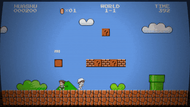</a> <a href="https://github.com/alchaincyf/huashu-art-motion">alchaincyf/huashu-art-motion</a></td>
<td align="center" valign="top"><a href="https://github.com/JohnHeibel/ClaudeAnimationBase">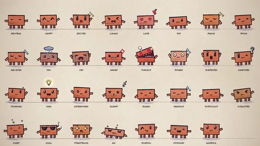</a> <a href="https://github.com/JohnHeibel/ClaudeAnimationBase">JohnHeibel/ClaudeAnimationBase</a></td>
<td align="center" valign="top"> <a href="https://github.com/gnipbao/story-to-handdrawn-video">gnipbao/story-to-handdrawn-video</a></td>
</tr></table>

| 仓库 | 星数 | 做什么 | 安全评级 |
|---|---:|---|---|
| [lemomo-ai/lemo-opuscar](https://github.com/lemomo-ai/lemo-opuscar) | 15.9k | Opus 5.5 x 39 种影片风格：风格提示词 + 纯代码样片 + 导演与技术指南 | [SAFE](https://agentskillshub.top/skill/lemomo-ai/lemo-opuscar/) |
| [alchaincyf/huashu-art-motion](https://github.com/alchaincyf/huashu-art-motion) | 6.9k | 艺术动画 skill：35种艺术风格、9种解说语法，用代码制作动画。 | [SAFE](https://agentskillshub.top/skill/alchaincyf/huashu-art-motion/) |
| [JohnHeibel/ClaudeAnimationBase](https://github.com/JohnHeibel/ClaudeAnimationBase) | 3.0k | 用 Claude 制作手绘卡通动画的入门套件：p5.js + p5.brush、Clawd 角色、31 种表演情绪和给模型的指南 | [SAFE](https://agentskillshub.top/skill/JohnHeibel/ClaudeAnimationBase/) |
| [gnipbao/story-to-handdrawn-video](https://github.com/gnipbao/story-to-handdrawn-video) | 2.5k | Agent skill：把中文故事文案或有序图片转成手绘日记漫画风动画（无声 MP4 画面轨） | [SAFE](https://agentskillshub.top/skill/gnipbao/story-to-handdrawn-video/) |
| [edenfunf/reelmimic](https://github.com/edenfunf/reelmimic) | 2.0k | 给它一个喜欢的视频,生成同风格的新视频;由 Claude Code 或 Codex 规划、制作并与你一起审片 | [SAFE](https://agentskillshub.top/skill/edenfunf/reelmimic/) |
| [Lanqiao-Luca/ai-video-marker](https://github.com/Lanqiao-Luca/ai-video-marker) | 534 | AI 视频制作工作流：Workflow、Agent、Skill、Standards 四层方法，含可独立复现的像素动画与原创配乐。 | [SAFE](https://agentskillshub.top/skill/Lanqiao-Luca/ai-video-marker/) |
| [tuzhechen2005/opus-video-skills](https://github.com/tuzhechen2005/opus-video-skills) | 497 | 用 Claude Opus 5.5 以代码制作视频的 skill 合集，每种风格一个 skill，如手绘动画、动态排版短片 | [SAFE](https://agentskillshub.top/skill/tuzhechen2005/opus-video-skills/) |
| [aaronyi97/image-story-video-wizard](https://github.com/aaronyi97/image-story-video-wizard) | 412 | 带确认关卡的 Codex 和 WorkBuddy skill，用于音频先行的图片故事视频制作 | [SAFE](https://agentskillshub.top/skill/aaronyi97/image-story-video-wizard/) |
| [kelano86/what-if-animation](https://github.com/kelano86/what-if-animation) | 345 | A free skill for Claude Code and OpenCode (runs on a free model): one topic line in, a finished 15-25 s What If animated episode out. Every frame dra… | [SAFE](https://agentskillshub.top/skill/kelano86/what-if-animation/) |
| [sevenevesai/riso-windowseat](https://github.com/sevenevesai/riso-windowseat) | 320 | 单个 HTML 文件中的程序化孔版印刷影片（Window Seat、Roost 等），附 Claude Code skills、文档和工具，用于制作自己的作品。 | [SAFE](https://agentskillshub.top/skill/sevenevesai/riso-windowseat/) |
| [liyue-aigc/xianxia-cinematic-video-director](https://github.com/liyue-aigc/xianxia-cinematic-video-director) | 279 | 用于东方仙侠题材分镜、运镜和视频连贯性的 Codex Skill | [SAFE](https://agentskillshub.top/skill/liyue-aigc/xianxia-cinematic-video-director/) |
| [buildwithhanif/claude-animation-skill](https://github.com/buildwithhanif/claude-animation-skill) | 153 | 用代码编写的手绘2D动画：细节设定集、精细蚂蚁rig、笔刷/水彩笔、逐帧匹配的重现循环、合成音效。Node canvas + ffmpeg | [SAFE](https://agentskillshub.top/skill/buildwithhanif/claude-animation-skill/) |
| [Mr-funny/hbg-life-simulation](https://github.com/Mr-funny/hbg-life-simulation) | 150 | HBG Agent Skill：制作中文人生模拟叙事视频，含统一漫画 IP、多段人生快速开场、Edge TTS、同步字幕和成片 QA | [SAFE](https://agentskillshub.top/skill/Mr-funny/hbg-life-simulation/) |
| [ChrisHKAI/ChrisHKAI-Video](https://github.com/ChrisHKAI/ChrisHKAI-Video) | 149 | 粘贴创作者的 X 链接，生成由其 3D 搪胶玩偶形象主演的短片。Claude Code 的纯代码视频 skill。 | [SAFE](https://agentskillshub.top/skill/ChrisHKAI/ChrisHKAI-Video/) |
| [unclejobs-ai/motion-video-skill](https://github.com/unclejobs-ai/motion-video-skill) | 140 | 动态图形视频制作的 Claude Code skill:制作流程与逐步检查 | [SAFE](https://agentskillshub.top/skill/unclejobs-ai/motion-video-skill/) |
| [mromidev/claude-blender-skills](https://github.com/mromidev/claude-blender-skills) | 87 | Claude skill：逼真 Blender 动画的完整工作流及 YouTube 视频背后的实际脚本 | [SAFE](https://agentskillshub.top/skill/mromidev/claude-blender-skills/) |
| [nocodehack/make-short](https://github.com/nocodehack/make-short) | 67 | Claude Code skill：制作动画 YouTube Shorts（3D Blender 世界中的 2D 角色），含 critic agent | [SAFE](https://agentskillshub.top/skill/nocodehack/make-short/) |
| [iart-ai/javascript-animation-skills](https://github.com/iart-ai/javascript-animation-skills) | 62 | JavaScript 绘制每一帧：Opus 5.5 风格动画作为 agent skills，画布动画、代码合成音轨、音画同步检查 | [SAFE](https://agentskillshub.top/skill/iart-ai/javascript-animation-skills/) |
| [liangdabiao/story-handdrawn-remotion](https://github.com/liangdabiao/story-handdrawn-remotion) | 40 | 视频 Skill：把中文/英文故事文本变成手绘日记漫画风竖屏视频，每句按文字、黑白画稿、彩色插画三阶段揭示 | [SAFE](https://agentskillshub.top/skill/liangdabiao/story-handdrawn-remotion/) |
| [AllenAI2014/remotion-guofeng-starter](https://github.com/AllenAI2014/remotion-guofeng-starter) | 36 | 国风纸片动画：Remotion 风格资产库 + 制作流程 Skill，给 AI 一首诗或成语即可出片，全程代码渲染 | [SAFE](https://agentskillshub.top/skill/AllenAI2014/remotion-guofeng-starter/) |
| [deenukhan/stick-figure-shorts](https://github.com/deenukhan/stick-figure-shorts) | 35 | Claude Code skill：用代码（Remotion）绘制、用 ElevenLabs 配音的20-40秒简笔画故事短片 | [SAFE](https://agentskillshub.top/skill/deenukhan/stick-figure-shorts/) |
| [hsynozdamar-byte/cinecode-studio](https://github.com/hsynozdamar-byte/cinecode-studio) | 32 | cinecode 桌面制作面板：输入创意，确认定时脚本，Claude Code 在本机制作影片；修改、用 HyperFrames 编辑并克隆视频。 | [SAFE](https://agentskillshub.top/skill/hsynozdamar-byte/cinecode-studio/) |
| [JimLiu/taohuayuan](https://github.com/JimLiu/taohuayuan) | 31 | 《桃花源记》实时三维长卷，用 three.js 实现，可在浏览器里沿溪而行 | [SAFE](https://agentskillshub.top/skill/JimLiu/taohuayuan/) |
| [AsadMoulviDev/reel-video](https://github.com/AsadMoulviDev/reel-video) | 30 | 用 Claude Code、Codex、Cursor 和 Grok Build 制作 AI 视频，除已付费的套餐外无额外生成费用 | [SAFE](https://agentskillshub.top/skill/AsadMoulviDev/reel-video/) |
| [zakariaf/cinecode](https://github.com/zakariaf/cinecode) | 27 | 完全用代码制作动画电影的 Claude Code 插件：描述电影，Claude 会编写、制作动画、配乐并渲染。 | [SAFE](https://agentskillshub.top/skill/zakariaf/cinecode/) |
| [deenukhan/story-animator](https://github.com/deenukhan/story-animator) | 26 | Claude Code skill：将一句话创意变成带旁白的2D动画故事视频。每帧用代码（Remotion）绘制，并由ElevenLabs配音。 | [SAFE](https://agentskillshub.top/skill/deenukhan/story-animator/) |
| [garycaogan/pixel-diary](https://github.com/garycaogan/pixel-diary) | 21 | 用代码制作“像素角色+对话框”视频：分集 JSON → HyperFrames 出片，附 Claude Code 复刻 skill | [SAFE](https://agentskillshub.top/skill/garycaogan/pixel-diary/) |
| [thuann-vn/claude-3d-animated-shorts](https://github.com/thuann-vn/claude-3d-animated-shorts) | 18 | Claude skill：RicksClips 风格的竖屏 3D 动画故事 Shorts（three.js），真实 3D 角色、办公室/家居场景，不使用 AI… | [SAFE](https://agentskillshub.top/skill/thuann-vn/claude-3d-animated-shorts/) |
| [LetMeHappyCode/auto-video-agent](https://github.com/LetMeHappyCode/auto-video-agent) | 13 | 基于 Agent / Skill / Workflow 编排，流水线化生成「分镜插画提示词 → AI 生图 → 拼接成片」的成套视频 | [SAFE](https://agentskillshub.top/skill/LetMeHappyCode/auto-video-agent/) |
| [nocodehack/nocodehack-roblox-engine](https://github.com/nocodehack/nocodehack-roblox-engine) | 13 | Claude Code skill that makes animated Roblox-style Shorts from one line: story, animation, camera, sound. Free. | [SAFE](https://agentskillshub.top/skill/nocodehack/nocodehack-roblox-engine/) |
| [yenceesanjeev/2d-character-sketch](https://github.com/yenceesanjeev/2d-character-sketch) | 10 | Agent skill：用代码绘制简单2D卡通角色，让角色说话并本地渲染短动画视频 | [CAUTION](https://agentskillshub.top/skill/yenceesanjeev/2d-character-sketch/) |
| [i-afaqrashid/claude-animation-studio](https://github.com/i-afaqrashid/claude-animation-studio) | 9 | Claude Code 插件：用代码绘制每帧动画、合成音乐，并实现完美同步。 | [SAFE](https://agentskillshub.top/skill/i-afaqrashid/claude-animation-studio/) |
| [taylorzhou16/video-gen](https://github.com/taylorzhou16/video-gen) | 9 | 面向 Claude Code 的 AI 视频剪辑 Skill | [SAFE](https://agentskillshub.top/skill/taylorzhou16/video-gen/) |
| [krishnagoswami52/stickman-skill](https://github.com/krishnagoswami52/stickman-skill) | 7 | Claude skill：用代码生成带免费内置 AI 配音的电影感火柴人故事 MP4（无需 ElevenLabs） | [*待评级*](https://agentskillshub.top/skill/krishnagoswami52/stickman-skill/) |
| [huynhcongdac/story-video-skill](https://github.com/huynhcongdac/story-video-skill) | 6 | AI agent 的 skill：用 AI 图片制作3–5分钟故事视频，角色跨场景保持面部一致。 | [SAFE](https://agentskillshub.top/skill/huynhcongdac/story-video-skill/) |

## 🎞 动效与 Logo

[在在线页面打开这一类,按星数排序 →](https://agentskillshub.top/best/claude-video-skills/#type-motion)

<table><tr>
<td align="center" valign="top"><a href="https://github.com/diffusionstudio/lottie">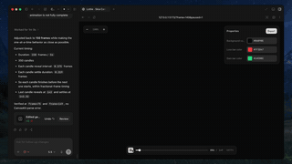</a> <a href="https://github.com/diffusionstudio/lottie">diffusionstudio/lottie</a></td>
<td align="center" valign="top"> <a href="https://github.com/nolangz/pixel2motion">nolangz/pixel2motion</a></td>
<td align="center" valign="top"> <a href="https://github.com/alexgreensh/anidoodle">alexgreensh/anidoodle</a></td>
</tr></table>

| 仓库 | 星数 | 做什么 | 安全评级 |
|---|---:|---|---|
| [diffusionstudio/lottie](https://github.com/diffusionstudio/lottie) | 5.7k | 用 Claude Code 或 Codex 生成可用于生产的 Lottie 动画 | [SAFE](https://agentskillshub.top/skill/diffusionstudio/lottie/) |
| [nolangz/pixel2motion](https://github.com/nolangz/pixel2motion) | 2.7k | AI logo 动画 skill：把位图 logo 转成 SVG 动画、HTML 动画演示、GIF/视频预览和动效 QA 证据 | [SAFE](https://agentskillshub.top/skill/nolangz/pixel2motion/) |
| [pyang5166/gbro-collage-broll](https://github.com/pyang5166/gbro-collage-broll) | 1.9k | 半调纸拼贴 B-roll 生成 skill：三闸门审批，Gemini Omni Flash 首尾帧组装动画 | [SAFE](https://agentskillshub.top/skill/pyang5166/gbro-collage-broll/) |
| [WoYun520/gif-factory](https://github.com/WoYun520/gif-factory) | 1.8k | 用于根据角色参考图创建和验证动态 GIF 贴纸包的 Codex skill。 | [SAFE](https://agentskillshub.top/skill/WoYun520/gif-factory/) |
| [alexgreensh/anidoodle](https://github.com/alexgreensh/anidoodle) | 1.7k | 用代码写出的手绘艺术与动画：插画、循环动画、交互网页艺术、贴纸和配乐短片，数十种风格 | [SAFE](https://agentskillshub.top/skill/alexgreensh/anidoodle/) |
| [cclank/lanshu-animated-architecture-diagram](https://github.com/cclank/lanshu-animated-architecture-diagram) | 1.0k | 手绘动画架构图 Codex skill | [SAFE](https://agentskillshub.top/skill/cclank/lanshu-animated-architecture-diagram/) |
| [ythx-101/live-panel-skill](https://github.com/ythx-101/live-panel-skill) | 857 | 配置驱动的动画架构图：用一个 JSON 文件生成终端风格循环图或动态浅色信息图，输出 H.264 mp4、实时网页或 Claude Code 风格 skill… | [SAFE](https://agentskillshub.top/skill/ythx-101/live-panel-skill/) |
| [lazypay/Archscribe](https://github.com/lazypay/Archscribe) | 380 | 手绘深色背景架构与流程动画图，输出可编辑的 .excalidraw、PNG 和动态 GIF。Codex/Claude skill。 | [SAFE](https://agentskillshub.top/skill/lazypay/Archscribe/) |
| [YIAN6557/eian-riso-broll](https://github.com/YIAN6557/eian-riso-broll) | 370 | 面向口播视频的 Risograph 风格信息动画 skill：逐字稿 → 1080×1920 竖屏 MP4 | [SAFE](https://agentskillshub.top/skill/YIAN6557/eian-riso-broll/) |
| [MegaTroll222/VOX-COLLAGE-BROLL](https://github.com/MegaTroll222/VOX-COLLAGE-BROLL) | 320 | 把一句口播变成纸拼贴讲解视频的 Claude Code skill，gbro-collage-broll 的英文改编版 | [SAFE](https://agentskillshub.top/skill/MegaTroll222/VOX-COLLAGE-BROLL/) |
| [HRuiCcc/RuiC-motion-reel](https://github.com/HRuiCcc/RuiC-motion-reel) | 200 | 用代码生成 15 秒动态图形成片的 agent skill:自研渲染引擎,不用外部美术素材和 AE,15 种风格 | [SAFE](https://agentskillshub.top/skill/HRuiCcc/RuiC-motion-reel/) |
| [Liamrjohnston/remotion-motion-graphics-skill](https://github.com/Liamrjohnston/remotion-motion-graphics-skill) | 163 | 用于 AI 视频工作流的 Remotion 动态图形 skills，可用于生产 | [SAFE](https://agentskillshub.top/skill/Liamrjohnston/remotion-motion-graphics-skill/) |
| [lisamsung/agent-meme-forge](https://github.com/lisamsung/agent-meme-forge) | 101 | Codex skill：将图片或文字概念制作成微信中文表情包，4个关键姿势生成16帧，文字不由模型绘制。 | [SAFE](https://agentskillshub.top/skill/lisamsung/agent-meme-forge/) |
| [fantuan-lab/animated-sticker-studio](https://github.com/fantuan-lab/animated-sticker-studio) | 66 | 单张角色图→一套动态聊天贴纸（微信/Telegram/LINE/Discord），Claude Code与Codex skill | [SAFE](https://agentskillshub.top/skill/fantuan-lab/animated-sticker-studio/) |
| [Felpborges/claude-video](https://github.com/Felpborges/claude-video) | 58 | Claude Code 中用葡萄牙语制作动效：风格库、5个问题、参考图分析和 MP4。 | [SAFE](https://agentskillshub.top/skill/Felpborges/claude-video/) |
| [zz41354899/mografy](https://github.com/zz41354899/mografy) | 57 | 使用 Claude Code 或 Codex 创建、预览并导出 Canvas 动态图形，支持 MP4、Lottie 和 SVGA 导出，优先本地运行且开源。 | [CAUTION](https://agentskillshub.top/skill/zz41354899/mografy/) |
| [hughminhphan/motion-kit](https://github.com/hughminhphan/motion-kit) | 38 | Claude Code skill，让 agent 制作的视频像动效设计师制作：按移动设定曲线和时长，反应连贯不僵硬，适用于 HyperFrames 和任意… | [SAFE](https://agentskillshub.top/skill/hughminhphan/motion-kit/) |
| [dillydog580/animate-roblox-characters](https://github.com/dillydog580/animate-roblox-characters) | 34 | 面向 Codex 和 Claude 的 AI 驱动 Roblox R6/R15 动画 skill，使用真实 Blender rigs、审核关键帧、Roblox… | [SAFE](https://agentskillshub.top/skill/dillydog580/animate-roblox-characters/) |
| [AgriciDaniel/claude-gif](https://github.com/AgriciDaniel/claude-gif) | 33 | Claude Code 的 GIF 制作 skill，6 条生成流水线，含 Remotion、Veo 3.1、FFmpeg、图片序列等 | [SAFE](https://agentskillshub.top/skill/AgriciDaniel/claude-gif/) |
| [kasfulk/effectcraft-motion-skills](https://github.com/kasfulk/effectcraft-motion-skills) | 32 | Claude Code skill：通过 effectcraft-cli 将 JSON 规范转为竖屏 9:16 动态图形/信息图，支持主题和文本计时 | [SAFE](https://agentskillshub.top/skill/kasfulk/effectcraft-motion-skills/) |
| [iart-ai/kinetic-typography-skills](https://github.com/iart-ai/kinetic-typography-skills) | 26 | 给 AI 编程 agent 的动态文字 skill:把文字做成卡点的动画字体,用于社媒、片头和歌词视频 | [SAFE](https://agentskillshub.top/skill/iart-ai/kinetic-typography-skills/) |
| [toufuim/personal-ip-brand-intro-skill](https://github.com/toufuim/personal-ip-brand-intro-skill) | 20 | 开源 Codex Skill：用文字、原创插图或用户图片制作个人 IP 品牌开场，支持上传音乐对拍与无音乐自主节拍 | [SAFE](https://agentskillshub.top/skill/toufuim/personal-ip-brand-intro-skill/) |
| [liuhaisi2026212-maker/motion-palette-15](https://github.com/liuhaisi2026212-maker/motion-palette-15) | 19 | 十五画境：教 AI 用代码制作 MG 动画短片，支持 16 种风格卡。Canvas、Three.js、Remotion 可混用，导出带配乐 MP4。Claud… | [SAFE](https://agentskillshub.top/skill/liuhaisi2026212-maker/motion-palette-15/) |
| [awesome-skills/manim-skill](https://github.com/awesome-skills/manim-skill) | 15 | Claude Code 的 Manim 动画 skill:为技术博客和教学内容生成程序化动画 | [SAFE](https://agentskillshub.top/skill/awesome-skills/manim-skill/) |
| [fernandokaraka/remotion-motion-graphics-skill](https://github.com/fernandokaraka/remotion-motion-graphics-skill) | 13 | Claude Code skill：用 Remotion 做动态图形视频，含标题卡、字幕条和带 alpha 通道的叠加层 | [SAFE](https://agentskillshub.top/skill/fernandokaraka/remotion-motion-graphics-skill/) |
| [zhenwusw/orca-motion-skill](https://github.com/zhenwusw/orca-motion-skill) | 13 | 制作场景内动态图形的 agent skill，由抽象的、设计 token 驱动的形状构成，与 orca-transition-skill 配套 | [SAFE](https://agentskillshub.top/skill/zhenwusw/orca-motion-skill/) |
| [deenukhan/animation-styles](https://github.com/deenukhan/animation-styles) | 12 | 39种用Remotion代码绘制的动画风格，作为Claude Code skill。每种含一部5秒茶饮短片，可用自己的故事重述。 | [SAFE](https://agentskillshub.top/skill/deenukhan/animation-styles/) |
| [sudadom/arabic-motion-graphics-skill](https://github.com/sudadom/arabic-motion-graphics-skill) | 12 | 阿拉伯语 RTL 动态图形 agent skill：用 Remotion 制作短视频、解释动画和 Logo 展示 | [SAFE](https://agentskillshub.top/skill/sudadom/arabic-motion-graphics-skill/) |
| [acelera-agency/html-animation](https://github.com/acelera-agency/html-animation) | 10 | 用代码做动态图形的 agent skill：以单个 HTML 文件制作动画 logo、动态排版和品牌视频并导出 MP4 | [SAFE](https://agentskillshub.top/skill/acelera-agency/html-animation/) |
| [rock3r/cav](https://github.com/rock3r/cav) | 10 | 在终端构建、检查并渲染 Cavalry 动效：cav CLI 和 agent skill | [SAFE](https://agentskillshub.top/skill/rock3r/cav/) |
| [liuliu-66-create/ll-video-motion](https://github.com/liuliu-66-create/ll-video-motion) | 9 | 将中文文案转为本地 Remotion 动效，使用 Codex Skill | [SAFE](https://agentskillshub.top/skill/liuliu-66-create/ll-video-motion/) |
| [codie1982/chorono-editor](https://github.com/codie1982/chorono-editor) | 8 | 开源 2D 动画编辑器。通过 MCP 使用 Claude Code 或 Codex 创建，再可视化调整图层和关键帧。 | [SAFE](https://agentskillshub.top/skill/codie1982/chorono-editor/) |
| [hubeiqiao/og-video-preview](https://github.com/hubeiqiao/og-video-preview) | 8 | 将任意获准的 Open Graph 图片转为循环 og:video，适用于 Claude Code、Codex 和支持 Agent Skills 的 agen… | [SAFE](https://agentskillshub.top/skill/hubeiqiao/og-video-preview/) |
| [CJ10110425/logo-intro](https://github.com/CJ10110425/logo-intro) | 7 | 用任意 SVG logo 制作 WebGL 片头：镜头扭曲特写、字标显现、渐变绽放、锁定环和闪光。提供 JS module、单文件 HTML、视频导出和 Cl… | [SAFE](https://agentskillshub.top/skill/CJ10110425/logo-intro/) |
| [hacimertgokhan/geomotion](https://github.com/hacimertgokhan/geomotion) | 6 | 手绘形状变形线条动画。零依赖 JS 引擎，含工作室、CLI、MCP server、Claude skill；导出 SVG、Lottie、HTML 或分享链接。 | [SAFE](https://agentskillshub.top/skill/hacimertgokhan/geomotion/) |
| [iart-ai/youtube-video-skills](https://github.com/iart-ai/youtube-video-skills) | 6 | Claude Code 的 Audiogram 和 YouTube 片头片尾 skill，为频道建立品牌并将每期内容转为动态图形。 | [SAFE](https://agentskillshub.top/skill/iart-ai/youtube-video-skills/) |
| [Tu-Zhenzhao/pocketworld](https://github.com/Tu-Zhenzhao/pocketworld) | 5 | 一句话，一张图，一个动态像素世界。用于 GIF、视频和透明 Web 组件的 agent skill。 | [SAFE](https://agentskillshub.top/skill/Tu-Zhenzhao/pocketworld/) |
| [YanKaFei/ascii-h3-director](https://github.com/YanKaFei/ascii-h3-director) | 5 | MiniMax H3 的 ASCII/动态排版导演，支持确定性预览和接缝检查续接。DSH 插件 + 可移植 Agent Skill。 | [SAFE](https://agentskillshub.top/skill/YanKaFei/ascii-h3-director/) |
| [antropos17/chatgpt-gif-cinema](https://github.com/antropos17/chatgpt-gif-cinema) | 5 | 将 GPT 生成的 GIF 制作成短片。用于审片、重拍场景和导出 MP4 的 Codex 与 Claude Code skill，含无需密钥演示。 | [SAFE](https://agentskillshub.top/skill/antropos17/chatgpt-gif-cinema/) |
| [luminexlabs-io/antigravity-remotion-skill](https://github.com/luminexlabs-io/antigravity-remotion-skill) | 5 | 面向 antigravity 的 Remotion，确保达到 Claude 级别 | [SAFE](https://agentskillshub.top/skill/luminexlabs-io/antigravity-remotion-skill/) |

## 📝 剧本与学习

[在在线页面打开这一类,按星数排序 →](https://agentskillshub.top/best/claude-video-skills/#type-craft)

<table><tr>
<td align="center" valign="top"><a href="https://github.com/eternityspring/reelbench-skills">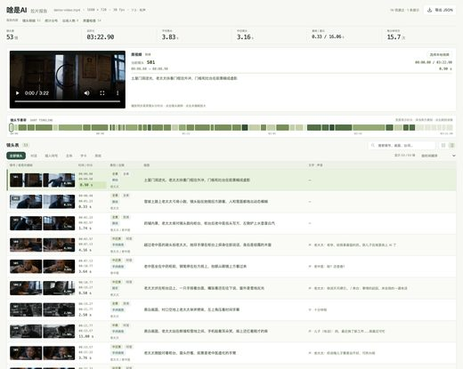</a> <a href="https://github.com/eternityspring/reelbench-skills">eternityspring/reelbench-skills</a></td>
<td align="center" valign="top"> <a href="https://github.com/wocha-xiaoli/video-shot-analysis-feishu">wocha-xiaoli/video-shot-analysis-feishu</a></td>
<td align="center" valign="top"><a href="https://github.com/erduo1998-cell/video-script-builder">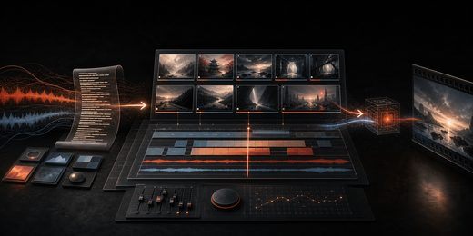</a> <a href="https://github.com/erduo1998-cell/video-script-builder">erduo1998-cell/video-script-builder</a></td>
</tr></table>

| 仓库 | 星数 | 做什么 | 安全评级 |
|---|---:|---|---|
| [jtydhr88/screenwriting-skills](https://github.com/jtydhr88/screenwriting-skills) | 2.1k | 编剧、电视剧写作与戏剧构作的 26 个专业 agent skill，适用于 Claude Code 和 Codex | [SAFE](https://agentskillshub.top/skill/jtydhr88/screenwriting-skills/) |
| [eternityspring/reelbench-skills](https://github.com/eternityspring/reelbench-skills) | 1.2k | AI 视频的学习与工具 skill：逐镜头拉片分析、带分镜信息的视频合成、清除视频元数据 | [SAFE](https://agentskillshub.top/skill/eternityspring/reelbench-skills/) |
| [gnipbao/minimax-h3-video-reverse-skill](https://github.com/gnipbao/minimax-h3-video-reverse-skill) | 331 | MiniMax H3 视频反推 skill：从参考视频整理镜头、首帧与动态提示词，附中文教程与验证工具 | [SAFE](https://agentskillshub.top/skill/gnipbao/minimax-h3-video-reverse-skill/) |
| [wyuzhi/qisi-video-remix](https://github.com/wyuzhi/qisi-video-remix) | 195 | 视频创意改编 skill：参考视频 → 剧本 → 分镜 → 分段生成提示词 | [SAFE](https://agentskillshub.top/skill/wyuzhi/qisi-video-remix/) |
| [adityaarsharma/youtube-marketing-skills](https://github.com/adityaarsharma/youtube-marketing-skills) | 85 | 开源的 YouTube 增长工具包：21 个 AI 命令，不绑定特定 agent | [SAFE](https://agentskillshub.top/skill/adityaarsharma/youtube-marketing-skills/) |
| [wocha-xiaoli/video-shot-analysis-feishu](https://github.com/wocha-xiaoli/video-shot-analysis-feishu) | 47 | 视频拉片到飞书 Base：自动抽帧、逐镜头分析、倒推分镜与视频生成提示词的 Codex/OpenCode skill | [SAFE](https://agentskillshub.top/skill/wocha-xiaoli/video-shot-analysis-feishu/) |
| [liuliu-66-create/ll-video-decomposer](https://github.com/liuliu-66-create/ll-video-decomposer) | 26 | 五层视频拆解 Codex Skill：支持视频链接、本地媒体和逐字稿 | [SAFE](https://agentskillshub.top/skill/liuliu-66-create/ll-video-decomposer/) |
| [chenmisss/laoxu-video-script](https://github.com/chenmisss/laoxu-video-script) | 14 | 自媒体起号方法论 skill：定位、选题、成稿、五维诊断和母题库，适用于 Claude Code 和 Codex | [SAFE](https://agentskillshub.top/skill/chenmisss/laoxu-video-script/) |
| [erduo1998-cell/video-script-builder](https://github.com/erduo1998-cell/video-script-builder) | 14 | 把中文视频逐字稿转换为可执行 HyperFrames 分镜规格的 agent skill | [SAFE](https://agentskillshub.top/skill/erduo1998-cell/video-script-builder/) |
| [sharon-laicc/viral-video-decomposer](https://github.com/sharon-laicc/viral-video-decomposer) | 12 | 拆解爆款短视频，生成镜头级拉片、爆款机制、AI 生产蓝图和视频生成 brief 的 Codex/Claude skill | [SAFE](https://agentskillshub.top/skill/sharon-laicc/viral-video-decomposer/) |

## 🎵 音乐视频

[在在线页面打开这一类,按星数排序 →](https://agentskillshub.top/best/claude-video-skills/#type-music)

<table><tr>
<td align="center" valign="top"> <a href="https://github.com/EGSECDA/vocaloid-style-mv-pipeline">EGSECDA/vocaloid-style-mv-pipeline</a></td>
<td align="center" valign="top"> <a href="https://github.com/10291124jcjc-dotcom/ancient-rap-battle">10291124jcjc-dotcom/ancient-rap-battle</a></td>
<td align="center" valign="top"><a href="https://github.com/ledbetterljoshua/functional-emotions-video">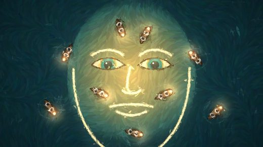</a> <a href="https://github.com/ledbetterljoshua/functional-emotions-video">ledbetterljoshua/functional-emotions-video</a></td>
</tr></table>

| 仓库 | 星数 | 做什么 | 安全评级 |
|---|---:|---|---|
| [JohnHeibel/PDoomVideo](https://github.com/JohnHeibel/PDoomVideo) | 2.9k | Claude Opus 5.5 音乐视频《I'm Upping My P(doom)》的源代码 | [SAFE](https://agentskillshub.top/skill/JohnHeibel/PDoomVideo/) |
| [EGSECDA/vocaloid-style-mv-pipeline](https://github.com/EGSECDA/vocaloid-style-mv-pipeline) | 272 | Vocaloid风手绘歌词MV：Claude Code skill，JIZURA、Canvas2D/WebGL2、AI图、Blender3D、16:9/9:16 | [SAFE](https://agentskillshub.top/skill/EGSECDA/vocaloid-style-mv-pipeline/) |
| [10291124jcjc-dotcom/ancient-rap-battle](https://github.com/10291124jcjc-dotcom/ancient-rap-battle) | 238 | 历史人物说唱对决视频 Claude Code skill（Suno + Midjourney + MiniMax H3 对口型） | [SAFE](https://agentskillshub.top/skill/10291124jcjc-dotcom/ancient-rap-battle/) |
| [Joker-chichi/claude-mv-skill](https://github.com/Joker-chichi/claude-mv-skill) | 224 | Claude Code skill for hand-painted animation and lyric music videos | [SAFE](https://agentskillshub.top/skill/Joker-chichi/claude-mv-skill/) |
| [Win-Hao/music-mv](https://github.com/Win-Hao/music-mv) | 134 | 用 AI 写代码制作音乐 MV 的 agent skill：理解歌曲→定画风→画角色→分镜→草图到成片→看片修改；每帧由代码绘制，非视频生成，模型不限。 | [SAFE](https://agentskillshub.top/skill/Win-Hao/music-mv/) |
| [ledbetterljoshua/functional-emotions-video](https://github.com/ledbetterljoshua/functional-emotions-video) | 79 | Claude Opus 5.5 制作的《Functional Emotions》手绘风音乐视频：自研 GPU 笔触渲染器、7 个并行章节 agent | [SAFE](https://agentskillshub.top/skill/ledbetterljoshua/functional-emotions-video/) |
| [lintsinghua/paint-mv-skills](https://github.com/lintsinghua/paint-mv-skills) | 64 | 把一首歌和歌词做成手绘水彩音乐视频的 agent skill,沿用 PDoomVideo 的流程 | [SAFE](https://agentskillshub.top/skill/lintsinghua/paint-mv-skills/) |
| [SyanChen7/dancing-notes](https://github.com/SyanChen7/dancing-notes) | 27 | Dancing Notes · 跳跃的音符 — 言说新事开发的 Remotion 音乐可视化 agent skill。 | [SAFE](https://agentskillshub.top/skill/SyanChen7/dancing-notes/) |
| [IdkwhatImD0ing/claude-music-videos](https://github.com/IdkwhatImD0ing/claude-music-videos) | 23 | 用 Claude 在 Claude Code 中制作的音乐视频，每帧均由代码渲染：Blender 桌面微缩模型（P(doom)）和 League of Leg… | [SAFE](https://agentskillshub.top/skill/IdkwhatImD0ing/claude-music-videos/) |
| [022512db-netizen/rhythm-dancer-video](https://github.com/022512db-netizen/rhythm-dancer-video) | 17 | 角色图→绿幕舞蹈视频、代码搭建的踩点舞台与配乐，渲染为MP4的Agent Skill | [SAFE](https://agentskillshub.top/skill/022512db-netizen/rhythm-dancer-video/) |
| [TheMarco/claude-music-video](https://github.com/TheMarco/claude-music-video) | 12 | Claude Code 插件：根据歌曲制作音乐视频，分析节拍网格，使用素材或自有片段，可通过视频 MCP 添加 AI 片段，并用 GPU 合成器叠加视频设计元… | [SAFE](https://agentskillshub.top/skill/TheMarco/claude-music-video/) |
| [chenqianshinian/music-mv-studio](https://github.com/chenqianshinian/music-mv-studio) | 9 | MV 制作 skill：用歌曲和歌词生成竖版MV，含导演方法、七首长片管线、像素级质检和41条踩坑清单 | [SAFE](https://agentskillshub.top/skill/chenqianshinian/music-mv-studio/) |
| [latent-variable/deep-learning-birthday](https://github.com/latent-variable/deep-learning-birthday) | 9 | 为 AlexNet 14 岁生日做的孔版印刷风音乐视频,用本地开源模型和 Claude 完成 | [SAFE](https://agentskillshub.top/skill/latent-variable/deep-learning-birthday/) |
| [10291124jcjc-dotcom/xp-desktop-mv](https://github.com/10291124jcjc-dotcom/xp-desktop-mv) | 8 | Claude Code skill：将音乐视频片段转为节拍同步的 Windows XP 桌面录屏（示例：APT. → Pinkdows XP） | [CAUTION](https://agentskillshub.top/skill/10291124jcjc-dotcom/xp-desktop-mv/) |
| [BuzyOwl/song-video-director](https://github.com/BuzyOwl/song-video-director) | 8 | Claude Code skill：构建代码渲染的音乐视频（Remotion、p5.js、three.js） | [SAFE](https://agentskillshub.top/skill/BuzyOwl/song-video-director/) |
| [neelnanda-io/dont-go-quiet-on-me](https://github.com/neelnanda-io/dont-go-quiet-on-me) | 8 | 《别对我沉默》：一首歌曲及用代码手绘的音乐视频，讲述 mech interp 的历史，使用 Claude Opus 5.5 和 Suno v6 制作 | [SAFE](https://agentskillshub.top/skill/neelnanda-io/dont-go-quiet-on-me/) |
| [bishpls/animation-pipeline](https://github.com/bishpls/animation-pipeline) | 7 | 用 Claude Code 制作的影片：歌曲、剪纸孔版动画、动态文字，全部以代码完成。首作：OPEN ALL NIGHT（献给广告的情歌）。 | [SAFE](https://agentskillshub.top/skill/bishpls/animation-pipeline/) |
| [BusyBee3333/viral-video-edit-skills](https://github.com/BusyBee3333/viral-video-edit-skills) | 5 | Claude/Codex 的节拍同步音乐短视频剪辑 skill：歌曲分析、素材采集与质检、Hook 撰写、起音锁定剪辑、音频反应特效、电影感调色、交付质检。 | [SAFE](https://agentskillshub.top/skill/BusyBee3333/viral-video-edit-skills/) |

**安全评级**是 Agent Skills Hub 对仓库 README 和安装步骤的评级。*待评级*表示目录还没评到它。

预览图是各项目 README 里图片的缩小副本,只收录采用宽松许可证的项目,版权归原作者所有。来源和许可证见 [assets/previews/NOTICE.md](assets/previews/NOTICE.md)。如需移除请提 issue。

## 相关合集

- [opusvideo/awesome-claude-video](https://github.com/opusvideo/awesome-claude-video) —— 大家用 Opus 5.5 做出来的视频,附原帖。它收作品,本列表收工具。
- [TripoGrowthLab/awesome-opus-5-5-prompts](https://github.com/TripoGrowthLab/awesome-opus-5-5-prompts) —— Opus 5.5 做 3D 场景、游戏和模拟的提示词。

## 推荐仓库

提一个 issue 附上 GitHub 链接。它会走和每个条目一样的评审;决定上不上榜的是上面的规则,不是星数。

---

机器可读版本:[`data/skills.json`](data/skills.json)。生成于 2026-11-14。
